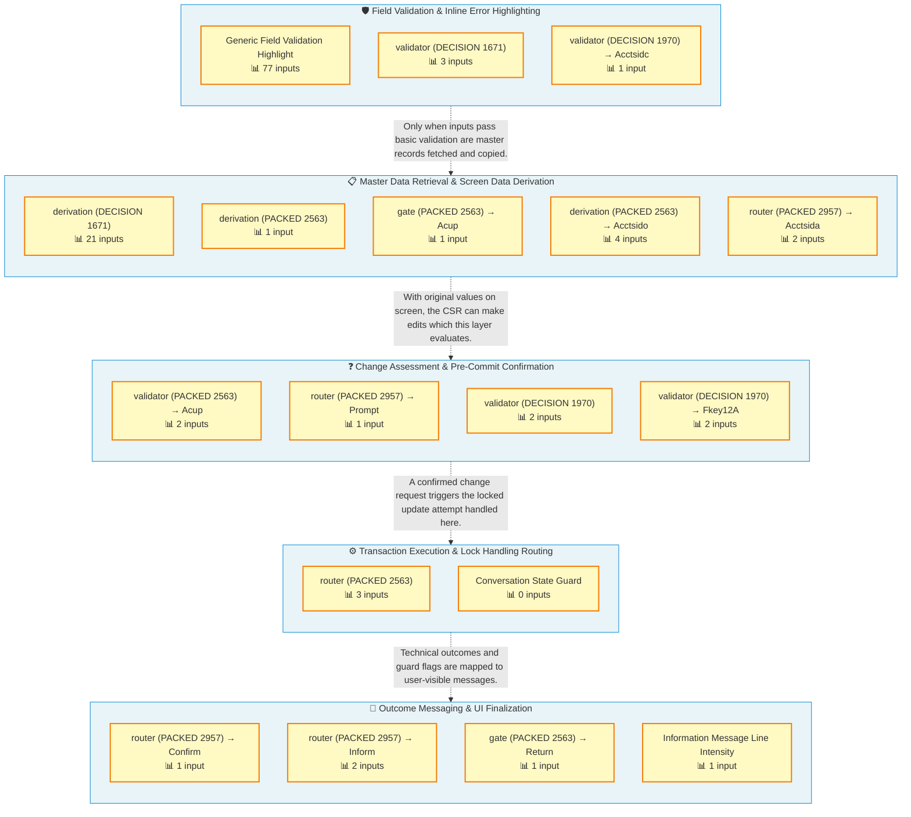

# DMN Report for `assets/aws_mainframe_modernization_carddemo/code/app/cbl/COACTUPC.cbl`

### Business Overview

**Purpose & Impact:** COACTUPC governs the full life-cycle of a ‘Card Demo – Account Update’ conversation in CICS: validating every keystroke, loading the official customer record, letting the CSR stage and confirm changes, performing the locked update, and finally telling the UI exactly what happened.  If any decision in this chain is wrong the branch could show stale data, apply an unintended credit-limit, or mask a failed database write – exposing the bank to Reg-E and UDAAP violations and potential financial loss.  The architecture therefore layers decisions from front-end field policing, through data retrieval, to post-commit messaging so that each business concern is isolated and testable.

**Process:** The “Field Validation & Inline Error Highlighting” layer runs first, firing more than 70 micro-rules such as “flg_address_line_1_blank” and specialised cash-limit checks to immediately colour offending fields red (Generic Field Validation Highlight, Acctsidc).  Once inputs look sane, the “Master Data Retrieval & Screen Data Derivation” layer copies 26+ master-file columns into working storage (DECISION 1671) and derives screen identifiers (Acctsido, Acctsida) so the CSR sees original values.

The third layer, “Change Assessment & Pre-Commit Confirmation”, decides whether edits are truly new (Acup_changes_ok_not_confirmed), lights PF-keys, and may prompt for confirmation via router 2957.  When the CSR presses CONFIRM the “Transaction Execution & Lock Handling Routing” layer executes the update, consolidating lock conflicts and data-change races in router 2563 while the Conversation State Guard catches any illegal state.

Finally, “Outcome Messaging & UI Finalization” converts technical results into user-facing messages: router 2957 emits Confirm/Inform responses, Information Message Line Intensity brightens or dims the status bar, and gate Return suppresses redundant screens.  The layered flow ensures that each downstream step receives only clean, well-shaped facts from the layer above, simplifying both testing and future regulatory tweaks.

### Layered Flow Diagram

Decisions organized by functional layer discovered through dependency analysis.



**Key Architectural Insights:**
- Router 2957 is reused across three distinct decisions (Prompt, Confirm, Inform) showing how COBOL encodes multiple branches in a single table-driven module.
- All 70+ field-level validations are consolidated in one highlight decision, simplifying UI maintenance without touching deeper business logic.
- Master data derivation copies every original value before any edit, enabling precise change tracking and easy roll-back if confirmation is cancelled.
- Lock-handling and stale-data scenarios are centralised in router 2563, isolating complex concurrency logic from UI layers.
- The Conversation State Guard provides a fail-fast safety net, ensuring any unidentified screen flow stops the transaction before corrupting data.

**Layer Descriptions:**
- **Field Validation & Inline Error Highlighting:** Polices every incoming screen field, validates business rules and visually highlights errors so CSRs correct data before proceeding.
- **Master Data Retrieval & Screen Data Derivation:** Fetches customer/account master records and derives display-ready fields so the UI can show original values and key identifiers.
- **Change Assessment & Pre-Commit Confirmation:** Determines whether staged edits are valid, lights the correct PF-keys and, if required, prompts the CSR to confirm or cancel the pending update.
- **Transaction Execution & Lock Handling Routing:** Attempts the account update, reconciles lock conflicts or stale-data collisions, and categorises the technical outcome for downstream use.
- **Outcome Messaging & UI Finalization:** Translates execution results into user-facing messages, adjusts information line intensity and suppresses or displays follow-up screens.

## Decision Table Legend

Throughout this report, decision tables use consistent visual coding:

**Decision Categories:**
- 🎯 **Business** = Business rules, regulatory compliance, policy decisions
- 🔧 **Technical** = Infrastructure, validation, routing, algorithms

**Table Columns:**
- 🔵 **Blue columns** = Inputs (conditions)
- 🟪 **Purple columns** = Outputs (results)

<details open>
<summary><h2>🎯 Business Decisions</h2></summary>

## Decision: Generic Field Validation Highlight 🎯

PURPOSE & IMPACT:
This decision flags individual screen fields that have failed validation so the UI can visually highlight them (e.g., turn the field label red).  Correct highlighting directs the CSR to the exact data element requiring correction, reducing average call-handling time and preventing the posting of corrupt customer master data.  A wrong decision leaves bad data undetected, causing downstream rejects in nightly batch updates and potential regulatory reporting errors that can trigger fines.
PROCESS & INTEGRATION:
The decision executes immediately after the field-level validation routine in online card-maintenance program COACTUPC.  It inspects the boolean validation flags (FLG-*-BLANK / FLG-*-NOT-OK) that were set earlier in the same module and, when any flag is true, moves “-1” to the corresponding highlight indicator (ACS*L) that the CICS BMS map interprets as a video attribute for reverse/bright display.  The resulting highlight map is sent back to the CSR terminal and is also stored in the COMMAREA for potential re-display on subsequent screens.
REGULATORY/BUSINESS CONTEXT:
Accurate customer-data capture is required under U.S. CARD Act, PCI-DSS, and CFPB regulations for consumer disclosures.  Bank policy Card-OPS-VAL-03 mandates 100 % field-level validation with visual feedback to users, audited quarterly by Compliance.

<table>
  <thead>
    <tr>
      <th style="background-color: #fff; padding: 10px; text-align: center;">#</th>
      <th style="background-color: #e3f2fd; color: #1976d2; padding: 10px; text-align: center;">flg_acct_status_blank</th>
      <th style="background-color: #e3f2fd; color: #1976d2; padding: 10px; text-align: center;">flg_acct_status_not_ok</th>
      <th style="background-color: #e3f2fd; color: #1976d2; padding: 10px; text-align: center;">flg_acctfilter_blank</th>
      <th style="background-color: #e3f2fd; color: #1976d2; padding: 10px; text-align: center;">flg_acctfilter_not_ok</th>
      <th style="background-color: #e3f2fd; color: #1976d2; padding: 10px; text-align: center;">flg_address_line_1_blank</th>
      <th style="background-color: #e3f2fd; color: #1976d2; padding: 10px; text-align: center;">flg_address_line_1_not_ok</th>
      <th style="background-color: #e3f2fd; color: #1976d2; padding: 10px; text-align: center;">flg_cash_credit_limit_blank</th>
      <th style="background-color: #e3f2fd; color: #1976d2; padding: 10px; text-align: center;">flg_cash_credit_limit_not_ok</th>
      <th style="background-color: #e3f2fd; color: #1976d2; padding: 10px; text-align: center;">flg_city_blank</th>
      <th style="background-color: #e3f2fd; color: #1976d2; padding: 10px; text-align: center;">flg_city_not_ok</th>
      <th style="background-color: #e3f2fd; color: #1976d2; padding: 10px; text-align: center;">flg_country_blank</th>
      <th style="background-color: #e3f2fd; color: #1976d2; padding: 10px; text-align: center;">flg_country_not_ok</th>
      <th style="background-color: #e3f2fd; color: #1976d2; padding: 10px; text-align: center;">flg_cred_limit_blank</th>
      <th style="background-color: #e3f2fd; color: #1976d2; padding: 10px; text-align: center;">flg_cred_limit_not_ok</th>
      <th style="background-color: #e3f2fd; color: #1976d2; padding: 10px; text-align: center;">flg_curr_bal_blank</th>
      <th style="background-color: #e3f2fd; color: #1976d2; padding: 10px; text-align: center;">flg_curr_bal_not_ok</th>
      <th style="background-color: #e3f2fd; color: #1976d2; padding: 10px; text-align: center;">flg_curr_cyc_credit_blank</th>
      <th style="background-color: #e3f2fd; color: #1976d2; padding: 10px; text-align: center;">flg_curr_cyc_credit_not_ok</th>
      <th style="background-color: #e3f2fd; color: #1976d2; padding: 10px; text-align: center;">flg_curr_cyc_debit_blank</th>
      <th style="background-color: #e3f2fd; color: #1976d2; padding: 10px; text-align: center;">flg_curr_cyc_debit_not_ok</th>
      <th style="background-color: #e3f2fd; color: #1976d2; padding: 10px; text-align: center;">flg_dt_of_birth_day_blank</th>
      <th style="background-color: #e3f2fd; color: #1976d2; padding: 10px; text-align: center;">flg_dt_of_birth_day_not_ok</th>
      <th style="background-color: #e3f2fd; color: #1976d2; padding: 10px; text-align: center;">flg_dt_of_birth_month_blank</th>
      <th style="background-color: #e3f2fd; color: #1976d2; padding: 10px; text-align: center;">flg_dt_of_birth_month_not_ok</th>
      <th style="background-color: #e3f2fd; color: #1976d2; padding: 10px; text-align: center;">flg_dt_of_birth_year_blank</th>
      <th style="background-color: #e3f2fd; color: #1976d2; padding: 10px; text-align: center;">flg_dt_of_birth_year_not_ok</th>
      <th style="background-color: #e3f2fd; color: #1976d2; padding: 10px; text-align: center;">flg_edit_us_ssn_part1_blank</th>
      <th style="background-color: #e3f2fd; color: #1976d2; padding: 10px; text-align: center;">flg_edit_us_ssn_part1_not_ok</th>
      <th style="background-color: #e3f2fd; color: #1976d2; padding: 10px; text-align: center;">flg_edit_us_ssn_part2_blank</th>
      <th style="background-color: #e3f2fd; color: #1976d2; padding: 10px; text-align: center;">flg_edit_us_ssn_part2_not_ok</th>
      <th style="background-color: #e3f2fd; color: #1976d2; padding: 10px; text-align: center;">flg_edit_us_ssn_part3_blank</th>
      <th style="background-color: #e3f2fd; color: #1976d2; padding: 10px; text-align: center;">flg_edit_us_ssn_part3_not_ok</th>
      <th style="background-color: #e3f2fd; color: #1976d2; padding: 10px; text-align: center;">flg_eft_account_id_blank</th>
      <th style="background-color: #e3f2fd; color: #1976d2; padding: 10px; text-align: center;">flg_eft_account_id_not_ok</th>
      <th style="background-color: #e3f2fd; color: #1976d2; padding: 10px; text-align: center;">flg_expiry_day_blank</th>
      <th style="background-color: #e3f2fd; color: #1976d2; padding: 10px; text-align: center;">flg_expiry_day_not_ok</th>
      <th style="background-color: #e3f2fd; color: #1976d2; padding: 10px; text-align: center;">flg_expiry_month_blank</th>
      <th style="background-color: #e3f2fd; color: #1976d2; padding: 10px; text-align: center;">flg_expiry_month_not_ok</th>
      <th style="background-color: #e3f2fd; color: #1976d2; padding: 10px; text-align: center;">flg_expiry_year_blank</th>
      <th style="background-color: #e3f2fd; color: #1976d2; padding: 10px; text-align: center;">flg_expiry_year_not_ok</th>
      <th style="background-color: #e3f2fd; color: #1976d2; padding: 10px; text-align: center;">flg_fico_score_blank</th>
      <th style="background-color: #e3f2fd; color: #1976d2; padding: 10px; text-align: center;">flg_fico_score_not_ok</th>
      <th style="background-color: #e3f2fd; color: #1976d2; padding: 10px; text-align: center;">flg_first_name_blank</th>
      <th style="background-color: #e3f2fd; color: #1976d2; padding: 10px; text-align: center;">flg_first_name_not_ok</th>
      <th style="background-color: #e3f2fd; color: #1976d2; padding: 10px; text-align: center;">flg_last_name_blank</th>
      <th style="background-color: #e3f2fd; color: #1976d2; padding: 10px; text-align: center;">flg_last_name_not_ok</th>
      <th style="background-color: #e3f2fd; color: #1976d2; padding: 10px; text-align: center;">flg_middle_name_not_ok</th>
      <th style="background-color: #e3f2fd; color: #1976d2; padding: 10px; text-align: center;">flg_open_day_blank</th>
      <th style="background-color: #e3f2fd; color: #1976d2; padding: 10px; text-align: center;">flg_open_day_not_ok</th>
      <th style="background-color: #e3f2fd; color: #1976d2; padding: 10px; text-align: center;">flg_open_month_blank</th>
      <th style="background-color: #e3f2fd; color: #1976d2; padding: 10px; text-align: center;">flg_open_month_not_ok</th>
      <th style="background-color: #e3f2fd; color: #1976d2; padding: 10px; text-align: center;">flg_open_year_blank</th>
      <th style="background-color: #e3f2fd; color: #1976d2; padding: 10px; text-align: center;">flg_open_year_not_ok</th>
      <th style="background-color: #e3f2fd; color: #1976d2; padding: 10px; text-align: center;">flg_phone_num_1a_blank</th>
      <th style="background-color: #e3f2fd; color: #1976d2; padding: 10px; text-align: center;">flg_phone_num_1a_not_ok</th>
      <th style="background-color: #e3f2fd; color: #1976d2; padding: 10px; text-align: center;">flg_phone_num_1b_blank</th>
      <th style="background-color: #e3f2fd; color: #1976d2; padding: 10px; text-align: center;">flg_phone_num_1b_not_ok</th>
      <th style="background-color: #e3f2fd; color: #1976d2; padding: 10px; text-align: center;">flg_phone_num_1c_blank</th>
      <th style="background-color: #e3f2fd; color: #1976d2; padding: 10px; text-align: center;">flg_phone_num_1c_not_ok</th>
      <th style="background-color: #e3f2fd; color: #1976d2; padding: 10px; text-align: center;">flg_phone_num_2a_blank</th>
      <th style="background-color: #e3f2fd; color: #1976d2; padding: 10px; text-align: center;">flg_phone_num_2a_not_ok</th>
      <th style="background-color: #e3f2fd; color: #1976d2; padding: 10px; text-align: center;">flg_phone_num_2b_blank</th>
      <th style="background-color: #e3f2fd; color: #1976d2; padding: 10px; text-align: center;">flg_phone_num_2b_not_ok</th>
      <th style="background-color: #e3f2fd; color: #1976d2; padding: 10px; text-align: center;">flg_phone_num_2c_blank</th>
      <th style="background-color: #e3f2fd; color: #1976d2; padding: 10px; text-align: center;">flg_phone_num_2c_not_ok</th>
      <th style="background-color: #e3f2fd; color: #1976d2; padding: 10px; text-align: center;">flg_pri_cardholder_blank</th>
      <th style="background-color: #e3f2fd; color: #1976d2; padding: 10px; text-align: center;">flg_pri_cardholder_not_ok</th>
      <th style="background-color: #e3f2fd; color: #1976d2; padding: 10px; text-align: center;">flg_reissue_day_blank</th>
      <th style="background-color: #e3f2fd; color: #1976d2; padding: 10px; text-align: center;">flg_reissue_day_not_ok</th>
      <th style="background-color: #e3f2fd; color: #1976d2; padding: 10px; text-align: center;">flg_reissue_month_blank</th>
      <th style="background-color: #e3f2fd; color: #1976d2; padding: 10px; text-align: center;">flg_reissue_month_not_ok</th>
      <th style="background-color: #e3f2fd; color: #1976d2; padding: 10px; text-align: center;">flg_reissue_year_blank</th>
      <th style="background-color: #e3f2fd; color: #1976d2; padding: 10px; text-align: center;">flg_reissue_year_not_ok</th>
      <th style="background-color: #e3f2fd; color: #1976d2; padding: 10px; text-align: center;">flg_state_blank</th>
      <th style="background-color: #e3f2fd; color: #1976d2; padding: 10px; text-align: center;">flg_state_not_ok</th>
      <th style="background-color: #e3f2fd; color: #1976d2; padding: 10px; text-align: center;">flg_zipcode_blank</th>
      <th style="background-color: #e3f2fd; color: #1976d2; padding: 10px; text-align: center;">flg_zipcode_not_ok</th>
      <th style="background-color: #f3e5f5; color: #7b1fa2; padding: 10px; text-align: center;">acctsidl</th>
      <th style="background-color: #f3e5f5; color: #7b1fa2; padding: 10px; text-align: center;">acrcycrl</th>
      <th style="background-color: #f3e5f5; color: #7b1fa2; padding: 10px; text-align: center;">acrcydbl</th>
      <th style="background-color: #f3e5f5; color: #7b1fa2; padding: 10px; text-align: center;">acrdliml</th>
      <th style="background-color: #f3e5f5; color: #7b1fa2; padding: 10px; text-align: center;">acsadl1l</th>
      <th style="background-color: #f3e5f5; color: #7b1fa2; padding: 10px; text-align: center;">acscityl</th>
      <th style="background-color: #f3e5f5; color: #7b1fa2; padding: 10px; text-align: center;">acsctryl</th>
      <th style="background-color: #f3e5f5; color: #7b1fa2; padding: 10px; text-align: center;">acseftcl</th>
      <th style="background-color: #f3e5f5; color: #7b1fa2; padding: 10px; text-align: center;">acsfnaml</th>
      <th style="background-color: #f3e5f5; color: #7b1fa2; padding: 10px; text-align: center;">acshliml</th>
      <th style="background-color: #f3e5f5; color: #7b1fa2; padding: 10px; text-align: center;">acslnaml</th>
      <th style="background-color: #f3e5f5; color: #7b1fa2; padding: 10px; text-align: center;">acsmnaml</th>
      <th style="background-color: #f3e5f5; color: #7b1fa2; padding: 10px; text-align: center;">acspflgl</th>
      <th style="background-color: #f3e5f5; color: #7b1fa2; padding: 10px; text-align: center;">acsph1al</th>
      <th style="background-color: #f3e5f5; color: #7b1fa2; padding: 10px; text-align: center;">acsph1bl</th>
      <th style="background-color: #f3e5f5; color: #7b1fa2; padding: 10px; text-align: center;">acsph1cl</th>
      <th style="background-color: #f3e5f5; color: #7b1fa2; padding: 10px; text-align: center;">acsph2al</th>
      <th style="background-color: #f3e5f5; color: #7b1fa2; padding: 10px; text-align: center;">acsph2bl</th>
      <th style="background-color: #f3e5f5; color: #7b1fa2; padding: 10px; text-align: center;">acsph2cl</th>
      <th style="background-color: #f3e5f5; color: #7b1fa2; padding: 10px; text-align: center;">acssttel</th>
      <th style="background-color: #f3e5f5; color: #7b1fa2; padding: 10px; text-align: center;">acstfcol</th>
      <th style="background-color: #f3e5f5; color: #7b1fa2; padding: 10px; text-align: center;">acsttusl</th>
      <th style="background-color: #f3e5f5; color: #7b1fa2; padding: 10px; text-align: center;">acszipcl</th>
      <th style="background-color: #f3e5f5; color: #7b1fa2; padding: 10px; text-align: center;">actssn1l</th>
      <th style="background-color: #f3e5f5; color: #7b1fa2; padding: 10px; text-align: center;">actssn2l</th>
      <th style="background-color: #f3e5f5; color: #7b1fa2; padding: 10px; text-align: center;">actssn3l</th>
      <th style="background-color: #f3e5f5; color: #7b1fa2; padding: 10px; text-align: center;">acurball</th>
      <th style="background-color: #f3e5f5; color: #7b1fa2; padding: 10px; text-align: center;">dobdayl</th>
      <th style="background-color: #f3e5f5; color: #7b1fa2; padding: 10px; text-align: center;">dobmonl</th>
      <th style="background-color: #f3e5f5; color: #7b1fa2; padding: 10px; text-align: center;">dobyearl</th>
      <th style="background-color: #f3e5f5; color: #7b1fa2; padding: 10px; text-align: center;">expdayl</th>
      <th style="background-color: #f3e5f5; color: #7b1fa2; padding: 10px; text-align: center;">expmonl</th>
      <th style="background-color: #f3e5f5; color: #7b1fa2; padding: 10px; text-align: center;">expyearl</th>
      <th style="background-color: #f3e5f5; color: #7b1fa2; padding: 10px; text-align: center;">opndayl</th>
      <th style="background-color: #f3e5f5; color: #7b1fa2; padding: 10px; text-align: center;">opnmonl</th>
      <th style="background-color: #f3e5f5; color: #7b1fa2; padding: 10px; text-align: center;">opnyearl</th>
      <th style="background-color: #f3e5f5; color: #7b1fa2; padding: 10px; text-align: center;">risdayl</th>
      <th style="background-color: #f3e5f5; color: #7b1fa2; padding: 10px; text-align: center;">rismonl</th>
      <th style="background-color: #f3e5f5; color: #7b1fa2; padding: 10px; text-align: center;">risyearl</th>
    </tr>
    <tr>
      <th style="background-color: #fff; padding: 6px;"></th>
      <th style="background-color: #bbdefb; color: #0d47a1; padding: 6px; font-weight: normal; font-size: 0.9em; font-style: italic; text-align: left; min-width: 200px; max-width: 400px;">Raised when account status field is blank; triggers ACSTTUSL error highlight.</th>
      <th style="background-color: #bbdefb; color: #0d47a1; padding: 6px; font-weight: normal; font-size: 0.9em; font-style: italic; text-align: left; min-width: 200px; max-width: 400px;">Signals the account status code entered is invalid; prompts red highlight and stops processing.</th>
      <th style="background-color: #bbdefb; color: #0d47a1; padding: 6px; font-weight: normal; font-size: 0.9em; font-style: italic; text-align: left; min-width: 200px; max-width: 400px;">Set when all search keys are blank; prompts ‘no criteria’ message.</th>
      <th style="background-color: #bbdefb; color: #0d47a1; padding: 6px; font-weight: normal; font-size: 0.9em; font-style: italic; text-align: left; min-width: 200px; max-width: 400px;">Set when search account id fails initial validation; stops processing until corrected.</th>
      <th style="background-color: #bbdefb; color: #0d47a1; padding: 6px; font-weight: normal; font-size: 0.9em; font-style: italic; text-align: left; min-width: 200px; max-width: 400px;">Validation flag raised when Address Line 1 is blank; sets ACSADL1L to red.</th>
      <th style="background-color: #bbdefb; color: #0d47a1; padding: 6px; font-weight: normal; font-size: 0.9em; font-style: italic; text-align: left; min-width: 200px; max-width: 400px;">Indicates Address Line 1 fails edits; sets ACSADL1L red.</th>
      <th style="background-color: #bbdefb; color: #0d47a1; padding: 6px; font-weight: normal; font-size: 0.9em; font-style: italic; text-align: left; min-width: 200px; max-width: 400px;">Flag when cash credit limit left blank; highlights ACSHLIML.</th>
      <th style="background-color: #bbdefb; color: #0d47a1; padding: 6px; font-weight: normal; font-size: 0.9em; font-style: italic; text-align: left; min-width: 200px; max-width: 400px;">Signals that the entered cash credit limit is invalid; drives error handling and sets ACSHLIML to red.</th>
      <th style="background-color: #bbdefb; color: #0d47a1; padding: 6px; font-weight: normal; font-size: 0.9em; font-style: italic; text-align: left; min-width: 200px; max-width: 400px;">Flag when city field blank; highlights ACSCITYL.</th>
      <th style="background-color: #bbdefb; color: #0d47a1; padding: 6px; font-weight: normal; font-size: 0.9em; font-style: italic; text-align: left; min-width: 200px; max-width: 400px;">Marks city (address line 3) invalid; moves –1 to ACSCITYL.</th>
      <th style="background-color: #bbdefb; color: #0d47a1; padding: 6px; font-weight: normal; font-size: 0.9em; font-style: italic; text-align: left; min-width: 200px; max-width: 400px;">Flag when country code left blank; highlights ACSCTRYL.</th>
      <th style="background-color: #bbdefb; color: #0d47a1; padding: 6px; font-weight: normal; font-size: 0.9em; font-style: italic; text-align: left; min-width: 200px; max-width: 400px;">Indicates country code fails validation; highlights ACSCTRYL.</th>
      <th style="background-color: #bbdefb; color: #0d47a1; padding: 6px; font-weight: normal; font-size: 0.9em; font-style: italic; text-align: left; min-width: 200px; max-width: 400px;">Flag for blank overall credit limit; sets ACRDLIML red.</th>
      <th style="background-color: #bbdefb; color: #0d47a1; padding: 6px; font-weight: normal; font-size: 0.9em; font-style: italic; text-align: left; min-width: 200px; max-width: 400px;">Raised when credit limit fails numeric edits; sets ACRDLIML red.</th>
      <th style="background-color: #bbdefb; color: #0d47a1; padding: 6px; font-weight: normal; font-size: 0.9em; font-style: italic; text-align: left; min-width: 200px; max-width: 400px;">Flag raised when current balance left blank; sets ACURBALL red.</th>
      <th style="background-color: #bbdefb; color: #0d47a1; padding: 6px; font-weight: normal; font-size: 0.9em; font-style: italic; text-align: left; min-width: 200px; max-width: 400px;">Raised when current balance fails numeric edits; sets ACURBALL red.</th>
      <th style="background-color: #bbdefb; color: #0d47a1; padding: 6px; font-weight: normal; font-size: 0.9em; font-style: italic; text-align: left; min-width: 200px; max-width: 400px;">Flag for blank current-cycle credit; sets ACRCYCRL red.</th>
      <th style="background-color: #bbdefb; color: #0d47a1; padding: 6px; font-weight: normal; font-size: 0.9em; font-style: italic; text-align: left; min-width: 200px; max-width: 400px;">Raised when current-cycle credit invalid; sets ACRCYCRL red.</th>
      <th style="background-color: #bbdefb; color: #0d47a1; padding: 6px; font-weight: normal; font-size: 0.9em; font-style: italic; text-align: left; min-width: 200px; max-width: 400px;">Flag when current-cycle debit is blank; highlights ACRCYDBL.</th>
      <th style="background-color: #bbdefb; color: #0d47a1; padding: 6px; font-weight: normal; font-size: 0.9em; font-style: italic; text-align: left; min-width: 200px; max-width: 400px;">Indicates current-cycle debit fails validation; highlights ACRCYDBL.</th>
      <th style="background-color: #bbdefb; color: #0d47a1; padding: 6px; font-weight: normal; font-size: 0.9em; font-style: italic; text-align: left; min-width: 200px; max-width: 400px;">Flag when DOB day blank; sets DOBDAYL red.</th>
      <th style="background-color: #bbdefb; color: #0d47a1; padding: 6px; font-weight: normal; font-size: 0.9em; font-style: italic; text-align: left; min-width: 200px; max-width: 400px;">Flag for invalid DOB day; sets DOBDAYL red.</th>
      <th style="background-color: #bbdefb; color: #0d47a1; padding: 6px; font-weight: normal; font-size: 0.9em; font-style: italic; text-align: left; min-width: 200px; max-width: 400px;">Flag when DOB month blank; sets DOBMONL red.</th>
      <th style="background-color: #bbdefb; color: #0d47a1; padding: 6px; font-weight: normal; font-size: 0.9em; font-style: italic; text-align: left; min-width: 200px; max-width: 400px;">Error flag for invalid DOB month; highlights DOBMONL.</th>
      <th style="background-color: #bbdefb; color: #0d47a1; padding: 6px; font-weight: normal; font-size: 0.9em; font-style: italic; text-align: left; min-width: 200px; max-width: 400px;">Flag when DOB year blank; sets DOBYEARL red.</th>
      <th style="background-color: #bbdefb; color: #0d47a1; padding: 6px; font-weight: normal; font-size: 0.9em; font-style: italic; text-align: left; min-width: 200px; max-width: 400px;">Flag when DOB year invalid; sets DOBYEARL red.</th>
      <th style="background-color: #bbdefb; color: #0d47a1; padding: 6px; font-weight: normal; font-size: 0.9em; font-style: italic; text-align: left; min-width: 200px; max-width: 400px;">Error flag for SSN part 1 when blank; triggers highlight of ACTSSN1L.</th>
      <th style="background-color: #bbdefb; color: #0d47a1; padding: 6px; font-weight: normal; font-size: 0.9em; font-style: italic; text-align: left; min-width: 200px; max-width: 400px;">Flag when SSN part 1 fails validation; sets ACTSSN1L red.</th>
      <th style="background-color: #bbdefb; color: #0d47a1; padding: 6px; font-weight: normal; font-size: 0.9em; font-style: italic; text-align: left; min-width: 200px; max-width: 400px;">Error flag when SSN part 2 is blank; sets ACTSSN2L red.</th>
      <th style="background-color: #bbdefb; color: #0d47a1; padding: 6px; font-weight: normal; font-size: 0.9em; font-style: italic; text-align: left; min-width: 200px; max-width: 400px;">Flag when SSN part 2 fails validation; sets ACTSSN2L red.</th>
      <th style="background-color: #bbdefb; color: #0d47a1; padding: 6px; font-weight: normal; font-size: 0.9em; font-style: italic; text-align: left; min-width: 200px; max-width: 400px;">Flag when SSN part 3 is blank; sets ACTSSN3L to error state.</th>
      <th style="background-color: #bbdefb; color: #0d47a1; padding: 6px; font-weight: normal; font-size: 0.9em; font-style: italic; text-align: left; min-width: 200px; max-width: 400px;">Flag when SSN part 3 fails edits; sets ACTSSN3L red.</th>
      <th style="background-color: #bbdefb; color: #0d47a1; padding: 6px; font-weight: normal; font-size: 0.9em; font-style: italic; text-align: left; min-width: 200px; max-width: 400px;">Flag for blank EFT account ID; sets ACSEFTCL red.</th>
      <th style="background-color: #bbdefb; color: #0d47a1; padding: 6px; font-weight: normal; font-size: 0.9em; font-style: italic; text-align: left; min-width: 200px; max-width: 400px;">Validation flag for bad EFT account ID; sets ACSEFTCL red.</th>
      <th style="background-color: #bbdefb; color: #0d47a1; padding: 6px; font-weight: normal; font-size: 0.9em; font-style: italic; text-align: left; min-width: 200px; max-width: 400px;">Flag for blank expiration day; sets EXPDAYL red.</th>
      <th style="background-color: #bbdefb; color: #0d47a1; padding: 6px; font-weight: normal; font-size: 0.9em; font-style: italic; text-align: left; min-width: 200px; max-width: 400px;">Raised when card expiry day fails edits; sets EXPDAYL error.</th>
      <th style="background-color: #bbdefb; color: #0d47a1; padding: 6px; font-weight: normal; font-size: 0.9em; font-style: italic; text-align: left; min-width: 200px; max-width: 400px;">Raised when expiry month blank; sets EXPMONL error.</th>
      <th style="background-color: #bbdefb; color: #0d47a1; padding: 6px; font-weight: normal; font-size: 0.9em; font-style: italic; text-align: left; min-width: 200px; max-width: 400px;">Error flag for invalid expiry month; sets EXPMONL.</th>
      <th style="background-color: #bbdefb; color: #0d47a1; padding: 6px; font-weight: normal; font-size: 0.9em; font-style: italic; text-align: left; min-width: 200px; max-width: 400px;">Flag when expiry year blank; sets EXPYEARL red.</th>
      <th style="background-color: #bbdefb; color: #0d47a1; padding: 6px; font-weight: normal; font-size: 0.9em; font-style: italic; text-align: left; min-width: 200px; max-width: 400px;">Raised when expiry year fails validation; sets EXPYEARL red.</th>
      <th style="background-color: #bbdefb; color: #0d47a1; padding: 6px; font-weight: normal; font-size: 0.9em; font-style: italic; text-align: left; min-width: 200px; max-width: 400px;">Raised when FICO score field is blank; marks ACSTFCOL and sets INPUT-ERROR.</th>
      <th style="background-color: #bbdefb; color: #0d47a1; padding: 6px; font-weight: normal; font-size: 0.9em; font-style: italic; text-align: left; min-width: 200px; max-width: 400px;">Validation flag for FICO score; set to TRUE when the entered score fails numeric/format edits and INPUT-ERROR is raised.</th>
      <th style="background-color: #bbdefb; color: #0d47a1; padding: 6px; font-weight: normal; font-size: 0.9em; font-style: italic; text-align: left; min-width: 200px; max-width: 400px;">Flag that first name was left blank; triggers ACSFNAML highlight.</th>
      <th style="background-color: #bbdefb; color: #0d47a1; padding: 6px; font-weight: normal; font-size: 0.9em; font-style: italic; text-align: left; min-width: 200px; max-width: 400px;">Validation flag for customer first name; TRUE when name violates alpha rules or is missing, triggering error highlight.</th>
      <th style="background-color: #bbdefb; color: #0d47a1; padding: 6px; font-weight: normal; font-size: 0.9em; font-style: italic; text-align: left; min-width: 200px; max-width: 400px;">Flag when last name left blank; highlights ACSLNAML.</th>
      <th style="background-color: #bbdefb; color: #0d47a1; padding: 6px; font-weight: normal; font-size: 0.9em; font-style: italic; text-align: left; min-width: 200px; max-width: 400px;">Marks last name field invalid or blank; sets ACSLNAML red.</th>
      <th style="background-color: #bbdefb; color: #0d47a1; padding: 6px; font-weight: normal; font-size: 0.9em; font-style: italic; text-align: left; min-width: 200px; max-width: 400px;">Flag when middle name fails validation; sets ACSMNAML red.</th>
      <th style="background-color: #bbdefb; color: #0d47a1; padding: 6px; font-weight: normal; font-size: 0.9em; font-style: italic; text-align: left; min-width: 200px; max-width: 400px;">Error flag for missing open-day; moves –1 to OPNDAYL.</th>
      <th style="background-color: #bbdefb; color: #0d47a1; padding: 6px; font-weight: normal; font-size: 0.9em; font-style: italic; text-align: left; min-width: 200px; max-width: 400px;">Error flag for invalid open-day; highlights OPNDAYL.</th>
      <th style="background-color: #bbdefb; color: #0d47a1; padding: 6px; font-weight: normal; font-size: 0.9em; font-style: italic; text-align: left; min-width: 200px; max-width: 400px;">Raised when open month left blank; sets OPNMONL error.</th>
      <th style="background-color: #bbdefb; color: #0d47a1; padding: 6px; font-weight: normal; font-size: 0.9em; font-style: italic; text-align: left; min-width: 200px; max-width: 400px;">Raised when open-month fails edits; moves –1 to OPNMONL.</th>
      <th style="background-color: #bbdefb; color: #0d47a1; padding: 6px; font-weight: normal; font-size: 0.9em; font-style: italic; text-align: left; min-width: 200px; max-width: 400px;">Raised when open year blank; sets OPNYEARL red.</th>
      <th style="background-color: #bbdefb; color: #0d47a1; padding: 6px; font-weight: normal; font-size: 0.9em; font-style: italic; text-align: left; min-width: 200px; max-width: 400px;">Error flag for invalid open year; sets OPNYEARL red.</th>
      <th style="background-color: #bbdefb; color: #0d47a1; padding: 6px; font-weight: normal; font-size: 0.9em; font-style: italic; text-align: left; min-width: 200px; max-width: 400px;">Raised when first segment of phone 1 is blank; sets ACSPH1AL red.</th>
      <th style="background-color: #bbdefb; color: #0d47a1; padding: 6px; font-weight: normal; font-size: 0.9em; font-style: italic; text-align: left; min-width: 200px; max-width: 400px;">Marks first segment of phone 1 invalid; sets ACSPH1AL red.</th>
      <th style="background-color: #bbdefb; color: #0d47a1; padding: 6px; font-weight: normal; font-size: 0.9em; font-style: italic; text-align: left; min-width: 200px; max-width: 400px;">Flag when phone 1 segment B blank; highlights ACSPH1BL.</th>
      <th style="background-color: #bbdefb; color: #0d47a1; padding: 6px; font-weight: normal; font-size: 0.9em; font-style: italic; text-align: left; min-width: 200px; max-width: 400px;">Flags middle segment of primary phone invalid; sets ACSPH1BL red.</th>
      <th style="background-color: #bbdefb; color: #0d47a1; padding: 6px; font-weight: normal; font-size: 0.9em; font-style: italic; text-align: left; min-width: 200px; max-width: 400px;">Raised when phone segment 1C blank; highlights ACSPH1CL.</th>
      <th style="background-color: #bbdefb; color: #0d47a1; padding: 6px; font-weight: normal; font-size: 0.9em; font-style: italic; text-align: left; min-width: 200px; max-width: 400px;">Marks third segment of primary phone as invalid; highlights ACSPH1CL.</th>
      <th style="background-color: #bbdefb; color: #0d47a1; padding: 6px; font-weight: normal; font-size: 0.9em; font-style: italic; text-align: left; min-width: 200px; max-width: 400px;">Flag when secondary phone segment 2A blank; sets ACSPH2AL red.</th>
      <th style="background-color: #bbdefb; color: #0d47a1; padding: 6px; font-weight: normal; font-size: 0.9em; font-style: italic; text-align: left; min-width: 200px; max-width: 400px;">Marks first segment of secondary phone invalid; sets ACSPH2AL red.</th>
      <th style="background-color: #bbdefb; color: #0d47a1; padding: 6px; font-weight: normal; font-size: 0.9em; font-style: italic; text-align: left; min-width: 200px; max-width: 400px;">Raised when phone 2 segment B blank; highlights ACSPH2BL.</th>
      <th style="background-color: #bbdefb; color: #0d47a1; padding: 6px; font-weight: normal; font-size: 0.9em; font-style: italic; text-align: left; min-width: 200px; max-width: 400px;">Flags middle segment of secondary phone invalid; moves –1 to ACSPH2BL.</th>
      <th style="background-color: #bbdefb; color: #0d47a1; padding: 6px; font-weight: normal; font-size: 0.9em; font-style: italic; text-align: left; min-width: 200px; max-width: 400px;">Flag when secondary phone segment C is blank; highlights ACSPH2CL.</th>
      <th style="background-color: #bbdefb; color: #0d47a1; padding: 6px; font-weight: normal; font-size: 0.9em; font-style: italic; text-align: left; min-width: 200px; max-width: 400px;">Indicates third segment of secondary phone number failed edits; highlights ACSPH2CL.</th>
      <th style="background-color: #bbdefb; color: #0d47a1; padding: 6px; font-weight: normal; font-size: 0.9em; font-style: italic; text-align: left; min-width: 200px; max-width: 400px;">Flag when primary-cardholder indicator blank; sets ACSPFLGL red.</th>
      <th style="background-color: #bbdefb; color: #0d47a1; padding: 6px; font-weight: normal; font-size: 0.9em; font-style: italic; text-align: left; min-width: 200px; max-width: 400px;">Validation flag when primary cardholder indicator not Y/N; sets ACSPFLGL red.</th>
      <th style="background-color: #bbdefb; color: #0d47a1; padding: 6px; font-weight: normal; font-size: 0.9em; font-style: italic; text-align: left; min-width: 200px; max-width: 400px;">Flag when reissue day blank; sets RISDAYL red.</th>
      <th style="background-color: #bbdefb; color: #0d47a1; padding: 6px; font-weight: normal; font-size: 0.9em; font-style: italic; text-align: left; min-width: 200px; max-width: 400px;">Flag for invalid reissue day; sets RISDAYL red.</th>
      <th style="background-color: #bbdefb; color: #0d47a1; padding: 6px; font-weight: normal; font-size: 0.9em; font-style: italic; text-align: left; min-width: 200px; max-width: 400px;">Flag for blank reissue month; sets RISMONL red.</th>
      <th style="background-color: #bbdefb; color: #0d47a1; padding: 6px; font-weight: normal; font-size: 0.9em; font-style: italic; text-align: left; min-width: 200px; max-width: 400px;">Error flag for invalid reissue month; sets RISMONL.</th>
      <th style="background-color: #bbdefb; color: #0d47a1; padding: 6px; font-weight: normal; font-size: 0.9em; font-style: italic; text-align: left; min-width: 200px; max-width: 400px;">Flag when reissue year blank; sets RISYEARL red.</th>
      <th style="background-color: #bbdefb; color: #0d47a1; padding: 6px; font-weight: normal; font-size: 0.9em; font-style: italic; text-align: left; min-width: 200px; max-width: 400px;">Flag for invalid reissue year; sets RISYEARL red.</th>
      <th style="background-color: #bbdefb; color: #0d47a1; padding: 6px; font-weight: normal; font-size: 0.9em; font-style: italic; text-align: left; min-width: 200px; max-width: 400px;">Flag when state/province blank; sets ACSSTTEL red.</th>
      <th style="background-color: #bbdefb; color: #0d47a1; padding: 6px; font-weight: normal; font-size: 0.9em; font-style: italic; text-align: left; min-width: 200px; max-width: 400px;">Error flag when state code invalid or mismatched to ZIP; triggers INPUT-ERROR.</th>
      <th style="background-color: #bbdefb; color: #0d47a1; padding: 6px; font-weight: normal; font-size: 0.9em; font-style: italic; text-align: left; min-width: 200px; max-width: 400px;">Raised when ZIP code is blank; sets ACSZIPCL red.</th>
      <th style="background-color: #bbdefb; color: #0d47a1; padding: 6px; font-weight: normal; font-size: 0.9em; font-style: italic; text-align: left; min-width: 200px; max-width: 400px;">Validation flag for ZIP code/state mismatch; INPUT-ERROR set when TRUE.</th>
      <th style="background-color: #e1bee7; color: #4a148c; padding: 6px; font-weight: normal; font-size: 0.9em; font-style: italic; text-align: left; min-width: 200px; max-width: 400px;">Attribute for Account Id input; –1 when filter blank/invalid or generic other errors.</th>
      <th style="background-color: #e1bee7; color: #4a148c; padding: 6px; font-weight: normal; font-size: 0.9em; font-style: italic; text-align: left; min-width: 200px; max-width: 400px;">Attribute for current-cycle credit input; –1 marks error.</th>
      <th style="background-color: #e1bee7; color: #4a148c; padding: 6px; font-weight: normal; font-size: 0.9em; font-style: italic; text-align: left; min-width: 200px; max-width: 400px;">Attribute for current-cycle debit input; –1 on blank/invalid.</th>
      <th style="background-color: #e1bee7; color: #4a148c; padding: 6px; font-weight: normal; font-size: 0.9em; font-style: italic; text-align: left; min-width: 200px; max-width: 400px;">Screen attribute for credit-limit input; –1 marks blank/invalid amount.</th>
      <th style="background-color: #e1bee7; color: #4a148c; padding: 6px; font-weight: normal; font-size: 0.9em; font-style: italic; text-align: left; min-width: 200px; max-width: 400px;">Attribute for Address Line 1 input; –1 on blank/invalid.</th>
      <th style="background-color: #e1bee7; color: #4a148c; padding: 6px; font-weight: normal; font-size: 0.9em; font-style: italic; text-align: left; min-width: 200px; max-width: 400px;">Attribute for city input; –1 when blank/invalid.</th>
      <th style="background-color: #e1bee7; color: #4a148c; padding: 6px; font-weight: normal; font-size: 0.9em; font-style: italic; text-align: left; min-width: 200px; max-width: 400px;">Attribute for country code input; –1 when blank/invalid.</th>
      <th style="background-color: #e1bee7; color: #4a148c; padding: 6px; font-weight: normal; font-size: 0.9em; font-style: italic; text-align: left; min-width: 200px; max-width: 400px;">Attribute for EFT account ID input; –1 marks error.</th>
      <th style="background-color: #e1bee7; color: #4a148c; padding: 6px; font-weight: normal; font-size: 0.9em; font-style: italic; text-align: left; min-width: 200px; max-width: 400px;">Attribute for first name input; –1 on blank/invalid entry.</th>
      <th style="background-color: #e1bee7; color: #4a148c; padding: 6px; font-weight: normal; font-size: 0.9em; font-style: italic; text-align: left; min-width: 200px; max-width: 400px;">Attribute for cash credit limit input; –1 on blank/invalid value.</th>
      <th style="background-color: #e1bee7; color: #4a148c; padding: 6px; font-weight: normal; font-size: 0.9em; font-style: italic; text-align: left; min-width: 200px; max-width: 400px;">Attribute for last name input; –1 when invalid/blank.</th>
      <th style="background-color: #e1bee7; color: #4a148c; padding: 6px; font-weight: normal; font-size: 0.9em; font-style: italic; text-align: left; min-width: 200px; max-width: 400px;">Attribute for middle name input; –1 when middle name fails edits.</th>
      <th style="background-color: #e1bee7; color: #4a148c; padding: 6px; font-weight: normal; font-size: 0.9em; font-style: italic; text-align: left; min-width: 200px; max-width: 400px;">Attribute for Primary-Cardholder indicator input; –1 when value invalid/blank.</th>
      <th style="background-color: #e1bee7; color: #4a148c; padding: 6px; font-weight: normal; font-size: 0.9em; font-style: italic; text-align: left; min-width: 200px; max-width: 400px;">Attribute byte for phone segment 1A; –1 when first phone digits invalid/blank.</th>
      <th style="background-color: #e1bee7; color: #4a148c; padding: 6px; font-weight: normal; font-size: 0.9em; font-style: italic; text-align: left; min-width: 200px; max-width: 400px;">Screen attribute for primary phone segment 1B; set to –1 to mark the field in error when segment 1B is blank/invalid.</th>
      <th style="background-color: #e1bee7; color: #4a148c; padding: 6px; font-weight: normal; font-size: 0.9em; font-style: italic; text-align: left; min-width: 200px; max-width: 400px;">Screen attribute for primary phone segment 1C; –1 marks the field when segment 1C is blank/invalid.</th>
      <th style="background-color: #e1bee7; color: #4a148c; padding: 6px; font-weight: normal; font-size: 0.9em; font-style: italic; text-align: left; min-width: 200px; max-width: 400px;">Attribute for secondary phone segment 2A; –1 when field invalid/blank.</th>
      <th style="background-color: #e1bee7; color: #4a148c; padding: 6px; font-weight: normal; font-size: 0.9em; font-style: italic; text-align: left; min-width: 200px; max-width: 400px;">Attribute for secondary phone segment 2B; –1 marks error.</th>
      <th style="background-color: #e1bee7; color: #4a148c; padding: 6px; font-weight: normal; font-size: 0.9em; font-style: italic; text-align: left; min-width: 200px; max-width: 400px;">Screen attribute for secondary phone segment 2C; –1 when invalid/blank.</th>
      <th style="background-color: #e1bee7; color: #4a148c; padding: 6px; font-weight: normal; font-size: 0.9em; font-style: italic; text-align: left; min-width: 200px; max-width: 400px;">Attribute for state/province input; –1 when invalid/blank.</th>
      <th style="background-color: #e1bee7; color: #4a148c; padding: 6px; font-weight: normal; font-size: 0.9em; font-style: italic; text-align: left; min-width: 200px; max-width: 400px;">Attribute for FICO score input; –1 when score blank/invalid.</th>
      <th style="background-color: #e1bee7; color: #4a148c; padding: 6px; font-weight: normal; font-size: 0.9em; font-style: italic; text-align: left; min-width: 200px; max-width: 400px;">Attribute for account status input; –1 when status invalid or protected after details fetch.</th>
      <th style="background-color: #e1bee7; color: #4a148c; padding: 6px; font-weight: normal; font-size: 0.9em; font-style: italic; text-align: left; min-width: 200px; max-width: 400px;">Attribute for ZIP code input; –1 when blank/invalid.</th>
      <th style="background-color: #e1bee7; color: #4a148c; padding: 6px; font-weight: normal; font-size: 0.9em; font-style: italic; text-align: left; min-width: 200px; max-width: 400px;">Attribute for SSN part 1 input; –1 on blank/invalid.</th>
      <th style="background-color: #e1bee7; color: #4a148c; padding: 6px; font-weight: normal; font-size: 0.9em; font-style: italic; text-align: left; min-width: 200px; max-width: 400px;">Screen attribute for SSN part 2 input; –1 (red) indicates part 2 is blank or fails edit.</th>
      <th style="background-color: #e1bee7; color: #4a148c; padding: 6px; font-weight: normal; font-size: 0.9em; font-style: italic; text-align: left; min-width: 200px; max-width: 400px;">Attribute for SSN part 3 input; –1 indicates error.</th>
      <th style="background-color: #e1bee7; color: #4a148c; padding: 6px; font-weight: normal; font-size: 0.9em; font-style: italic; text-align: left; min-width: 200px; max-width: 400px;">Attribute/field for current balance input; –1 on error when used as input, or field displaying balance.</th>
      <th style="background-color: #e1bee7; color: #4a148c; padding: 6px; font-weight: normal; font-size: 0.9em; font-style: italic; text-align: left; min-width: 200px; max-width: 400px;">Screen attribute for Date-of-Birth day; –1 marks blank/invalid entry.</th>
      <th style="background-color: #e1bee7; color: #4a148c; padding: 6px; font-weight: normal; font-size: 0.9em; font-style: italic; text-align: left; min-width: 200px; max-width: 400px;">Attribute for DOB month input; –1 when invalid/blank.</th>
      <th style="background-color: #e1bee7; color: #4a148c; padding: 6px; font-weight: normal; font-size: 0.9em; font-style: italic; text-align: left; min-width: 200px; max-width: 400px;">Attribute for DOB year input; –1 on blank/invalid.</th>
      <th style="background-color: #e1bee7; color: #4a148c; padding: 6px; font-weight: normal; font-size: 0.9em; font-style: italic; text-align: left; min-width: 200px; max-width: 400px;">Attribute for expiry day input; –1 when invalid/blank.</th>
      <th style="background-color: #e1bee7; color: #4a148c; padding: 6px; font-weight: normal; font-size: 0.9em; font-style: italic; text-align: left; min-width: 200px; max-width: 400px;">Attribute for expiry month input; –1 when invalid/blank.</th>
      <th style="background-color: #e1bee7; color: #4a148c; padding: 6px; font-weight: normal; font-size: 0.9em; font-style: italic; text-align: left; min-width: 200px; max-width: 400px;">Attribute for expiry year input; –1 when invalid/blank.</th>
      <th style="background-color: #e1bee7; color: #4a148c; padding: 6px; font-weight: normal; font-size: 0.9em; font-style: italic; text-align: left; min-width: 200px; max-width: 400px;">Screen attribute for open day; –1 when day invalid or blank.</th>
      <th style="background-color: #e1bee7; color: #4a148c; padding: 6px; font-weight: normal; font-size: 0.9em; font-style: italic; text-align: left; min-width: 200px; max-width: 400px;">Screen attribute for open month input; red when month missing/invalid.</th>
      <th style="background-color: #e1bee7; color: #4a148c; padding: 6px; font-weight: normal; font-size: 0.9em; font-style: italic; text-align: left; min-width: 200px; max-width: 400px;">Screen-attribute for Open-Year input; moved to –1 (DFHRED) to highlight the field when open year is blank or invalid.</th>
      <th style="background-color: #e1bee7; color: #4a148c; padding: 6px; font-weight: normal; font-size: 0.9em; font-style: italic; text-align: left; min-width: 200px; max-width: 400px;">Attribute for reissue day input; –1 when invalid/blank.</th>
      <th style="background-color: #e1bee7; color: #4a148c; padding: 6px; font-weight: normal; font-size: 0.9em; font-style: italic; text-align: left; min-width: 200px; max-width: 400px;">Attribute for reissue month input; –1 when blank/invalid.</th>
      <th style="background-color: #e1bee7; color: #4a148c; padding: 6px; font-weight: normal; font-size: 0.9em; font-style: italic; text-align: left; min-width: 200px; max-width: 400px;">Attribute for reissue year input; –1 on blank/invalid.</th>
    </tr>
  </thead>
  <tbody>
    <tr>
      <td style="background-color: #fff; padding: 8px; text-align: center;"><strong>1</strong></td>
      <td style="background-color: #e3f2fd; padding: 8px; text-align: center;">-</td>
      <td style="background-color: #e3f2fd; padding: 8px; text-align: center;">-</td>
      <td style="background-color: #e3f2fd; padding: 8px; text-align: center;">-</td>
      <td style="background-color: #e3f2fd; padding: 8px; text-align: center;">true</td>
      <td style="background-color: #e3f2fd; padding: 8px; text-align: center;">-</td>
      <td style="background-color: #e3f2fd; padding: 8px; text-align: center;">-</td>
      <td style="background-color: #e3f2fd; padding: 8px; text-align: center;">-</td>
      <td style="background-color: #e3f2fd; padding: 8px; text-align: center;">-</td>
      <td style="background-color: #e3f2fd; padding: 8px; text-align: center;">-</td>
      <td style="background-color: #e3f2fd; padding: 8px; text-align: center;">-</td>
      <td style="background-color: #e3f2fd; padding: 8px; text-align: center;">-</td>
      <td style="background-color: #e3f2fd; padding: 8px; text-align: center;">-</td>
      <td style="background-color: #e3f2fd; padding: 8px; text-align: center;">-</td>
      <td style="background-color: #e3f2fd; padding: 8px; text-align: center;">-</td>
      <td style="background-color: #e3f2fd; padding: 8px; text-align: center;">-</td>
      <td style="background-color: #e3f2fd; padding: 8px; text-align: center;">-</td>
      <td style="background-color: #e3f2fd; padding: 8px; text-align: center;">-</td>
      <td style="background-color: #e3f2fd; padding: 8px; text-align: center;">-</td>
      <td style="background-color: #e3f2fd; padding: 8px; text-align: center;">-</td>
      <td style="background-color: #e3f2fd; padding: 8px; text-align: center;">-</td>
      <td style="background-color: #e3f2fd; padding: 8px; text-align: center;">-</td>
      <td style="background-color: #e3f2fd; padding: 8px; text-align: center;">-</td>
      <td style="background-color: #e3f2fd; padding: 8px; text-align: center;">-</td>
      <td style="background-color: #e3f2fd; padding: 8px; text-align: center;">-</td>
      <td style="background-color: #e3f2fd; padding: 8px; text-align: center;">-</td>
      <td style="background-color: #e3f2fd; padding: 8px; text-align: center;">-</td>
      <td style="background-color: #e3f2fd; padding: 8px; text-align: center;">-</td>
      <td style="background-color: #e3f2fd; padding: 8px; text-align: center;">-</td>
      <td style="background-color: #e3f2fd; padding: 8px; text-align: center;">-</td>
      <td style="background-color: #e3f2fd; padding: 8px; text-align: center;">-</td>
      <td style="background-color: #e3f2fd; padding: 8px; text-align: center;">-</td>
      <td style="background-color: #e3f2fd; padding: 8px; text-align: center;">-</td>
      <td style="background-color: #e3f2fd; padding: 8px; text-align: center;">-</td>
      <td style="background-color: #e3f2fd; padding: 8px; text-align: center;">-</td>
      <td style="background-color: #e3f2fd; padding: 8px; text-align: center;">-</td>
      <td style="background-color: #e3f2fd; padding: 8px; text-align: center;">-</td>
      <td style="background-color: #e3f2fd; padding: 8px; text-align: center;">-</td>
      <td style="background-color: #e3f2fd; padding: 8px; text-align: center;">-</td>
      <td style="background-color: #e3f2fd; padding: 8px; text-align: center;">-</td>
      <td style="background-color: #e3f2fd; padding: 8px; text-align: center;">-</td>
      <td style="background-color: #e3f2fd; padding: 8px; text-align: center;">-</td>
      <td style="background-color: #e3f2fd; padding: 8px; text-align: center;">-</td>
      <td style="background-color: #e3f2fd; padding: 8px; text-align: center;">-</td>
      <td style="background-color: #e3f2fd; padding: 8px; text-align: center;">-</td>
      <td style="background-color: #e3f2fd; padding: 8px; text-align: center;">-</td>
      <td style="background-color: #e3f2fd; padding: 8px; text-align: center;">-</td>
      <td style="background-color: #e3f2fd; padding: 8px; text-align: center;">-</td>
      <td style="background-color: #e3f2fd; padding: 8px; text-align: center;">-</td>
      <td style="background-color: #e3f2fd; padding: 8px; text-align: center;">-</td>
      <td style="background-color: #e3f2fd; padding: 8px; text-align: center;">-</td>
      <td style="background-color: #e3f2fd; padding: 8px; text-align: center;">-</td>
      <td style="background-color: #e3f2fd; padding: 8px; text-align: center;">-</td>
      <td style="background-color: #e3f2fd; padding: 8px; text-align: center;">-</td>
      <td style="background-color: #e3f2fd; padding: 8px; text-align: center;">-</td>
      <td style="background-color: #e3f2fd; padding: 8px; text-align: center;">-</td>
      <td style="background-color: #e3f2fd; padding: 8px; text-align: center;">-</td>
      <td style="background-color: #e3f2fd; padding: 8px; text-align: center;">-</td>
      <td style="background-color: #e3f2fd; padding: 8px; text-align: center;">-</td>
      <td style="background-color: #e3f2fd; padding: 8px; text-align: center;">-</td>
      <td style="background-color: #e3f2fd; padding: 8px; text-align: center;">-</td>
      <td style="background-color: #e3f2fd; padding: 8px; text-align: center;">-</td>
      <td style="background-color: #e3f2fd; padding: 8px; text-align: center;">-</td>
      <td style="background-color: #e3f2fd; padding: 8px; text-align: center;">-</td>
      <td style="background-color: #e3f2fd; padding: 8px; text-align: center;">-</td>
      <td style="background-color: #e3f2fd; padding: 8px; text-align: center;">-</td>
      <td style="background-color: #e3f2fd; padding: 8px; text-align: center;">-</td>
      <td style="background-color: #e3f2fd; padding: 8px; text-align: center;">-</td>
      <td style="background-color: #e3f2fd; padding: 8px; text-align: center;">-</td>
      <td style="background-color: #e3f2fd; padding: 8px; text-align: center;">-</td>
      <td style="background-color: #e3f2fd; padding: 8px; text-align: center;">-</td>
      <td style="background-color: #e3f2fd; padding: 8px; text-align: center;">-</td>
      <td style="background-color: #e3f2fd; padding: 8px; text-align: center;">-</td>
      <td style="background-color: #e3f2fd; padding: 8px; text-align: center;">-</td>
      <td style="background-color: #e3f2fd; padding: 8px; text-align: center;">-</td>
      <td style="background-color: #e3f2fd; padding: 8px; text-align: center;">-</td>
      <td style="background-color: #e3f2fd; padding: 8px; text-align: center;">-</td>
      <td style="background-color: #e3f2fd; padding: 8px; text-align: center;">-</td>
      <td style="background-color: #f3e5f5; padding: 8px; text-align: center;">-1</td>
      <td style="background-color: #f3e5f5; padding: 8px; text-align: center;">-</td>
      <td style="background-color: #f3e5f5; padding: 8px; text-align: center;">-</td>
      <td style="background-color: #f3e5f5; padding: 8px; text-align: center;">-</td>
      <td style="background-color: #f3e5f5; padding: 8px; text-align: center;">-</td>
      <td style="background-color: #f3e5f5; padding: 8px; text-align: center;">-</td>
      <td style="background-color: #f3e5f5; padding: 8px; text-align: center;">-</td>
      <td style="background-color: #f3e5f5; padding: 8px; text-align: center;">-</td>
      <td style="background-color: #f3e5f5; padding: 8px; text-align: center;">-</td>
      <td style="background-color: #f3e5f5; padding: 8px; text-align: center;">-</td>
      <td style="background-color: #f3e5f5; padding: 8px; text-align: center;">-</td>
      <td style="background-color: #f3e5f5; padding: 8px; text-align: center;">-</td>
      <td style="background-color: #f3e5f5; padding: 8px; text-align: center;">-</td>
      <td style="background-color: #f3e5f5; padding: 8px; text-align: center;">-</td>
      <td style="background-color: #f3e5f5; padding: 8px; text-align: center;">-</td>
      <td style="background-color: #f3e5f5; padding: 8px; text-align: center;">-</td>
      <td style="background-color: #f3e5f5; padding: 8px; text-align: center;">-</td>
      <td style="background-color: #f3e5f5; padding: 8px; text-align: center;">-</td>
      <td style="background-color: #f3e5f5; padding: 8px; text-align: center;">-</td>
      <td style="background-color: #f3e5f5; padding: 8px; text-align: center;">-</td>
      <td style="background-color: #f3e5f5; padding: 8px; text-align: center;">-</td>
      <td style="background-color: #f3e5f5; padding: 8px; text-align: center;">-</td>
      <td style="background-color: #f3e5f5; padding: 8px; text-align: center;">-</td>
      <td style="background-color: #f3e5f5; padding: 8px; text-align: center;">-</td>
      <td style="background-color: #f3e5f5; padding: 8px; text-align: center;">-</td>
      <td style="background-color: #f3e5f5; padding: 8px; text-align: center;">-</td>
      <td style="background-color: #f3e5f5; padding: 8px; text-align: center;">-</td>
      <td style="background-color: #f3e5f5; padding: 8px; text-align: center;">-</td>
      <td style="background-color: #f3e5f5; padding: 8px; text-align: center;">-</td>
      <td style="background-color: #f3e5f5; padding: 8px; text-align: center;">-</td>
      <td style="background-color: #f3e5f5; padding: 8px; text-align: center;">-</td>
      <td style="background-color: #f3e5f5; padding: 8px; text-align: center;">-</td>
      <td style="background-color: #f3e5f5; padding: 8px; text-align: center;">-</td>
      <td style="background-color: #f3e5f5; padding: 8px; text-align: center;">-</td>
      <td style="background-color: #f3e5f5; padding: 8px; text-align: center;">-</td>
      <td style="background-color: #f3e5f5; padding: 8px; text-align: center;">-</td>
      <td style="background-color: #f3e5f5; padding: 8px; text-align: center;">-</td>
      <td style="background-color: #f3e5f5; padding: 8px; text-align: center;">-</td>
      <td style="background-color: #f3e5f5; padding: 8px; text-align: center;">-</td>
    </tr>
    <tr>
      <td style="background-color: #fff; padding: 8px; text-align: center;"><strong>2</strong></td>
      <td style="background-color: #e3f2fd; padding: 8px; text-align: center;">-</td>
      <td style="background-color: #e3f2fd; padding: 8px; text-align: center;">-</td>
      <td style="background-color: #e3f2fd; padding: 8px; text-align: center;">true</td>
      <td style="background-color: #e3f2fd; padding: 8px; text-align: center;">-</td>
      <td style="background-color: #e3f2fd; padding: 8px; text-align: center;">-</td>
      <td style="background-color: #e3f2fd; padding: 8px; text-align: center;">-</td>
      <td style="background-color: #e3f2fd; padding: 8px; text-align: center;">-</td>
      <td style="background-color: #e3f2fd; padding: 8px; text-align: center;">-</td>
      <td style="background-color: #e3f2fd; padding: 8px; text-align: center;">-</td>
      <td style="background-color: #e3f2fd; padding: 8px; text-align: center;">-</td>
      <td style="background-color: #e3f2fd; padding: 8px; text-align: center;">-</td>
      <td style="background-color: #e3f2fd; padding: 8px; text-align: center;">-</td>
      <td style="background-color: #e3f2fd; padding: 8px; text-align: center;">-</td>
      <td style="background-color: #e3f2fd; padding: 8px; text-align: center;">-</td>
      <td style="background-color: #e3f2fd; padding: 8px; text-align: center;">-</td>
      <td style="background-color: #e3f2fd; padding: 8px; text-align: center;">-</td>
      <td style="background-color: #e3f2fd; padding: 8px; text-align: center;">-</td>
      <td style="background-color: #e3f2fd; padding: 8px; text-align: center;">-</td>
      <td style="background-color: #e3f2fd; padding: 8px; text-align: center;">-</td>
      <td style="background-color: #e3f2fd; padding: 8px; text-align: center;">-</td>
      <td style="background-color: #e3f2fd; padding: 8px; text-align: center;">-</td>
      <td style="background-color: #e3f2fd; padding: 8px; text-align: center;">-</td>
      <td style="background-color: #e3f2fd; padding: 8px; text-align: center;">-</td>
      <td style="background-color: #e3f2fd; padding: 8px; text-align: center;">-</td>
      <td style="background-color: #e3f2fd; padding: 8px; text-align: center;">-</td>
      <td style="background-color: #e3f2fd; padding: 8px; text-align: center;">-</td>
      <td style="background-color: #e3f2fd; padding: 8px; text-align: center;">-</td>
      <td style="background-color: #e3f2fd; padding: 8px; text-align: center;">-</td>
      <td style="background-color: #e3f2fd; padding: 8px; text-align: center;">-</td>
      <td style="background-color: #e3f2fd; padding: 8px; text-align: center;">-</td>
      <td style="background-color: #e3f2fd; padding: 8px; text-align: center;">-</td>
      <td style="background-color: #e3f2fd; padding: 8px; text-align: center;">-</td>
      <td style="background-color: #e3f2fd; padding: 8px; text-align: center;">-</td>
      <td style="background-color: #e3f2fd; padding: 8px; text-align: center;">-</td>
      <td style="background-color: #e3f2fd; padding: 8px; text-align: center;">-</td>
      <td style="background-color: #e3f2fd; padding: 8px; text-align: center;">-</td>
      <td style="background-color: #e3f2fd; padding: 8px; text-align: center;">-</td>
      <td style="background-color: #e3f2fd; padding: 8px; text-align: center;">-</td>
      <td style="background-color: #e3f2fd; padding: 8px; text-align: center;">-</td>
      <td style="background-color: #e3f2fd; padding: 8px; text-align: center;">-</td>
      <td style="background-color: #e3f2fd; padding: 8px; text-align: center;">-</td>
      <td style="background-color: #e3f2fd; padding: 8px; text-align: center;">-</td>
      <td style="background-color: #e3f2fd; padding: 8px; text-align: center;">-</td>
      <td style="background-color: #e3f2fd; padding: 8px; text-align: center;">-</td>
      <td style="background-color: #e3f2fd; padding: 8px; text-align: center;">-</td>
      <td style="background-color: #e3f2fd; padding: 8px; text-align: center;">-</td>
      <td style="background-color: #e3f2fd; padding: 8px; text-align: center;">-</td>
      <td style="background-color: #e3f2fd; padding: 8px; text-align: center;">-</td>
      <td style="background-color: #e3f2fd; padding: 8px; text-align: center;">-</td>
      <td style="background-color: #e3f2fd; padding: 8px; text-align: center;">-</td>
      <td style="background-color: #e3f2fd; padding: 8px; text-align: center;">-</td>
      <td style="background-color: #e3f2fd; padding: 8px; text-align: center;">-</td>
      <td style="background-color: #e3f2fd; padding: 8px; text-align: center;">-</td>
      <td style="background-color: #e3f2fd; padding: 8px; text-align: center;">-</td>
      <td style="background-color: #e3f2fd; padding: 8px; text-align: center;">-</td>
      <td style="background-color: #e3f2fd; padding: 8px; text-align: center;">-</td>
      <td style="background-color: #e3f2fd; padding: 8px; text-align: center;">-</td>
      <td style="background-color: #e3f2fd; padding: 8px; text-align: center;">-</td>
      <td style="background-color: #e3f2fd; padding: 8px; text-align: center;">-</td>
      <td style="background-color: #e3f2fd; padding: 8px; text-align: center;">-</td>
      <td style="background-color: #e3f2fd; padding: 8px; text-align: center;">-</td>
      <td style="background-color: #e3f2fd; padding: 8px; text-align: center;">-</td>
      <td style="background-color: #e3f2fd; padding: 8px; text-align: center;">-</td>
      <td style="background-color: #e3f2fd; padding: 8px; text-align: center;">-</td>
      <td style="background-color: #e3f2fd; padding: 8px; text-align: center;">-</td>
      <td style="background-color: #e3f2fd; padding: 8px; text-align: center;">-</td>
      <td style="background-color: #e3f2fd; padding: 8px; text-align: center;">-</td>
      <td style="background-color: #e3f2fd; padding: 8px; text-align: center;">-</td>
      <td style="background-color: #e3f2fd; padding: 8px; text-align: center;">-</td>
      <td style="background-color: #e3f2fd; padding: 8px; text-align: center;">-</td>
      <td style="background-color: #e3f2fd; padding: 8px; text-align: center;">-</td>
      <td style="background-color: #e3f2fd; padding: 8px; text-align: center;">-</td>
      <td style="background-color: #e3f2fd; padding: 8px; text-align: center;">-</td>
      <td style="background-color: #e3f2fd; padding: 8px; text-align: center;">-</td>
      <td style="background-color: #e3f2fd; padding: 8px; text-align: center;">-</td>
      <td style="background-color: #e3f2fd; padding: 8px; text-align: center;">-</td>
      <td style="background-color: #e3f2fd; padding: 8px; text-align: center;">-</td>
      <td style="background-color: #f3e5f5; padding: 8px; text-align: center;">-1</td>
      <td style="background-color: #f3e5f5; padding: 8px; text-align: center;">-</td>
      <td style="background-color: #f3e5f5; padding: 8px; text-align: center;">-</td>
      <td style="background-color: #f3e5f5; padding: 8px; text-align: center;">-</td>
      <td style="background-color: #f3e5f5; padding: 8px; text-align: center;">-</td>
      <td style="background-color: #f3e5f5; padding: 8px; text-align: center;">-</td>
      <td style="background-color: #f3e5f5; padding: 8px; text-align: center;">-</td>
      <td style="background-color: #f3e5f5; padding: 8px; text-align: center;">-</td>
      <td style="background-color: #f3e5f5; padding: 8px; text-align: center;">-</td>
      <td style="background-color: #f3e5f5; padding: 8px; text-align: center;">-</td>
      <td style="background-color: #f3e5f5; padding: 8px; text-align: center;">-</td>
      <td style="background-color: #f3e5f5; padding: 8px; text-align: center;">-</td>
      <td style="background-color: #f3e5f5; padding: 8px; text-align: center;">-</td>
      <td style="background-color: #f3e5f5; padding: 8px; text-align: center;">-</td>
      <td style="background-color: #f3e5f5; padding: 8px; text-align: center;">-</td>
      <td style="background-color: #f3e5f5; padding: 8px; text-align: center;">-</td>
      <td style="background-color: #f3e5f5; padding: 8px; text-align: center;">-</td>
      <td style="background-color: #f3e5f5; padding: 8px; text-align: center;">-</td>
      <td style="background-color: #f3e5f5; padding: 8px; text-align: center;">-</td>
      <td style="background-color: #f3e5f5; padding: 8px; text-align: center;">-</td>
      <td style="background-color: #f3e5f5; padding: 8px; text-align: center;">-</td>
      <td style="background-color: #f3e5f5; padding: 8px; text-align: center;">-</td>
      <td style="background-color: #f3e5f5; padding: 8px; text-align: center;">-</td>
      <td style="background-color: #f3e5f5; padding: 8px; text-align: center;">-</td>
      <td style="background-color: #f3e5f5; padding: 8px; text-align: center;">-</td>
      <td style="background-color: #f3e5f5; padding: 8px; text-align: center;">-</td>
      <td style="background-color: #f3e5f5; padding: 8px; text-align: center;">-</td>
      <td style="background-color: #f3e5f5; padding: 8px; text-align: center;">-</td>
      <td style="background-color: #f3e5f5; padding: 8px; text-align: center;">-</td>
      <td style="background-color: #f3e5f5; padding: 8px; text-align: center;">-</td>
      <td style="background-color: #f3e5f5; padding: 8px; text-align: center;">-</td>
      <td style="background-color: #f3e5f5; padding: 8px; text-align: center;">-</td>
      <td style="background-color: #f3e5f5; padding: 8px; text-align: center;">-</td>
      <td style="background-color: #f3e5f5; padding: 8px; text-align: center;">-</td>
      <td style="background-color: #f3e5f5; padding: 8px; text-align: center;">-</td>
      <td style="background-color: #f3e5f5; padding: 8px; text-align: center;">-</td>
      <td style="background-color: #f3e5f5; padding: 8px; text-align: center;">-</td>
      <td style="background-color: #f3e5f5; padding: 8px; text-align: center;">-</td>
      <td style="background-color: #f3e5f5; padding: 8px; text-align: center;">-</td>
    </tr>
    <tr>
      <td style="background-color: #fff; padding: 8px; text-align: center;"><strong>3</strong></td>
      <td style="background-color: #e3f2fd; padding: 8px; text-align: center;">-</td>
      <td style="background-color: #e3f2fd; padding: 8px; text-align: center;">-</td>
      <td style="background-color: #e3f2fd; padding: 8px; text-align: center;">-</td>
      <td style="background-color: #e3f2fd; padding: 8px; text-align: center;">-</td>
      <td style="background-color: #e3f2fd; padding: 8px; text-align: center;">-</td>
      <td style="background-color: #e3f2fd; padding: 8px; text-align: center;">-</td>
      <td style="background-color: #e3f2fd; padding: 8px; text-align: center;">-</td>
      <td style="background-color: #e3f2fd; padding: 8px; text-align: center;">-</td>
      <td style="background-color: #e3f2fd; padding: 8px; text-align: center;">-</td>
      <td style="background-color: #e3f2fd; padding: 8px; text-align: center;">-</td>
      <td style="background-color: #e3f2fd; padding: 8px; text-align: center;">-</td>
      <td style="background-color: #e3f2fd; padding: 8px; text-align: center;">-</td>
      <td style="background-color: #e3f2fd; padding: 8px; text-align: center;">-</td>
      <td style="background-color: #e3f2fd; padding: 8px; text-align: center;">-</td>
      <td style="background-color: #e3f2fd; padding: 8px; text-align: center;">-</td>
      <td style="background-color: #e3f2fd; padding: 8px; text-align: center;">-</td>
      <td style="background-color: #e3f2fd; padding: 8px; text-align: center;">-</td>
      <td style="background-color: #e3f2fd; padding: 8px; text-align: center;">-</td>
      <td style="background-color: #e3f2fd; padding: 8px; text-align: center;">-</td>
      <td style="background-color: #e3f2fd; padding: 8px; text-align: center;">-</td>
      <td style="background-color: #e3f2fd; padding: 8px; text-align: center;">-</td>
      <td style="background-color: #e3f2fd; padding: 8px; text-align: center;">-</td>
      <td style="background-color: #e3f2fd; padding: 8px; text-align: center;">-</td>
      <td style="background-color: #e3f2fd; padding: 8px; text-align: center;">-</td>
      <td style="background-color: #e3f2fd; padding: 8px; text-align: center;">-</td>
      <td style="background-color: #e3f2fd; padding: 8px; text-align: center;">-</td>
      <td style="background-color: #e3f2fd; padding: 8px; text-align: center;">-</td>
      <td style="background-color: #e3f2fd; padding: 8px; text-align: center;">-</td>
      <td style="background-color: #e3f2fd; padding: 8px; text-align: center;">-</td>
      <td style="background-color: #e3f2fd; padding: 8px; text-align: center;">-</td>
      <td style="background-color: #e3f2fd; padding: 8px; text-align: center;">-</td>
      <td style="background-color: #e3f2fd; padding: 8px; text-align: center;">-</td>
      <td style="background-color: #e3f2fd; padding: 8px; text-align: center;">-</td>
      <td style="background-color: #e3f2fd; padding: 8px; text-align: center;">-</td>
      <td style="background-color: #e3f2fd; padding: 8px; text-align: center;">-</td>
      <td style="background-color: #e3f2fd; padding: 8px; text-align: center;">-</td>
      <td style="background-color: #e3f2fd; padding: 8px; text-align: center;">-</td>
      <td style="background-color: #e3f2fd; padding: 8px; text-align: center;">-</td>
      <td style="background-color: #e3f2fd; padding: 8px; text-align: center;">-</td>
      <td style="background-color: #e3f2fd; padding: 8px; text-align: center;">-</td>
      <td style="background-color: #e3f2fd; padding: 8px; text-align: center;">-</td>
      <td style="background-color: #e3f2fd; padding: 8px; text-align: center;">-</td>
      <td style="background-color: #e3f2fd; padding: 8px; text-align: center;">-</td>
      <td style="background-color: #e3f2fd; padding: 8px; text-align: center;">-</td>
      <td style="background-color: #e3f2fd; padding: 8px; text-align: center;">-</td>
      <td style="background-color: #e3f2fd; padding: 8px; text-align: center;">-</td>
      <td style="background-color: #e3f2fd; padding: 8px; text-align: center;">-</td>
      <td style="background-color: #e3f2fd; padding: 8px; text-align: center;">-</td>
      <td style="background-color: #e3f2fd; padding: 8px; text-align: center;">-</td>
      <td style="background-color: #e3f2fd; padding: 8px; text-align: center;">-</td>
      <td style="background-color: #e3f2fd; padding: 8px; text-align: center;">-</td>
      <td style="background-color: #e3f2fd; padding: 8px; text-align: center;">-</td>
      <td style="background-color: #e3f2fd; padding: 8px; text-align: center;">-</td>
      <td style="background-color: #e3f2fd; padding: 8px; text-align: center;">-</td>
      <td style="background-color: #e3f2fd; padding: 8px; text-align: center;">-</td>
      <td style="background-color: #e3f2fd; padding: 8px; text-align: center;">-</td>
      <td style="background-color: #e3f2fd; padding: 8px; text-align: center;">-</td>
      <td style="background-color: #e3f2fd; padding: 8px; text-align: center;">-</td>
      <td style="background-color: #e3f2fd; padding: 8px; text-align: center;">-</td>
      <td style="background-color: #e3f2fd; padding: 8px; text-align: center;">-</td>
      <td style="background-color: #e3f2fd; padding: 8px; text-align: center;">-</td>
      <td style="background-color: #e3f2fd; padding: 8px; text-align: center;">-</td>
      <td style="background-color: #e3f2fd; padding: 8px; text-align: center;">-</td>
      <td style="background-color: #e3f2fd; padding: 8px; text-align: center;">-</td>
      <td style="background-color: #e3f2fd; padding: 8px; text-align: center;">-</td>
      <td style="background-color: #e3f2fd; padding: 8px; text-align: center;">-</td>
      <td style="background-color: #e3f2fd; padding: 8px; text-align: center;">true</td>
      <td style="background-color: #e3f2fd; padding: 8px; text-align: center;">-</td>
      <td style="background-color: #e3f2fd; padding: 8px; text-align: center;">-</td>
      <td style="background-color: #e3f2fd; padding: 8px; text-align: center;">-</td>
      <td style="background-color: #e3f2fd; padding: 8px; text-align: center;">-</td>
      <td style="background-color: #e3f2fd; padding: 8px; text-align: center;">-</td>
      <td style="background-color: #e3f2fd; padding: 8px; text-align: center;">-</td>
      <td style="background-color: #e3f2fd; padding: 8px; text-align: center;">-</td>
      <td style="background-color: #e3f2fd; padding: 8px; text-align: center;">-</td>
      <td style="background-color: #e3f2fd; padding: 8px; text-align: center;">-</td>
      <td style="background-color: #e3f2fd; padding: 8px; text-align: center;">-</td>
      <td style="background-color: #f3e5f5; padding: 8px; text-align: center;">-</td>
      <td style="background-color: #f3e5f5; padding: 8px; text-align: center;">-</td>
      <td style="background-color: #f3e5f5; padding: 8px; text-align: center;">-</td>
      <td style="background-color: #f3e5f5; padding: 8px; text-align: center;">-</td>
      <td style="background-color: #f3e5f5; padding: 8px; text-align: center;">-</td>
      <td style="background-color: #f3e5f5; padding: 8px; text-align: center;">-</td>
      <td style="background-color: #f3e5f5; padding: 8px; text-align: center;">-</td>
      <td style="background-color: #f3e5f5; padding: 8px; text-align: center;">-</td>
      <td style="background-color: #f3e5f5; padding: 8px; text-align: center;">-</td>
      <td style="background-color: #f3e5f5; padding: 8px; text-align: center;">-</td>
      <td style="background-color: #f3e5f5; padding: 8px; text-align: center;">-</td>
      <td style="background-color: #f3e5f5; padding: 8px; text-align: center;">-</td>
      <td style="background-color: #f3e5f5; padding: 8px; text-align: center;">-1</td>
      <td style="background-color: #f3e5f5; padding: 8px; text-align: center;">-</td>
      <td style="background-color: #f3e5f5; padding: 8px; text-align: center;">-</td>
      <td style="background-color: #f3e5f5; padding: 8px; text-align: center;">-</td>
      <td style="background-color: #f3e5f5; padding: 8px; text-align: center;">-</td>
      <td style="background-color: #f3e5f5; padding: 8px; text-align: center;">-</td>
      <td style="background-color: #f3e5f5; padding: 8px; text-align: center;">-</td>
      <td style="background-color: #f3e5f5; padding: 8px; text-align: center;">-</td>
      <td style="background-color: #f3e5f5; padding: 8px; text-align: center;">-</td>
      <td style="background-color: #f3e5f5; padding: 8px; text-align: center;">-</td>
      <td style="background-color: #f3e5f5; padding: 8px; text-align: center;">-</td>
      <td style="background-color: #f3e5f5; padding: 8px; text-align: center;">-</td>
      <td style="background-color: #f3e5f5; padding: 8px; text-align: center;">-</td>
      <td style="background-color: #f3e5f5; padding: 8px; text-align: center;">-</td>
      <td style="background-color: #f3e5f5; padding: 8px; text-align: center;">-</td>
      <td style="background-color: #f3e5f5; padding: 8px; text-align: center;">-</td>
      <td style="background-color: #f3e5f5; padding: 8px; text-align: center;">-</td>
      <td style="background-color: #f3e5f5; padding: 8px; text-align: center;">-</td>
      <td style="background-color: #f3e5f5; padding: 8px; text-align: center;">-</td>
      <td style="background-color: #f3e5f5; padding: 8px; text-align: center;">-</td>
      <td style="background-color: #f3e5f5; padding: 8px; text-align: center;">-</td>
      <td style="background-color: #f3e5f5; padding: 8px; text-align: center;">-</td>
      <td style="background-color: #f3e5f5; padding: 8px; text-align: center;">-</td>
      <td style="background-color: #f3e5f5; padding: 8px; text-align: center;">-</td>
      <td style="background-color: #f3e5f5; padding: 8px; text-align: center;">-</td>
      <td style="background-color: #f3e5f5; padding: 8px; text-align: center;">-</td>
      <td style="background-color: #f3e5f5; padding: 8px; text-align: center;">-</td>
    </tr>
    <tr>
      <td style="background-color: #fff; padding: 8px; text-align: center;"><strong>4</strong></td>
      <td style="background-color: #e3f2fd; padding: 8px; text-align: center;">-</td>
      <td style="background-color: #e3f2fd; padding: 8px; text-align: center;">-</td>
      <td style="background-color: #e3f2fd; padding: 8px; text-align: center;">-</td>
      <td style="background-color: #e3f2fd; padding: 8px; text-align: center;">-</td>
      <td style="background-color: #e3f2fd; padding: 8px; text-align: center;">-</td>
      <td style="background-color: #e3f2fd; padding: 8px; text-align: center;">-</td>
      <td style="background-color: #e3f2fd; padding: 8px; text-align: center;">-</td>
      <td style="background-color: #e3f2fd; padding: 8px; text-align: center;">-</td>
      <td style="background-color: #e3f2fd; padding: 8px; text-align: center;">-</td>
      <td style="background-color: #e3f2fd; padding: 8px; text-align: center;">-</td>
      <td style="background-color: #e3f2fd; padding: 8px; text-align: center;">-</td>
      <td style="background-color: #e3f2fd; padding: 8px; text-align: center;">-</td>
      <td style="background-color: #e3f2fd; padding: 8px; text-align: center;">-</td>
      <td style="background-color: #e3f2fd; padding: 8px; text-align: center;">-</td>
      <td style="background-color: #e3f2fd; padding: 8px; text-align: center;">-</td>
      <td style="background-color: #e3f2fd; padding: 8px; text-align: center;">-</td>
      <td style="background-color: #e3f2fd; padding: 8px; text-align: center;">-</td>
      <td style="background-color: #e3f2fd; padding: 8px; text-align: center;">-</td>
      <td style="background-color: #e3f2fd; padding: 8px; text-align: center;">-</td>
      <td style="background-color: #e3f2fd; padding: 8px; text-align: center;">-</td>
      <td style="background-color: #e3f2fd; padding: 8px; text-align: center;">-</td>
      <td style="background-color: #e3f2fd; padding: 8px; text-align: center;">-</td>
      <td style="background-color: #e3f2fd; padding: 8px; text-align: center;">-</td>
      <td style="background-color: #e3f2fd; padding: 8px; text-align: center;">-</td>
      <td style="background-color: #e3f2fd; padding: 8px; text-align: center;">-</td>
      <td style="background-color: #e3f2fd; padding: 8px; text-align: center;">-</td>
      <td style="background-color: #e3f2fd; padding: 8px; text-align: center;">-</td>
      <td style="background-color: #e3f2fd; padding: 8px; text-align: center;">-</td>
      <td style="background-color: #e3f2fd; padding: 8px; text-align: center;">-</td>
      <td style="background-color: #e3f2fd; padding: 8px; text-align: center;">-</td>
      <td style="background-color: #e3f2fd; padding: 8px; text-align: center;">-</td>
      <td style="background-color: #e3f2fd; padding: 8px; text-align: center;">-</td>
      <td style="background-color: #e3f2fd; padding: 8px; text-align: center;">-</td>
      <td style="background-color: #e3f2fd; padding: 8px; text-align: center;">-</td>
      <td style="background-color: #e3f2fd; padding: 8px; text-align: center;">-</td>
      <td style="background-color: #e3f2fd; padding: 8px; text-align: center;">-</td>
      <td style="background-color: #e3f2fd; padding: 8px; text-align: center;">-</td>
      <td style="background-color: #e3f2fd; padding: 8px; text-align: center;">-</td>
      <td style="background-color: #e3f2fd; padding: 8px; text-align: center;">-</td>
      <td style="background-color: #e3f2fd; padding: 8px; text-align: center;">-</td>
      <td style="background-color: #e3f2fd; padding: 8px; text-align: center;">-</td>
      <td style="background-color: #e3f2fd; padding: 8px; text-align: center;">-</td>
      <td style="background-color: #e3f2fd; padding: 8px; text-align: center;">-</td>
      <td style="background-color: #e3f2fd; padding: 8px; text-align: center;">-</td>
      <td style="background-color: #e3f2fd; padding: 8px; text-align: center;">-</td>
      <td style="background-color: #e3f2fd; padding: 8px; text-align: center;">-</td>
      <td style="background-color: #e3f2fd; padding: 8px; text-align: center;">-</td>
      <td style="background-color: #e3f2fd; padding: 8px; text-align: center;">-</td>
      <td style="background-color: #e3f2fd; padding: 8px; text-align: center;">-</td>
      <td style="background-color: #e3f2fd; padding: 8px; text-align: center;">-</td>
      <td style="background-color: #e3f2fd; padding: 8px; text-align: center;">-</td>
      <td style="background-color: #e3f2fd; padding: 8px; text-align: center;">-</td>
      <td style="background-color: #e3f2fd; padding: 8px; text-align: center;">-</td>
      <td style="background-color: #e3f2fd; padding: 8px; text-align: center;">-</td>
      <td style="background-color: #e3f2fd; padding: 8px; text-align: center;">-</td>
      <td style="background-color: #e3f2fd; padding: 8px; text-align: center;">-</td>
      <td style="background-color: #e3f2fd; padding: 8px; text-align: center;">-</td>
      <td style="background-color: #e3f2fd; padding: 8px; text-align: center;">-</td>
      <td style="background-color: #e3f2fd; padding: 8px; text-align: center;">-</td>
      <td style="background-color: #e3f2fd; padding: 8px; text-align: center;">-</td>
      <td style="background-color: #e3f2fd; padding: 8px; text-align: center;">-</td>
      <td style="background-color: #e3f2fd; padding: 8px; text-align: center;">-</td>
      <td style="background-color: #e3f2fd; padding: 8px; text-align: center;">-</td>
      <td style="background-color: #e3f2fd; padding: 8px; text-align: center;">-</td>
      <td style="background-color: #e3f2fd; padding: 8px; text-align: center;">-</td>
      <td style="background-color: #e3f2fd; padding: 8px; text-align: center;">true</td>
      <td style="background-color: #e3f2fd; padding: 8px; text-align: center;">-</td>
      <td style="background-color: #e3f2fd; padding: 8px; text-align: center;">-</td>
      <td style="background-color: #e3f2fd; padding: 8px; text-align: center;">-</td>
      <td style="background-color: #e3f2fd; padding: 8px; text-align: center;">-</td>
      <td style="background-color: #e3f2fd; padding: 8px; text-align: center;">-</td>
      <td style="background-color: #e3f2fd; padding: 8px; text-align: center;">-</td>
      <td style="background-color: #e3f2fd; padding: 8px; text-align: center;">-</td>
      <td style="background-color: #e3f2fd; padding: 8px; text-align: center;">-</td>
      <td style="background-color: #e3f2fd; padding: 8px; text-align: center;">-</td>
      <td style="background-color: #e3f2fd; padding: 8px; text-align: center;">-</td>
      <td style="background-color: #e3f2fd; padding: 8px; text-align: center;">-</td>
      <td style="background-color: #f3e5f5; padding: 8px; text-align: center;">-</td>
      <td style="background-color: #f3e5f5; padding: 8px; text-align: center;">-</td>
      <td style="background-color: #f3e5f5; padding: 8px; text-align: center;">-</td>
      <td style="background-color: #f3e5f5; padding: 8px; text-align: center;">-</td>
      <td style="background-color: #f3e5f5; padding: 8px; text-align: center;">-</td>
      <td style="background-color: #f3e5f5; padding: 8px; text-align: center;">-</td>
      <td style="background-color: #f3e5f5; padding: 8px; text-align: center;">-</td>
      <td style="background-color: #f3e5f5; padding: 8px; text-align: center;">-</td>
      <td style="background-color: #f3e5f5; padding: 8px; text-align: center;">-</td>
      <td style="background-color: #f3e5f5; padding: 8px; text-align: center;">-</td>
      <td style="background-color: #f3e5f5; padding: 8px; text-align: center;">-</td>
      <td style="background-color: #f3e5f5; padding: 8px; text-align: center;">-</td>
      <td style="background-color: #f3e5f5; padding: 8px; text-align: center;">-1</td>
      <td style="background-color: #f3e5f5; padding: 8px; text-align: center;">-</td>
      <td style="background-color: #f3e5f5; padding: 8px; text-align: center;">-</td>
      <td style="background-color: #f3e5f5; padding: 8px; text-align: center;">-</td>
      <td style="background-color: #f3e5f5; padding: 8px; text-align: center;">-</td>
      <td style="background-color: #f3e5f5; padding: 8px; text-align: center;">-</td>
      <td style="background-color: #f3e5f5; padding: 8px; text-align: center;">-</td>
      <td style="background-color: #f3e5f5; padding: 8px; text-align: center;">-</td>
      <td style="background-color: #f3e5f5; padding: 8px; text-align: center;">-</td>
      <td style="background-color: #f3e5f5; padding: 8px; text-align: center;">-</td>
      <td style="background-color: #f3e5f5; padding: 8px; text-align: center;">-</td>
      <td style="background-color: #f3e5f5; padding: 8px; text-align: center;">-</td>
      <td style="background-color: #f3e5f5; padding: 8px; text-align: center;">-</td>
      <td style="background-color: #f3e5f5; padding: 8px; text-align: center;">-</td>
      <td style="background-color: #f3e5f5; padding: 8px; text-align: center;">-</td>
      <td style="background-color: #f3e5f5; padding: 8px; text-align: center;">-</td>
      <td style="background-color: #f3e5f5; padding: 8px; text-align: center;">-</td>
      <td style="background-color: #f3e5f5; padding: 8px; text-align: center;">-</td>
      <td style="background-color: #f3e5f5; padding: 8px; text-align: center;">-</td>
      <td style="background-color: #f3e5f5; padding: 8px; text-align: center;">-</td>
      <td style="background-color: #f3e5f5; padding: 8px; text-align: center;">-</td>
      <td style="background-color: #f3e5f5; padding: 8px; text-align: center;">-</td>
      <td style="background-color: #f3e5f5; padding: 8px; text-align: center;">-</td>
      <td style="background-color: #f3e5f5; padding: 8px; text-align: center;">-</td>
      <td style="background-color: #f3e5f5; padding: 8px; text-align: center;">-</td>
      <td style="background-color: #f3e5f5; padding: 8px; text-align: center;">-</td>
      <td style="background-color: #f3e5f5; padding: 8px; text-align: center;">-</td>
    </tr>
  </tbody>
</table>

**Hit Policy:** U (Unique - Only one rule can match)

<details>
<summary>📋 <strong>Code Evidence</strong> (4 supporting snippets)</summary>

The following COBOL code snippets provide the source evidence for this decision:

#### Evidence 1: Value Assignment

**File:** [`COACTUPC.cbl`](vscode://file/assets/aws_mainframe_modernization_carddemo/code/app/cbl/COACTUPC.cbl:522) | **Lines:** 522-524

```cobol
   522| WHEN FLG-ACCTFILTER-NOT-OK
   523|      MOVE -1             TO ACCTSIDL OF CACTUPAI
```
#### Evidence 2: Value Assignment

**File:** [`COACTUPC.cbl`](vscode://file/assets/aws_mainframe_modernization_carddemo/code/app/cbl/COACTUPC.cbl:3014) | **Lines:** 3014-3015

```cobol
  3014| WHEN FLG-ACCTFILTER-BLANK
  3015|      MOVE -1             TO ACCTSIDL OF CACTUPAI
```
#### Evidence 3: Value Assignment

**File:** [`COACTUPC.cbl`](vscode://file/assets/aws_mainframe_modernization_carddemo/code/app/cbl/COACTUPC.cbl:540) | **Lines:** 540-542

```cobol
   540| WHEN FLG-PRI-CARDHOLDER-NOT-OK
   541|      MOVE -1             TO ACSPFLGL OF CACTUPAI
```
#### Evidence 4: Value Assignment

**File:** [`COACTUPC.cbl`](vscode://file/assets/aws_mainframe_modernization_carddemo/code/app/cbl/COACTUPC.cbl:542) | **Lines:** 542-544

```cobol
   542| WHEN FLG-PRI-CARDHOLDER-BLANK
   543|      MOVE -1             TO ACSPFLGL OF CACTUPAI
```
</details>

---

## Decision: validator (DECISION 1671) 🎯

PURPOSE & IMPACT:
Validates and selects the correct Cash-Credit-Limit amount to be displayed and stored for the customer.  If the wrong amount is chosen (e.g., an un-validated figure is shown as an approved limit) the bank risks customer complaints, credit-risk mis-statements and potential regulatory breaches in lending disclosures.
PROCESS & INTEGRATION:
Runs inside program COACTUPC during the cash-account update step of the nightly batch.  Based on the validation flag it routes either the numeric (validated) limit or the exception text amount into the formatted display field (WS-EDIT-CURRENCY-9-2-F) and the persistent limit field (ACSHLIMO) that downstream posting, statement generation and risk-exposure reports consume.
REGULATORY/BUSINESS CONTEXT:
Governed by Basel III capital‐adequacy rules and internal credit-limit policies that require accurate reflection of usable credit lines; quarterly internal audit checks insist on 100 % accuracy for customer-visible limit figures.

<table>
  <thead>
    <tr>
      <th style="background-color: #fff; padding: 10px; text-align: center;">#</th>
      <th style="background-color: #e3f2fd; color: #1976d2; padding: 10px; text-align: center;">acup_new_cash_credit_limit_n</th>
      <th style="background-color: #e3f2fd; color: #1976d2; padding: 10px; text-align: center;">acup_new_cash_credit_limit_x</th>
      <th style="background-color: #e3f2fd; color: #1976d2; padding: 10px; text-align: center;">flg_cash_credit_limit_isvalid</th>
      <th style="background-color: #f3e5f5; color: #7b1fa2; padding: 10px; text-align: center;">acshlimo</th>
      <th style="background-color: #f3e5f5; color: #7b1fa2; padding: 10px; text-align: center;">ws_edit_currency_9_2_f</th>
    </tr>
    <tr>
      <th style="background-color: #fff; padding: 6px;"></th>
      <th style="background-color: #bbdefb; color: #0d47a1; padding: 6px; font-weight: normal; font-size: 0.9em; font-style: italic; text-align: left; min-width: 200px; max-width: 400px;">Numeric value of new cash limit post-conversion.</th>
      <th style="background-color: #bbdefb; color: #0d47a1; padding: 6px; font-weight: normal; font-size: 0.9em; font-style: italic; text-align: left; min-width: 200px; max-width: 400px;">Alphanumeric version of new cash credit limit as keyed; validated and converted to numeric if numeric test passes.</th>
      <th style="background-color: #bbdefb; color: #0d47a1; padding: 6px; font-weight: normal; font-size: 0.9em; font-style: italic; text-align: left; min-width: 200px; max-width: 400px;">Set when new cash credit limit passes numeric validation; allows formatted amount to display.</th>
      <th style="background-color: #e1bee7; color: #4a148c; padding: 6px; font-weight: normal; font-size: 0.9em; font-style: italic; text-align: left; min-width: 200px; max-width: 400px;">Output field for cash credit limit (formatted).</th>
      <th style="background-color: #e1bee7; color: #4a148c; padding: 6px; font-weight: normal; font-size: 0.9em; font-style: italic; text-align: left; min-width: 200px; max-width: 400px;">Work field holding currency formatted 9.2 value used before moving to map outputs.</th>
    </tr>
  </thead>
  <tbody>
    <tr>
      <td style="background-color: #fff; padding: 8px; text-align: center;"><strong>1</strong></td>
      <td style="background-color: #e3f2fd; padding: 8px; text-align: center;">!= null</td>
      <td style="background-color: #e3f2fd; padding: 8px; text-align: center;">-</td>
      <td style="background-color: #e3f2fd; padding: 8px; text-align: center;">true</td>
      <td style="background-color: #f3e5f5; padding: 8px; text-align: center;">acup_new_cash_credit_limit_n</td>
      <td style="background-color: #f3e5f5; padding: 8px; text-align: center;">acup_new_cash_credit_limit_n</td>
    </tr>
    <tr>
      <td style="background-color: #fff; padding: 8px; text-align: center;"><strong>2</strong></td>
      <td style="background-color: #e3f2fd; padding: 8px; text-align: center;">-</td>
      <td style="background-color: #e3f2fd; padding: 8px; text-align: center;">!= null</td>
      <td style="background-color: #e3f2fd; padding: 8px; text-align: center;">false</td>
      <td style="background-color: #f3e5f5; padding: 8px; text-align: center;">acup_new_cash_credit_limit_x</td>
      <td style="background-color: #f3e5f5; padding: 8px; text-align: center;">-</td>
    </tr>
  </tbody>
</table>

**Hit Policy:** U (Unique - Only one rule can match)

<details>
<summary>📋 <strong>Code Evidence</strong> (2 supporting snippets)</summary>

The following COBOL code snippets provide the source evidence for this decision:

#### Evidence 1: Condition Logic

**File:** [`COACTUPC.cbl`](vscode://file/assets/aws_mainframe_modernization_carddemo/code/app/cbl/COACTUPC.cbl:5231) | **Lines:** 5231-5234

```cobol
  5231| IF FLG-CASH-CREDIT-LIMIT-ISVALID
  5232|    MOVE ACUP-NEW-CASH-CREDIT-LIMIT-N TO WS-EDIT-CURRENCY-9-2-F
  5233|    MOVE WS-EDIT-CURRENCY-9-2-F      TO ACSHLIMO OF CACTUPAO
```
#### Evidence 2: Conditional Check

**File:** [`COACTUPC.cbl`](vscode://file/assets/aws_mainframe_modernization_carddemo/code/app/cbl/COACTUPC.cbl:5234) | **Lines:** 5234-5237

```cobol
  5234| ELSE
  5235|    MOVE ACUP-NEW-CASH-CREDIT-LIMIT-X TO ACSHLIMO OF CACTUPAO
  5236| END-IF
```
</details>

---

## Decision: validator (DECISION 1671) 🎯

PURPOSE & IMPACT:
Decision 1671 validates which "current balance" representation should be exposed to downstream consumers. When the numeric balance is valid it must be formatted and displayed; when it is not, the raw error-masked value is shown instead.  A wrong outcome would surface incorrect balances to customers, trigger financial mis-statements in statements, and expose the bank to customer complaints and reconciliation costs.
PROCESS & INTEGRATION:
The logic runs inside COACTUPC during the nightly account-update batch, immediately after balance validation.  Its outputs drive screen/statement fields (ACURBALO) and an intermediate formatted value (WS-EDIT-CURRENCY-9-2-F) that is later written to VSAM and sent to the customer-statement print process.
REGULATORY/BUSINESS CONTEXT:
Accurate balance disclosure is required under consumer-protection regulations and internal SOX financial-reporting controls; quarterly audits demand 100 % parity between core balances and what customers see.

<table>
  <thead>
    <tr>
      <th style="background-color: #fff; padding: 10px; text-align: center;">#</th>
      <th style="background-color: #e3f2fd; color: #1976d2; padding: 10px; text-align: center;">acup_new_curr_bal_n</th>
      <th style="background-color: #e3f2fd; color: #1976d2; padding: 10px; text-align: center;">acup_new_curr_bal_x</th>
      <th style="background-color: #e3f2fd; color: #1976d2; padding: 10px; text-align: center;">flg_curr_bal_isvalid</th>
      <th style="background-color: #f3e5f5; color: #7b1fa2; padding: 10px; text-align: center;">acurbalo</th>
      <th style="background-color: #f3e5f5; color: #7b1fa2; padding: 10px; text-align: center;">ws_edit_currency_9_2_f</th>
    </tr>
    <tr>
      <th style="background-color: #fff; padding: 6px;"></th>
      <th style="background-color: #bbdefb; color: #0d47a1; padding: 6px; font-weight: normal; font-size: 0.9em; font-style: italic; text-align: left; min-width: 200px; max-width: 400px;">Numeric value of new current balance after NUMVAL conversion.</th>
      <th style="background-color: #bbdefb; color: #0d47a1; padding: 6px; font-weight: normal; font-size: 0.9em; font-style: italic; text-align: left; min-width: 200px; max-width: 400px;">Alphanumeric entry of new current balance before numeric conversion.</th>
      <th style="background-color: #bbdefb; color: #0d47a1; padding: 6px; font-weight: normal; font-size: 0.9em; font-style: italic; text-align: left; min-width: 200px; max-width: 400px;">TRUE when new current balance passes numeric validation; enables formatted display.</th>
      <th style="background-color: #e1bee7; color: #4a148c; padding: 6px; font-weight: normal; font-size: 0.9em; font-style: italic; text-align: left; min-width: 200px; max-width: 400px;">Output field for current account balance (formatted) on detail screen.</th>
      <th style="background-color: #e1bee7; color: #4a148c; padding: 6px; font-weight: normal; font-size: 0.9em; font-style: italic; text-align: left; min-width: 200px; max-width: 400px;">Work field holding currency formatted 9.2 value used before moving to map outputs.</th>
    </tr>
  </thead>
  <tbody>
    <tr>
      <td style="background-color: #fff; padding: 8px; text-align: center;"><strong>1</strong></td>
      <td style="background-color: #e3f2fd; padding: 8px; text-align: center;">-</td>
      <td style="background-color: #e3f2fd; padding: 8px; text-align: center;">-</td>
      <td style="background-color: #e3f2fd; padding: 8px; text-align: center;">true</td>
      <td style="background-color: #f3e5f5; padding: 8px; text-align: center;">ws_edit_currency_9_2_f</td>
      <td style="background-color: #f3e5f5; padding: 8px; text-align: center;">acup_new_curr_bal_n</td>
    </tr>
    <tr>
      <td style="background-color: #fff; padding: 8px; text-align: center;"><strong>2</strong></td>
      <td style="background-color: #e3f2fd; padding: 8px; text-align: center;">-</td>
      <td style="background-color: #e3f2fd; padding: 8px; text-align: center;">-</td>
      <td style="background-color: #e3f2fd; padding: 8px; text-align: center;">false</td>
      <td style="background-color: #f3e5f5; padding: 8px; text-align: center;">acup_new_curr_bal_x</td>
      <td style="background-color: #f3e5f5; padding: 8px; text-align: center;">-</td>
    </tr>
  </tbody>
</table>

**Hit Policy:** U (Unique - Only one rule can match)

<details>
<summary>📋 <strong>Code Evidence</strong> (2 supporting snippets)</summary>

The following COBOL code snippets provide the source evidence for this decision:

#### Evidence 1: Condition Logic

**File:** [`COACTUPC.cbl`](vscode://file/assets/aws_mainframe_modernization_carddemo/code/app/cbl/COACTUPC.cbl:2890) | **Lines:** 2890-2892

```cobol
  2890| IF FLG-CURR-BAL-ISVALID
  2891|    MOVE ACUP-NEW-CURR-BAL-N         TO WS-EDIT-CURRENCY-9-2-F
  2892|    MOVE WS-EDIT-CURRENCY-9-2-F      TO ACURBALO OF CACTUPAO
```
#### Evidence 2: Conditional Check

**File:** [`COACTUPC.cbl`](vscode://file/assets/aws_mainframe_modernization_carddemo/code/app/cbl/COACTUPC.cbl:2893) | **Lines:** 2893-2895

```cobol
  2893| ELSE
  2894|    MOVE ACUP-NEW-CURR-BAL-X         TO ACURBALO OF CACTUPAO
  2895| END-IF
```
</details>

---

## Decision: validator (DECISION 1671) 🎯

PURPOSE & IMPACT:
This decision picks which Current-Cycle Debit amount the system will finally display and store. If the amount passed earlier editing tests (flag = true) we show the nicely formatted 9(9)V99 value; otherwise we fall back to the raw "exception" amount. A wrong choice would surface incorrect balances to customers, distort daily P&L, and create reconciliation breakages that could lead to regulatory mis-statements and customer complaints.
PROCESS & INTEGRATION:
The rule executes inside program COACTUPC immediately after the numeric/format edit routine, during nightly batch account-update processing. The resulting values are placed into WS-EDIT-CURRENCY-9-2-F (for later screen & report rendering) and ACRCYDBO (written to the account output area that downstream posting and statement generators read).
REGULATORY/BUSINESS CONTEXT:
Accurate debit presentation supports IFRS 9 financial-instrument reporting and internal SOX controls that require complete and accurate transaction data. The bank’s policy “GL-FIN-017 Currency Calculations” mandates 100 % accuracy with quarterly audit sampling.

<table>
  <thead>
    <tr>
      <th style="background-color: #fff; padding: 10px; text-align: center;">#</th>
      <th style="background-color: #e3f2fd; color: #1976d2; padding: 10px; text-align: center;">acup_new_curr_cyc_debit_n</th>
      <th style="background-color: #e3f2fd; color: #1976d2; padding: 10px; text-align: center;">acup_new_curr_cyc_debit_x</th>
      <th style="background-color: #e3f2fd; color: #1976d2; padding: 10px; text-align: center;">flg_curr_cyc_debit_isvalid</th>
      <th style="background-color: #f3e5f5; color: #7b1fa2; padding: 10px; text-align: center;">acrcydbo</th>
      <th style="background-color: #f3e5f5; color: #7b1fa2; padding: 10px; text-align: center;">ws_edit_currency_9_2_f</th>
    </tr>
    <tr>
      <th style="background-color: #fff; padding: 6px;"></th>
      <th style="background-color: #bbdefb; color: #0d47a1; padding: 6px; font-weight: normal; font-size: 0.9em; font-style: italic; text-align: left; min-width: 200px; max-width: 400px;">Numeric value of new current-cycle debit after conversion.</th>
      <th style="background-color: #bbdefb; color: #0d47a1; padding: 6px; font-weight: normal; font-size: 0.9em; font-style: italic; text-align: left; min-width: 200px; max-width: 400px;">Text version of new current-cycle debit as entered.</th>
      <th style="background-color: #bbdefb; color: #0d47a1; padding: 6px; font-weight: normal; font-size: 0.9em; font-style: italic; text-align: left; min-width: 200px; max-width: 400px;">TRUE when new current-cycle debit passes numeric edits; enables formatted display.</th>
      <th style="background-color: #e1bee7; color: #4a148c; padding: 6px; font-weight: normal; font-size: 0.9em; font-style: italic; text-align: left; min-width: 200px; max-width: 400px;">Output field displaying Current-Cycle-Debit on detail screen (formatted).</th>
      <th style="background-color: #e1bee7; color: #4a148c; padding: 6px; font-weight: normal; font-size: 0.9em; font-style: italic; text-align: left; min-width: 200px; max-width: 400px;">Work field holding currency formatted 9.2 value used before moving to map outputs.</th>
    </tr>
  </thead>
  <tbody>
    <tr>
      <td style="background-color: #fff; padding: 8px; text-align: center;"><strong>1</strong></td>
      <td style="background-color: #e3f2fd; padding: 8px; text-align: center;">-</td>
      <td style="background-color: #e3f2fd; padding: 8px; text-align: center;">-</td>
      <td style="background-color: #e3f2fd; padding: 8px; text-align: center;">true</td>
      <td style="background-color: #f3e5f5; padding: 8px; text-align: center;">ws_edit_currency_9_2_f</td>
      <td style="background-color: #f3e5f5; padding: 8px; text-align: center;">acup_new_curr_cyc_debit_n</td>
    </tr>
    <tr>
      <td style="background-color: #fff; padding: 8px; text-align: center;"><strong>2</strong></td>
      <td style="background-color: #e3f2fd; padding: 8px; text-align: center;">-</td>
      <td style="background-color: #e3f2fd; padding: 8px; text-align: center;">-</td>
      <td style="background-color: #e3f2fd; padding: 8px; text-align: center;">false</td>
      <td style="background-color: #f3e5f5; padding: 8px; text-align: center;">acup_new_curr_cyc_debit_x</td>
      <td style="background-color: #f3e5f5; padding: 8px; text-align: center;">-</td>
    </tr>
  </tbody>
</table>

**Hit Policy:** U (Unique - Only one rule can match)

<details>
<summary>📋 <strong>Code Evidence</strong> (2 supporting snippets)</summary>

The following COBOL code snippets provide the source evidence for this decision:

#### Evidence 1: Condition Logic

**File:** [`COACTUPC.cbl`](vscode://file/assets/aws_mainframe_modernization_carddemo/code/app/cbl/COACTUPC.cbl:2904) | **Lines:** 2904-2906

```cobol
  2904| IF FLG-CURR-CYC-DEBIT-ISVALID
  2905|    MOVE ACUP-NEW-CURR-CYC-DEBIT-N   TO WS-EDIT-CURRENCY-9-2-F
  2906|    MOVE WS-EDIT-CURRENCY-9-2-F      TO ACRCYDBO OF CACTUPAO
```
#### Evidence 2: Conditional Check

**File:** [`COACTUPC.cbl`](vscode://file/assets/aws_mainframe_modernization_carddemo/code/app/cbl/COACTUPC.cbl:2907) | **Lines:** 2907-2909

```cobol
  2907| ELSE
  2908|    MOVE ACUP-NEW-CURR-CYC-DEBIT-X   TO ACRCYDBO OF CACTUPAO
  2909| END-IF
```
</details>

---

## Decision: validator (DECISION 1671) 🎯

PURPOSE & IMPACT:
This decision selects which monetary value should become the customer’s official credit-limit once the user enters a change request.  If the new amount passes editing/validation rules, the properly formatted numeric value is stored and displayed; if it fails, the original (un-edited) text value is retained.  An incorrect decision would either expose the bank to lending-limit breaches (if an invalid amount is accepted) or cause customer dissatisfaction and operational re-work (if a valid amount is rejected).
PROCESS & INTEGRATION:
During the "Update Credit-Limit" batch/online routine (program COACTUPC) the flag FLG-CRED-LIMIT-ISVALID is evaluated immediately after field-level edits run.  Depending on the flag, the routine moves either the numeric value (ACUP-NEW-CREDIT-LIMIT-N) or the raw text value (ACUP-NEW-CREDIT-LIMIT-X) into working storage field WS-EDIT-CURRENCY-9-2-F and then into output field ACRDLIMO that is later written to VSAM/DB2 account files and downstream nightly extracts.
REGULATORY/BUSINESS CONTEXT:
The logic supports Basel III credit-exposure controls and must conform to the bank’s internal "Lending Operations Manual – Section 4.2 Credit-Limit Maintenance" which requires 100 % accuracy and audit traceability for all limit changes.

<table>
  <thead>
    <tr>
      <th style="background-color: #fff; padding: 10px; text-align: center;">#</th>
      <th style="background-color: #e3f2fd; color: #1976d2; padding: 10px; text-align: center;">acup_new_credit_limit_n</th>
      <th style="background-color: #e3f2fd; color: #1976d2; padding: 10px; text-align: center;">acup_new_credit_limit_x</th>
      <th style="background-color: #e3f2fd; color: #1976d2; padding: 10px; text-align: center;">flg_cred_limit_isvalid</th>
      <th style="background-color: #f3e5f5; color: #7b1fa2; padding: 10px; text-align: center;">acrdlimo</th>
      <th style="background-color: #f3e5f5; color: #7b1fa2; padding: 10px; text-align: center;">ws_edit_currency_9_2_f</th>
    </tr>
    <tr>
      <th style="background-color: #fff; padding: 6px;"></th>
      <th style="background-color: #bbdefb; color: #0d47a1; padding: 6px; font-weight: normal; font-size: 0.9em; font-style: italic; text-align: left; min-width: 200px; max-width: 400px;">Numeric value of new overall credit limit after conversion from text.</th>
      <th style="background-color: #bbdefb; color: #0d47a1; padding: 6px; font-weight: normal; font-size: 0.9em; font-style: italic; text-align: left; min-width: 200px; max-width: 400px;">Alphanumeric value of new overall credit limit as entered; validated then converted to numeric counterpart.</th>
      <th style="background-color: #bbdefb; color: #0d47a1; padding: 6px; font-weight: normal; font-size: 0.9em; font-style: italic; text-align: left; min-width: 200px; max-width: 400px;">Flag indicating new overall credit limit validated numerically; drives formatted display to ACRDLIMO.</th>
      <th style="background-color: #e1bee7; color: #4a148c; padding: 6px; font-weight: normal; font-size: 0.9em; font-style: italic; text-align: left; min-width: 200px; max-width: 400px;">Output field showing formatted credit limit on detail screen.</th>
      <th style="background-color: #e1bee7; color: #4a148c; padding: 6px; font-weight: normal; font-size: 0.9em; font-style: italic; text-align: left; min-width: 200px; max-width: 400px;">Work field holding currency formatted 9.2 value used before moving to map outputs.</th>
    </tr>
  </thead>
  <tbody>
    <tr>
      <td style="background-color: #fff; padding: 8px; text-align: center;"><strong>1</strong></td>
      <td style="background-color: #e3f2fd; padding: 8px; text-align: center;">-</td>
      <td style="background-color: #e3f2fd; padding: 8px; text-align: center;">-</td>
      <td style="background-color: #e3f2fd; padding: 8px; text-align: center;">true</td>
      <td style="background-color: #f3e5f5; padding: 8px; text-align: center;">acup_new_credit_limit_n</td>
      <td style="background-color: #f3e5f5; padding: 8px; text-align: center;">acup_new_credit_limit_n</td>
    </tr>
    <tr>
      <td style="background-color: #fff; padding: 8px; text-align: center;"><strong>2</strong></td>
      <td style="background-color: #e3f2fd; padding: 8px; text-align: center;">-</td>
      <td style="background-color: #e3f2fd; padding: 8px; text-align: center;">-</td>
      <td style="background-color: #e3f2fd; padding: 8px; text-align: center;">false</td>
      <td style="background-color: #f3e5f5; padding: 8px; text-align: center;">acup_new_credit_limit_x</td>
      <td style="background-color: #f3e5f5; padding: 8px; text-align: center;">-</td>
    </tr>
  </tbody>
</table>

**Hit Policy:** U (Unique - Only one rule can match)

<details>
<summary>📋 <strong>Code Evidence</strong> (2 supporting snippets)</summary>

The following COBOL code snippets provide the source evidence for this decision:

#### Evidence 1: Condition Logic

**File:** [`COACTUPC.cbl`](vscode://file/assets/aws_mainframe_modernization_carddemo/code/app/cbl/COACTUPC.cbl:2874) | **Lines:** 2874-2876

```cobol
  2874| IF FLG-CRED-LIMIT-ISVALID
  2875|    MOVE ACUP-NEW-CREDIT-LIMIT-N     TO WS-EDIT-CURRENCY-9-2-F
  2876|    MOVE WS-EDIT-CURRENCY-9-2-F      TO ACRDLIMO OF CACTUPAO
```
#### Evidence 2: Conditional Check

**File:** [`COACTUPC.cbl`](vscode://file/assets/aws_mainframe_modernization_carddemo/code/app/cbl/COACTUPC.cbl:2877) | **Lines:** 2877-2879

```cobol
  2877| ELSE
  2878|    MOVE ACUP-NEW-CREDIT-LIMIT-X     TO ACRDLIMO OF CACTUPAO
  2879| END-IF
```
</details>

---

## Decision: validator (DECISION 1671) 🎯

PURPOSE & IMPACT:
Validator 1671 decides which current-cycle credit amount should be displayed on the customer account screen or printed on statements.  A wrong value will cause customers to see an incorrect balance, leading to service complaints and potential regulatory mis-statements of account activity.
PROCESS & INTEGRATION:
The logic runs inside COACTUPC during the nightly batch that prepares daily-cycle account positions.  If the validation flag coming from upstream edits is TRUE, the program formats the numeric amount into display format and stores it in both the formatted work field and the output record; otherwise it bypasses formatting and copies the raw un-validated amount.  Down-stream the output record (ACRCYCRO) is sent to on-line inquiry screens and to the statement-printing extract.
REGULATORY / BUSINESS CONTEXT:
Accurate posting of current-cycle credits is required by consumer-protection regulations (e.g. Truth in Savings Act) and internal reconciliation policies that demand 100 % agreement between core ledgers and customer-visible data.

<table>
  <thead>
    <tr>
      <th style="background-color: #fff; padding: 10px; text-align: center;">#</th>
      <th style="background-color: #e3f2fd; color: #1976d2; padding: 10px; text-align: center;">acup_new_curr_cyc_credit_n</th>
      <th style="background-color: #e3f2fd; color: #1976d2; padding: 10px; text-align: center;">acup_new_curr_cyc_credit_x</th>
      <th style="background-color: #e3f2fd; color: #1976d2; padding: 10px; text-align: center;">flg_curr_cyc_credit_isvalid</th>
      <th style="background-color: #f3e5f5; color: #7b1fa2; padding: 10px; text-align: center;">acrcycro</th>
      <th style="background-color: #f3e5f5; color: #7b1fa2; padding: 10px; text-align: center;">ws_edit_currency_9_2_f</th>
    </tr>
    <tr>
      <th style="background-color: #fff; padding: 6px;"></th>
      <th style="background-color: #bbdefb; color: #0d47a1; padding: 6px; font-weight: normal; font-size: 0.9em; font-style: italic; text-align: left; min-width: 200px; max-width: 400px;">Numeric version of the new Current-Cycle-Credit amount; computed from ACUP-NEW-CURR-CYC-CREDIT-X when NUMVAL test succeeds.</th>
      <th style="background-color: #bbdefb; color: #0d47a1; padding: 6px; font-weight: normal; font-size: 0.9em; font-style: italic; text-align: left; min-width: 200px; max-width: 400px;">Text version of new current-cycle credit as entered.</th>
      <th style="background-color: #bbdefb; color: #0d47a1; padding: 6px; font-weight: normal; font-size: 0.9em; font-style: italic; text-align: left; min-width: 200px; max-width: 400px;">Set TRUE when the current-cycle credit amount passes numeric validation; controls formatted display.</th>
      <th style="background-color: #e1bee7; color: #4a148c; padding: 6px; font-weight: normal; font-size: 0.9em; font-style: italic; text-align: left; min-width: 200px; max-width: 400px;">Output field showing Current-Cycle-Credit amount (formatted) on detail screen.</th>
      <th style="background-color: #e1bee7; color: #4a148c; padding: 6px; font-weight: normal; font-size: 0.9em; font-style: italic; text-align: left; min-width: 200px; max-width: 400px;">Work field holding currency formatted 9.2 value used before moving to map outputs.</th>
    </tr>
  </thead>
  <tbody>
    <tr>
      <td style="background-color: #fff; padding: 8px; text-align: center;"><strong>1</strong></td>
      <td style="background-color: #e3f2fd; padding: 8px; text-align: center;">-</td>
      <td style="background-color: #e3f2fd; padding: 8px; text-align: center;">-</td>
      <td style="background-color: #e3f2fd; padding: 8px; text-align: center;">true</td>
      <td style="background-color: #f3e5f5; padding: 8px; text-align: center;">"copy_from_valid_amount"</td>
      <td style="background-color: #f3e5f5; padding: 8px; text-align: center;">"copy_from_valid_amount"</td>
    </tr>
    <tr>
      <td style="background-color: #fff; padding: 8px; text-align: center;"><strong>2</strong></td>
      <td style="background-color: #e3f2fd; padding: 8px; text-align: center;">-</td>
      <td style="background-color: #e3f2fd; padding: 8px; text-align: center;">-</td>
      <td style="background-color: #e3f2fd; padding: 8px; text-align: center;">false</td>
      <td style="background-color: #f3e5f5; padding: 8px; text-align: center;">"copy_from_invalid_amount"</td>
      <td style="background-color: #f3e5f5; padding: 8px; text-align: center;">-</td>
    </tr>
  </tbody>
</table>

**Hit Policy:** U (Unique - Only one rule can match)

<details>
<summary>📋 <strong>Code Evidence</strong> (2 supporting snippets)</summary>

The following COBOL code snippets provide the source evidence for this decision:

#### Evidence 1: Condition Logic

**File:** [`COACTUPC.cbl`](vscode://file/assets/aws_mainframe_modernization_carddemo/code/app/cbl/COACTUPC.cbl:2897) | **Lines:** 2897-2899

```cobol
  2897| IF FLG-CURR-CYC-CREDIT-ISVALID
  2898|    MOVE ACUP-NEW-CURR-CYC-CREDIT-N  TO WS-EDIT-CURRENCY-9-2-F
  2899|    MOVE WS-EDIT-CURRENCY-9-2-F      TO ACRCYCRO OF CACTUPAO
```
#### Evidence 2: Conditional Check

**File:** [`COACTUPC.cbl`](vscode://file/assets/aws_mainframe_modernization_carddemo/code/app/cbl/COACTUPC.cbl:2900) | **Lines:** 2900-2902

```cobol
  2900| ELSE
  2901|    MOVE ACUP-NEW-CURR-CYC-CREDIT-X  TO ACRCYCRO OF CACTUPAO
  2902| END-IF
```
</details>

---

## Decision: validator (DECISION 1970) → Acctsidc 🎯

PURPOSE & IMPACT:
This decision marks the account-selection input field on the CACTUPA screen in red when a previously run validation has determined the account filter value to be invalid.  Highlighting the field immediately alerts branch users to correct the entry, preventing bad account numbers from propagating into downstream posting and reconciliation processes.  If the flag were handled incorrectly, users could overlook errors, leading to mis-posted transactions, customer complaints, and costly manual corrections.
PROCESS & INTEGRATION:
The logic executes during the screen-painting phase of the online COBOL program COACTUPC.  After validation logic sets FLG-ACCTFILTER-NOT-OK, this decision evaluates the flag and, when necessary, supplies the colour code returned to the BMS map field ACCTSIDC.  The colour attribute is then rendered by CICS, and the same value is stored in the COMMAREA for any subsequent program steps.
REGULATORY/BUSINESS CONTEXT:
While not directly driven by regulation, the decision supports internal control policies (SOX §404) requiring user-interface validation to prevent data-quality errors in financial accounting systems.

<table>
  <thead>
    <tr>
      <th style="background-color: #fff; padding: 10px; text-align: center;">#</th>
      <th style="background-color: #e3f2fd; color: #1976d2; padding: 10px; text-align: center;">flg_acctfilter_not_ok</th>
      <th style="background-color: #f3e5f5; color: #7b1fa2; padding: 10px; text-align: center;">acctsidc</th>
    </tr>
    <tr>
      <th style="background-color: #fff; padding: 6px;"></th>
      <th style="background-color: #bbdefb; color: #0d47a1; padding: 6px; font-weight: normal; font-size: 0.9em; font-style: italic; text-align: left; min-width: 200px; max-width: 400px;">Set when search account id fails initial validation; stops processing until corrected.</th>
      <th style="background-color: #e1bee7; color: #4a148c; padding: 6px; font-weight: normal; font-size: 0.9em; font-style: italic; text-align: left; min-width: 200px; max-width: 400px;">Color attribute for Account ID output; set to DFHRED on validation errors.</th>
    </tr>
  </thead>
  <tbody>
    <tr>
      <td style="background-color: #fff; padding: 8px; text-align: center;"><strong>1</strong></td>
      <td style="background-color: #e3f2fd; padding: 8px; text-align: center;">true</td>
      <td style="background-color: #f3e5f5; padding: 8px; text-align: center;">"DFHRED"</td>
    </tr>
  </tbody>
</table>

**Hit Policy:** U (Unique - Only one rule can match)

<details>
<summary>📋 <strong>Code Evidence</strong> (1 supporting snippet)</summary>

The following COBOL code snippets provide the source evidence for this decision:

**File:** [`COACTUPC.cbl`](vscode://file/assets/aws_mainframe_modernization_carddemo/code/app/cbl/COACTUPC.cbl:3176) | **Lines:** 3176-3178

```cobol
  3176| IF FLG-ACCTFILTER-NOT-OK
  3177|    MOVE DFHRED              TO ACCTSIDC OF CACTUPAO
  3178| END-IF
```
</details>

---

## Decision: derivation (DECISION 1671) 🎯

PURPOSE & IMPACT:
Decision 1671 copies the customer data that already exists in the master files into the working-storage/output area so the "original values" can be displayed on the account-update screen.  If the wrong values are shown, branch staff may overwrite good data or fail to notice fraudulent changes, exposing the bank to customer complaints and potential compliance fines.
PROCESS & INTEGRATION:
This logic runs in the COBOL program COACTUPC immediately after the system locates an existing customer record (flag FOUND-CUST-IN-MASTER = TRUE).  All relevant master-file fields are mapped to their corresponding screen/output fields in one atomic block so downstream UI rendering and audit-trail logging receive consistent, immutable “before” images of the data.
REGULATORY/BUSINESS CONTEXT:
Accurate pre-population of customer information is required under KYC/AML record-keeping rules (e.g., USA PATRIOT Act, 31 CFR 1020.410) and internal audit policy that mandates a complete history of customer data changes for at least seven years.

<table>
  <thead>
    <tr>
      <th style="background-color: #fff; padding: 10px; text-align: center;">#</th>
      <th style="background-color: #e3f2fd; color: #1976d2; padding: 10px; text-align: center;">acup_old_cust_addr_country_cd</th>
      <th style="background-color: #e3f2fd; color: #1976d2; padding: 10px; text-align: center;">acup_old_cust_addr_line_1</th>
      <th style="background-color: #e3f2fd; color: #1976d2; padding: 10px; text-align: center;">acup_old_cust_addr_line_2</th>
      <th style="background-color: #e3f2fd; color: #1976d2; padding: 10px; text-align: center;">acup_old_cust_addr_line_3</th>
      <th style="background-color: #e3f2fd; color: #1976d2; padding: 10px; text-align: center;">acup_old_cust_addr_state_cd</th>
      <th style="background-color: #e3f2fd; color: #1976d2; padding: 10px; text-align: center;">acup_old_cust_addr_zip</th>
      <th style="background-color: #e3f2fd; color: #1976d2; padding: 10px; text-align: center;">acup_old_cust_dob_day</th>
      <th style="background-color: #e3f2fd; color: #1976d2; padding: 10px; text-align: center;">acup_old_cust_dob_mon</th>
      <th style="background-color: #e3f2fd; color: #1976d2; padding: 10px; text-align: center;">acup_old_cust_dob_year</th>
      <th style="background-color: #e3f2fd; color: #1976d2; padding: 10px; text-align: center;">acup_old_cust_eft_account_id</th>
      <th style="background-color: #e3f2fd; color: #1976d2; padding: 10px; text-align: center;">acup_old_cust_fico_score_x</th>
      <th style="background-color: #e3f2fd; color: #1976d2; padding: 10px; text-align: center;">acup_old_cust_first_name</th>
      <th style="background-color: #e3f2fd; color: #1976d2; padding: 10px; text-align: center;">acup_old_cust_govt_issued_id</th>
      <th style="background-color: #e3f2fd; color: #1976d2; padding: 10px; text-align: center;">acup_old_cust_id_x</th>
      <th style="background-color: #e3f2fd; color: #1976d2; padding: 10px; text-align: center;">acup_old_cust_last_name</th>
      <th style="background-color: #e3f2fd; color: #1976d2; padding: 10px; text-align: center;">acup_old_cust_middle_name</th>
      <th style="background-color: #e3f2fd; color: #1976d2; padding: 10px; text-align: center;">acup_old_cust_phone_num_1</th>
      <th style="background-color: #e3f2fd; color: #1976d2; padding: 10px; text-align: center;">acup_old_cust_phone_num_2</th>
      <th style="background-color: #e3f2fd; color: #1976d2; padding: 10px; text-align: center;">acup_old_cust_pri_holder_ind</th>
      <th style="background-color: #e3f2fd; color: #1976d2; padding: 10px; text-align: center;">acup_old_cust_ssn_x</th>
      <th style="background-color: #e3f2fd; color: #1976d2; padding: 10px; text-align: center;">found_cust_in_master</th>
      <th style="background-color: #f3e5f5; color: #7b1fa2; padding: 10px; text-align: center;">acsadl1o</th>
      <th style="background-color: #f3e5f5; color: #7b1fa2; padding: 10px; text-align: center;">acsadl2o</th>
      <th style="background-color: #f3e5f5; color: #7b1fa2; padding: 10px; text-align: center;">acscityo</th>
      <th style="background-color: #f3e5f5; color: #7b1fa2; padding: 10px; text-align: center;">acsctryo</th>
      <th style="background-color: #f3e5f5; color: #7b1fa2; padding: 10px; text-align: center;">acseftco</th>
      <th style="background-color: #f3e5f5; color: #7b1fa2; padding: 10px; text-align: center;">acsfnamo</th>
      <th style="background-color: #f3e5f5; color: #7b1fa2; padding: 10px; text-align: center;">acsgovto</th>
      <th style="background-color: #f3e5f5; color: #7b1fa2; padding: 10px; text-align: center;">acslnamo</th>
      <th style="background-color: #f3e5f5; color: #7b1fa2; padding: 10px; text-align: center;">acsmnamo</th>
      <th style="background-color: #f3e5f5; color: #7b1fa2; padding: 10px; text-align: center;">acspflgo</th>
      <th style="background-color: #f3e5f5; color: #7b1fa2; padding: 10px; text-align: center;">acsph1ao</th>
      <th style="background-color: #f3e5f5; color: #7b1fa2; padding: 10px; text-align: center;">acsph1bo</th>
      <th style="background-color: #f3e5f5; color: #7b1fa2; padding: 10px; text-align: center;">acsph1co</th>
      <th style="background-color: #f3e5f5; color: #7b1fa2; padding: 10px; text-align: center;">acsph2ao</th>
      <th style="background-color: #f3e5f5; color: #7b1fa2; padding: 10px; text-align: center;">acsph2bo</th>
      <th style="background-color: #f3e5f5; color: #7b1fa2; padding: 10px; text-align: center;">acsph2co</th>
      <th style="background-color: #f3e5f5; color: #7b1fa2; padding: 10px; text-align: center;">acsstteo</th>
      <th style="background-color: #f3e5f5; color: #7b1fa2; padding: 10px; text-align: center;">acstfcoo</th>
      <th style="background-color: #f3e5f5; color: #7b1fa2; padding: 10px; text-align: center;">acstnumo</th>
      <th style="background-color: #f3e5f5; color: #7b1fa2; padding: 10px; text-align: center;">acszipco</th>
      <th style="background-color: #f3e5f5; color: #7b1fa2; padding: 10px; text-align: center;">actssn1o</th>
      <th style="background-color: #f3e5f5; color: #7b1fa2; padding: 10px; text-align: center;">actssn2o</th>
      <th style="background-color: #f3e5f5; color: #7b1fa2; padding: 10px; text-align: center;">actssn3o</th>
      <th style="background-color: #f3e5f5; color: #7b1fa2; padding: 10px; text-align: center;">dobdayo</th>
      <th style="background-color: #f3e5f5; color: #7b1fa2; padding: 10px; text-align: center;">dobmono</th>
      <th style="background-color: #f3e5f5; color: #7b1fa2; padding: 10px; text-align: center;">dobyearo</th>
    </tr>
    <tr>
      <th style="background-color: #fff; padding: 6px;"></th>
      <th style="background-color: #bbdefb; color: #0d47a1; padding: 6px; font-weight: normal; font-size: 0.9em; font-style: italic; text-align: left; min-width: 200px; max-width: 400px;">Stores the country code from the customer’s existing address for change comparison logic.</th>
      <th style="background-color: #bbdefb; color: #0d47a1; padding: 6px; font-weight: normal; font-size: 0.9em; font-style: italic; text-align: left; min-width: 200px; max-width: 400px;">First line of customer’s original address for comparison.</th>
      <th style="background-color: #bbdefb; color: #0d47a1; padding: 6px; font-weight: normal; font-size: 0.9em; font-style: italic; text-align: left; min-width: 200px; max-width: 400px;">Second line of the customer’s original address used to detect address changes.</th>
      <th style="background-color: #bbdefb; color: #0d47a1; padding: 6px; font-weight: normal; font-size: 0.9em; font-style: italic; text-align: left; min-width: 200px; max-width: 400px;">Stored city line of address for change comparison.</th>
      <th style="background-color: #bbdefb; color: #0d47a1; padding: 6px; font-weight: normal; font-size: 0.9em; font-style: italic; text-align: left; min-width: 200px; max-width: 400px;">Stored state/province code for address change checks.</th>
      <th style="background-color: #bbdefb; color: #0d47a1; padding: 6px; font-weight: normal; font-size: 0.9em; font-style: italic; text-align: left; min-width: 200px; max-width: 400px;">Original ZIP/postal code saved for change detection.</th>
      <th style="background-color: #bbdefb; color: #0d47a1; padding: 6px; font-weight: normal; font-size: 0.9em; font-style: italic; text-align: left; min-width: 200px; max-width: 400px;">Day component of stored birth date; displayed for review.</th>
      <th style="background-color: #bbdefb; color: #0d47a1; padding: 6px; font-weight: normal; font-size: 0.9em; font-style: italic; text-align: left; min-width: 200px; max-width: 400px;">Original month of customer birth date; displayed and compared for changes.</th>
      <th style="background-color: #bbdefb; color: #0d47a1; padding: 6px; font-weight: normal; font-size: 0.9em; font-style: italic; text-align: left; min-width: 200px; max-width: 400px;">Stores existing birth year for audit/display before edits.</th>
      <th style="background-color: #bbdefb; color: #0d47a1; padding: 6px; font-weight: normal; font-size: 0.9em; font-style: italic; text-align: left; min-width: 200px; max-width: 400px;">Stored EFT account ID used to detect changes.</th>
      <th style="background-color: #bbdefb; color: #0d47a1; padding: 6px; font-weight: normal; font-size: 0.9em; font-style: italic; text-align: left; min-width: 200px; max-width: 400px;">Stored FICO score (text) used for change detection.</th>
      <th style="background-color: #bbdefb; color: #0d47a1; padding: 6px; font-weight: normal; font-size: 0.9em; font-style: italic; text-align: left; min-width: 200px; max-width: 400px;">Stored first name used in comparison logic.</th>
      <th style="background-color: #bbdefb; color: #0d47a1; padding: 6px; font-weight: normal; font-size: 0.9em; font-style: italic; text-align: left; min-width: 200px; max-width: 400px;">Existing government ID value used to detect changes.</th>
      <th style="background-color: #bbdefb; color: #0d47a1; padding: 6px; font-weight: normal; font-size: 0.9em; font-style: italic; text-align: left; min-width: 200px; max-width: 400px;">Stored alphanumeric customer id used for comparison.</th>
      <th style="background-color: #bbdefb; color: #0d47a1; padding: 6px; font-weight: normal; font-size: 0.9em; font-style: italic; text-align: left; min-width: 200px; max-width: 400px;">Stored last name for change comparison.</th>
      <th style="background-color: #bbdefb; color: #0d47a1; padding: 6px; font-weight: normal; font-size: 0.9em; font-style: italic; text-align: left; min-width: 200px; max-width: 400px;">Original middle name used in change comparison.</th>
      <th style="background-color: #bbdefb; color: #0d47a1; padding: 6px; font-weight: normal; font-size: 0.9em; font-style: italic; text-align: left; min-width: 200px; max-width: 400px;">Original primary phone number segments used for change detection.</th>
      <th style="background-color: #bbdefb; color: #0d47a1; padding: 6px; font-weight: normal; font-size: 0.9em; font-style: italic; text-align: left; min-width: 200px; max-width: 400px;">Stored secondary phone number used in comparison logic.</th>
      <th style="background-color: #bbdefb; color: #0d47a1; padding: 6px; font-weight: normal; font-size: 0.9em; font-style: italic; text-align: left; min-width: 200px; max-width: 400px;">Stored indicator whether customer is primary cardholder; used in change logic.</th>
      <th style="background-color: #bbdefb; color: #0d47a1; padding: 6px; font-weight: normal; font-size: 0.9em; font-style: italic; text-align: left; min-width: 200px; max-width: 400px;">Stored full SSN used for full-field comparison.</th>
      <th style="background-color: #bbdefb; color: #0d47a1; padding: 6px; font-weight: normal; font-size: 0.9em; font-style: italic; text-align: left; min-width: 200px; max-width: 400px;">TRUE when matching customer record located in master files during search.</th>
      <th style="background-color: #e1bee7; color: #4a148c; padding: 6px; font-weight: normal; font-size: 0.9em; font-style: italic; text-align: left; min-width: 200px; max-width: 400px;">Output field for Address Line 1 on detail screen.</th>
      <th style="background-color: #e1bee7; color: #4a148c; padding: 6px; font-weight: normal; font-size: 0.9em; font-style: italic; text-align: left; min-width: 200px; max-width: 400px;">Output field showing Address Line 2 during detail display.</th>
      <th style="background-color: #e1bee7; color: #4a148c; padding: 6px; font-weight: normal; font-size: 0.9em; font-style: italic; text-align: left; min-width: 200px; max-width: 400px;">Output field showing customer city during detail display.</th>
      <th style="background-color: #e1bee7; color: #4a148c; padding: 6px; font-weight: normal; font-size: 0.9em; font-style: italic; text-align: left; min-width: 200px; max-width: 400px;">Output map field showing customer country code; populated from old/new address during detail display.</th>
      <th style="background-color: #e1bee7; color: #4a148c; padding: 6px; font-weight: normal; font-size: 0.9em; font-style: italic; text-align: left; min-width: 200px; max-width: 400px;">Output field displaying EFT account ID.</th>
      <th style="background-color: #e1bee7; color: #4a148c; padding: 6px; font-weight: normal; font-size: 0.9em; font-style: italic; text-align: left; min-width: 200px; max-width: 400px;">Output field showing customer first name.</th>
      <th style="background-color: #e1bee7; color: #4a148c; padding: 6px; font-weight: normal; font-size: 0.9em; font-style: italic; text-align: left; min-width: 200px; max-width: 400px;">Output field displaying government-issued identification.</th>
      <th style="background-color: #e1bee7; color: #4a148c; padding: 6px; font-weight: normal; font-size: 0.9em; font-style: italic; text-align: left; min-width: 200px; max-width: 400px;">Output field showing customer last name on detail panel.</th>
      <th style="background-color: #e1bee7; color: #4a148c; padding: 6px; font-weight: normal; font-size: 0.9em; font-style: italic; text-align: left; min-width: 200px; max-width: 400px;">Output field displaying customer middle name.</th>
      <th style="background-color: #e1bee7; color: #4a148c; padding: 6px; font-weight: normal; font-size: 0.9em; font-style: italic; text-align: left; min-width: 200px; max-width: 400px;">Output field showing primary cardholder indicator.</th>
      <th style="background-color: #e1bee7; color: #4a148c; padding: 6px; font-weight: normal; font-size: 0.9em; font-style: italic; text-align: left; min-width: 200px; max-width: 400px;">Output field for first three digits of primary phone number.</th>
      <th style="background-color: #e1bee7; color: #4a148c; padding: 6px; font-weight: normal; font-size: 0.9em; font-style: italic; text-align: left; min-width: 200px; max-width: 400px;">Output field for second segment of primary phone number.</th>
      <th style="background-color: #e1bee7; color: #4a148c; padding: 6px; font-weight: normal; font-size: 0.9em; font-style: italic; text-align: left; min-width: 200px; max-width: 400px;">Output field for third segment of primary phone number.</th>
      <th style="background-color: #e1bee7; color: #4a148c; padding: 6px; font-weight: normal; font-size: 0.9em; font-style: italic; text-align: left; min-width: 200px; max-width: 400px;">Output field for first segment of secondary phone number.</th>
      <th style="background-color: #e1bee7; color: #4a148c; padding: 6px; font-weight: normal; font-size: 0.9em; font-style: italic; text-align: left; min-width: 200px; max-width: 400px;">Output field for second segment of secondary phone number.</th>
      <th style="background-color: #e1bee7; color: #4a148c; padding: 6px; font-weight: normal; font-size: 0.9em; font-style: italic; text-align: left; min-width: 200px; max-width: 400px;">Output field for third segment of secondary phone number.</th>
      <th style="background-color: #e1bee7; color: #4a148c; padding: 6px; font-weight: normal; font-size: 0.9em; font-style: italic; text-align: left; min-width: 200px; max-width: 400px;">Output field showing state/province code during detail display.</th>
      <th style="background-color: #e1bee7; color: #4a148c; padding: 6px; font-weight: normal; font-size: 0.9em; font-style: italic; text-align: left; min-width: 200px; max-width: 400px;">Output field displaying FICO score.</th>
      <th style="background-color: #e1bee7; color: #4a148c; padding: 6px; font-weight: normal; font-size: 0.9em; font-style: italic; text-align: left; min-width: 200px; max-width: 400px;">Output field showing customer ID on detail screen.</th>
      <th style="background-color: #e1bee7; color: #4a148c; padding: 6px; font-weight: normal; font-size: 0.9em; font-style: italic; text-align: left; min-width: 200px; max-width: 400px;">Output map field showing ZIP/postal code during detail display.</th>
      <th style="background-color: #e1bee7; color: #4a148c; padding: 6px; font-weight: normal; font-size: 0.9em; font-style: italic; text-align: left; min-width: 200px; max-width: 400px;">Output field showing first SSN segment during display.</th>
      <th style="background-color: #e1bee7; color: #4a148c; padding: 6px; font-weight: normal; font-size: 0.9em; font-style: italic; text-align: left; min-width: 200px; max-width: 400px;">Output field showing SSN part 2 on detail screen.</th>
      <th style="background-color: #e1bee7; color: #4a148c; padding: 6px; font-weight: normal; font-size: 0.9em; font-style: italic; text-align: left; min-width: 200px; max-width: 400px;">Output field showing SSN segment 3 during display.</th>
      <th style="background-color: #e1bee7; color: #4a148c; padding: 6px; font-weight: normal; font-size: 0.9em; font-style: italic; text-align: left; min-width: 200px; max-width: 400px;">Output field showing birth day on detail screen.</th>
      <th style="background-color: #e1bee7; color: #4a148c; padding: 6px; font-weight: normal; font-size: 0.9em; font-style: italic; text-align: left; min-width: 200px; max-width: 400px;">Output field showing month of birth during detail display.</th>
      <th style="background-color: #e1bee7; color: #4a148c; padding: 6px; font-weight: normal; font-size: 0.9em; font-style: italic; text-align: left; min-width: 200px; max-width: 400px;">Output field showing birth year on detail screen.</th>
    </tr>
  </thead>
  <tbody>
    <tr>
      <td style="background-color: #fff; padding: 8px; text-align: center;"><strong>1</strong></td>
      <td style="background-color: #e3f2fd; padding: 8px; text-align: center;">-</td>
      <td style="background-color: #e3f2fd; padding: 8px; text-align: center;">-</td>
      <td style="background-color: #e3f2fd; padding: 8px; text-align: center;">-</td>
      <td style="background-color: #e3f2fd; padding: 8px; text-align: center;">-</td>
      <td style="background-color: #e3f2fd; padding: 8px; text-align: center;">-</td>
      <td style="background-color: #e3f2fd; padding: 8px; text-align: center;">-</td>
      <td style="background-color: #e3f2fd; padding: 8px; text-align: center;">-</td>
      <td style="background-color: #e3f2fd; padding: 8px; text-align: center;">-</td>
      <td style="background-color: #e3f2fd; padding: 8px; text-align: center;">-</td>
      <td style="background-color: #e3f2fd; padding: 8px; text-align: center;">-</td>
      <td style="background-color: #e3f2fd; padding: 8px; text-align: center;">-</td>
      <td style="background-color: #e3f2fd; padding: 8px; text-align: center;">-</td>
      <td style="background-color: #e3f2fd; padding: 8px; text-align: center;">-</td>
      <td style="background-color: #e3f2fd; padding: 8px; text-align: center;">-</td>
      <td style="background-color: #e3f2fd; padding: 8px; text-align: center;">-</td>
      <td style="background-color: #e3f2fd; padding: 8px; text-align: center;">-</td>
      <td style="background-color: #e3f2fd; padding: 8px; text-align: center;">-</td>
      <td style="background-color: #e3f2fd; padding: 8px; text-align: center;">-</td>
      <td style="background-color: #e3f2fd; padding: 8px; text-align: center;">-</td>
      <td style="background-color: #e3f2fd; padding: 8px; text-align: center;">-</td>
      <td style="background-color: #e3f2fd; padding: 8px; text-align: center;">true</td>
      <td style="background-color: #f3e5f5; padding: 8px; text-align: center;">acup_old_cust_addr_line_1</td>
      <td style="background-color: #f3e5f5; padding: 8px; text-align: center;">acup_old_cust_addr_line_2</td>
      <td style="background-color: #f3e5f5; padding: 8px; text-align: center;">acup_old_cust_addr_line_3</td>
      <td style="background-color: #f3e5f5; padding: 8px; text-align: center;">acup_old_cust_addr_country_cd</td>
      <td style="background-color: #f3e5f5; padding: 8px; text-align: center;">acup_old_cust_eft_account_id</td>
      <td style="background-color: #f3e5f5; padding: 8px; text-align: center;">acup_old_cust_first_name</td>
      <td style="background-color: #f3e5f5; padding: 8px; text-align: center;">acup_old_cust_govt_issued_id</td>
      <td style="background-color: #f3e5f5; padding: 8px; text-align: center;">acup_old_cust_last_name</td>
      <td style="background-color: #f3e5f5; padding: 8px; text-align: center;">acup_old_cust_middle_name</td>
      <td style="background-color: #f3e5f5; padding: 8px; text-align: center;">acup_old_cust_pri_holder_ind</td>
      <td style="background-color: #f3e5f5; padding: 8px; text-align: center;">substring(acup_old_cust_phone_num_1,2,3)</td>
      <td style="background-color: #f3e5f5; padding: 8px; text-align: center;">substring(acup_old_cust_phone_num_1,6,3)</td>
      <td style="background-color: #f3e5f5; padding: 8px; text-align: center;">substring(acup_old_cust_phone_num_1,10,4)</td>
      <td style="background-color: #f3e5f5; padding: 8px; text-align: center;">substring(acup_old_cust_phone_num_2,2,3)</td>
      <td style="background-color: #f3e5f5; padding: 8px; text-align: center;">substring(acup_old_cust_phone_num_2,6,3)</td>
      <td style="background-color: #f3e5f5; padding: 8px; text-align: center;">substring(acup_old_cust_phone_num_2,10,4)</td>
      <td style="background-color: #f3e5f5; padding: 8px; text-align: center;">acup_old_cust_addr_state_cd</td>
      <td style="background-color: #f3e5f5; padding: 8px; text-align: center;">acup_old_cust_fico_score_x</td>
      <td style="background-color: #f3e5f5; padding: 8px; text-align: center;">acup_old_cust_id_x</td>
      <td style="background-color: #f3e5f5; padding: 8px; text-align: center;">acup_old_cust_addr_zip</td>
      <td style="background-color: #f3e5f5; padding: 8px; text-align: center;">substring(acup_old_cust_ssn_x,1,3)</td>
      <td style="background-color: #f3e5f5; padding: 8px; text-align: center;">substring(acup_old_cust_ssn_x,4,2)</td>
      <td style="background-color: #f3e5f5; padding: 8px; text-align: center;">substring(acup_old_cust_ssn_x,6,4)</td>
      <td style="background-color: #f3e5f5; padding: 8px; text-align: center;">acup_old_cust_dob_day</td>
      <td style="background-color: #f3e5f5; padding: 8px; text-align: center;">acup_old_cust_dob_mon</td>
      <td style="background-color: #f3e5f5; padding: 8px; text-align: center;">acup_old_cust_dob_year</td>
    </tr>
  </tbody>
</table>

**Hit Policy:** U (Unique - Only one rule can match)

<details>
<summary>📋 <strong>Code Evidence</strong> (1 supporting snippet)</summary>

The following COBOL code snippets provide the source evidence for this decision:

**File:** [`COACTUPC.cbl`](vscode://file/assets/aws_mainframe_modernization_carddemo/code/app/cbl/COACTUPC.cbl:5196) | **Lines:** 5196-5219

```cobol
  5196| IF FOUND-CUST-IN-MASTER
  5197|    MOVE ACUP-OLD-CUST-ID-X          TO ACSTNUMO OF CACTUPAO
  5198|    MOVE ACUP-OLD-CUST-SSN-X(1:3)    TO ACTSSN1O OF CACTUPAO
  5199|    MOVE ACUP-OLD-CUST-SSN-X(4:2)    TO ACTSSN2O OF CACTUPAO
  5200|    MOVE ACUP-OLD-CUST-SSN-X(6:4)    TO ACTSSN3O OF CACTUPAO
  5201|    MOVE ACUP-OLD-CUST-FICO-SCORE-X  TO ACSTFCOO OF CACTUPAO
  5202|    MOVE ACUP-OLD-CUST-DOB-YEAR      TO DOBYEARO OF CACTUPAO
  5203|    MOVE ACUP-OLD-CUST-DOB-MON       TO DOBMONO  OF CACTUPAO
  5204|    MOVE ACUP-OLD-CUST-DOB-DAY       TO DOBDAYO  OF CACTUPAO
  5205|    MOVE ACUP-OLD-CUST-FIRST-NAME    TO ACSFNAMO OF CACTUPAO
  5206|    MOVE ACUP-OLD-CUST-MIDDLE-NAME   TO ACSMNAMO OF CACTUPAO
  5207|    MOVE ACUP-OLD-CUST-LAST-NAME     TO ACSLNAMO OF CACTUPAO
  5208|    MOVE ACUP-OLD-CUST-ADDR-LINE-1   TO ACSADL1O OF CACTUPAO
  5209|    MOVE ACUP-OLD-CUST-ADDR-LINE-2   TO ACSADL2O OF CACTUPAO
  5210|    MOVE ACUP-OLD-CUST-ADDR-LINE-3   TO ACSCITYO OF CACTUPAO
  5211|    MOVE ACUP-OLD-CUST-ADDR-STATE-CD TO ACSSTTEO OF CACTUPAO
  5212|    MOVE ACUP-OLD-CUST-ADDR-ZIP      TO ACSZIPCO OF CACTUPAO
  5213|    MOVE ACUP-OLD-CUST-ADDR-COUNTRY-CD TO ACSCTRYO OF CACTUPAO
  5214|    MOVE ACUP-OLD-CUST-PHONE-NUM-1(2:3) TO ACSPH1AO OF CACTUPAO
  5215|    MOVE ACUP-OLD-CUST-PHONE-NUM-1(6:3) TO ACSPH1BO OF CACTUPAO
  5216|    MOVE ACUP-OLD-CUST-PHONE-NUM-1(10:4) TO ACSPH1CO OF CACTUPAO
  5217|    MOVE ACUP-OLD-CUST-PHONE-NUM-2(2:3) TO ACSPH2AO OF CACTUPAO
  5218|    MOVE ACUP-OLD-CUST-PHONE-NUM-2(6:3) TO ACSPH2BO OF CACTUPAO
  5219|    MOVE ACUP-OLD-CUST-PHONE-NUM-2(10:4) TO ACSPH2CO OF CACTUPAO
  5220|    MOVE ACUP-OLD-CUST-GOVT-ISSUED-ID TO ACSGOVTO OF CACTUPAO
  5221|    MOVE ACUP-OLD-CUST-EFT-ACCOUNT-ID TO ACSEFTCO OF CACTUPAO
  5222|    MOVE ACUP-OLD-CUST-PRI-HOLDER-IND TO ACSPFLGO OF CACTUPAO
  5223| END-IF
```
</details>

---

## Decision: derivation (DECISION 1671) 🎯

PURPOSE & IMPACT:
This decision populates the ‘original-value’ fields on the Account Update (CACTUPAO) screen so that users can compare historical values with the edits they are entering during an online maintenance session.  If these fields are not correctly derived, users may unknowingly overwrite key credit-line or expiration data, causing customer impact, reconciliation errors and potential regulatory breaches on credit-limit reporting.
PROCESS & INTEGRATION:
During the account-update transaction, the COBOL module COACTUPC checks whether the account or its owning customer exists in the master files.  When either indicator is true, the program copies every “ACUP-OLD-*” value into the matching ‘original’ display field.  Down-stream, these values are written to VSAM and sent to nightly batch reports that audit before-and-after changes.
REGULATORY/BUSINESS CONTEXT:
Accurate preservation of the prior state supports SOX change-management controls and internal audit policies that require full traceability of credit-line and expiration-date amendments on consumer accounts.

<table>
  <thead>
    <tr>
      <th style="background-color: #fff; padding: 10px; text-align: center;">#</th>
      <th style="background-color: #e3f2fd; color: #1976d2; padding: 10px; text-align: center;">acup_old_active_status</th>
      <th style="background-color: #e3f2fd; color: #1976d2; padding: 10px; text-align: center;">acup_old_cash_credit_limit_n</th>
      <th style="background-color: #e3f2fd; color: #1976d2; padding: 10px; text-align: center;">acup_old_credit_limit_n</th>
      <th style="background-color: #e3f2fd; color: #1976d2; padding: 10px; text-align: center;">acup_old_curr_bal_n</th>
      <th style="background-color: #e3f2fd; color: #1976d2; padding: 10px; text-align: center;">acup_old_curr_cyc_credit_n</th>
      <th style="background-color: #e3f2fd; color: #1976d2; padding: 10px; text-align: center;">acup_old_curr_cyc_debit_n</th>
      <th style="background-color: #e3f2fd; color: #1976d2; padding: 10px; text-align: center;">acup_old_exp_day</th>
      <th style="background-color: #e3f2fd; color: #1976d2; padding: 10px; text-align: center;">acup_old_exp_mon</th>
      <th style="background-color: #e3f2fd; color: #1976d2; padding: 10px; text-align: center;">acup_old_exp_year</th>
      <th style="background-color: #e3f2fd; color: #1976d2; padding: 10px; text-align: center;">acup_old_group_id</th>
      <th style="background-color: #e3f2fd; color: #1976d2; padding: 10px; text-align: center;">acup_old_open_day</th>
      <th style="background-color: #e3f2fd; color: #1976d2; padding: 10px; text-align: center;">acup_old_open_mon</th>
      <th style="background-color: #e3f2fd; color: #1976d2; padding: 10px; text-align: center;">acup_old_open_year</th>
      <th style="background-color: #e3f2fd; color: #1976d2; padding: 10px; text-align: center;">acup_old_reissue_day</th>
      <th style="background-color: #e3f2fd; color: #1976d2; padding: 10px; text-align: center;">acup_old_reissue_mon</th>
      <th style="background-color: #e3f2fd; color: #1976d2; padding: 10px; text-align: center;">acup_old_reissue_year</th>
      <th style="background-color: #e3f2fd; color: #1976d2; padding: 10px; text-align: center;">found_acct_in_master</th>
      <th style="background-color: #e3f2fd; color: #1976d2; padding: 10px; text-align: center;">found_cust_in_master</th>
      <th style="background-color: #f3e5f5; color: #7b1fa2; padding: 10px; text-align: center;">aaddgrpo</th>
      <th style="background-color: #f3e5f5; color: #7b1fa2; padding: 10px; text-align: center;">acrcycro</th>
      <th style="background-color: #f3e5f5; color: #7b1fa2; padding: 10px; text-align: center;">acrcydbo</th>
      <th style="background-color: #f3e5f5; color: #7b1fa2; padding: 10px; text-align: center;">acrdlimo</th>
      <th style="background-color: #f3e5f5; color: #7b1fa2; padding: 10px; text-align: center;">acshlimo</th>
      <th style="background-color: #f3e5f5; color: #7b1fa2; padding: 10px; text-align: center;">acsttuso</th>
      <th style="background-color: #f3e5f5; color: #7b1fa2; padding: 10px; text-align: center;">acurbalo</th>
      <th style="background-color: #f3e5f5; color: #7b1fa2; padding: 10px; text-align: center;">expdayo</th>
      <th style="background-color: #f3e5f5; color: #7b1fa2; padding: 10px; text-align: center;">expmono</th>
      <th style="background-color: #f3e5f5; color: #7b1fa2; padding: 10px; text-align: center;">expyearo</th>
      <th style="background-color: #f3e5f5; color: #7b1fa2; padding: 10px; text-align: center;">opndayo</th>
      <th style="background-color: #f3e5f5; color: #7b1fa2; padding: 10px; text-align: center;">opnmono</th>
      <th style="background-color: #f3e5f5; color: #7b1fa2; padding: 10px; text-align: center;">opnyearo</th>
      <th style="background-color: #f3e5f5; color: #7b1fa2; padding: 10px; text-align: center;">risdayo</th>
      <th style="background-color: #f3e5f5; color: #7b1fa2; padding: 10px; text-align: center;">rismono</th>
      <th style="background-color: #f3e5f5; color: #7b1fa2; padding: 10px; text-align: center;">risyearo</th>
      <th style="background-color: #f3e5f5; color: #7b1fa2; padding: 10px; text-align: center;">ws_edit_currency_9_2_f</th>
    </tr>
    <tr>
      <th style="background-color: #fff; padding: 6px;"></th>
      <th style="background-color: #bbdefb; color: #0d47a1; padding: 6px; font-weight: normal; font-size: 0.9em; font-style: italic; text-align: left; min-width: 200px; max-width: 400px;">Stored active/inactive account status used in change comparison and initial display.</th>
      <th style="background-color: #bbdefb; color: #0d47a1; padding: 6px; font-weight: normal; font-size: 0.9em; font-style: italic; text-align: left; min-width: 200px; max-width: 400px;">Numeric value of previous cash credit limit for display.</th>
      <th style="background-color: #bbdefb; color: #0d47a1; padding: 6px; font-weight: normal; font-size: 0.9em; font-style: italic; text-align: left; min-width: 200px; max-width: 400px;">Numeric value of previous overall credit limit displayed to user.</th>
      <th style="background-color: #bbdefb; color: #0d47a1; padding: 6px; font-weight: normal; font-size: 0.9em; font-style: italic; text-align: left; min-width: 200px; max-width: 400px;">Numeric value of old current balance saved for display.</th>
      <th style="background-color: #bbdefb; color: #0d47a1; padding: 6px; font-weight: normal; font-size: 0.9em; font-style: italic; text-align: left; min-width: 200px; max-width: 400px;">Numeric value of previous cycle credit for display.</th>
      <th style="background-color: #bbdefb; color: #0d47a1; padding: 6px; font-weight: normal; font-size: 0.9em; font-style: italic; text-align: left; min-width: 200px; max-width: 400px;">Previous cycle debit amount kept for display.</th>
      <th style="background-color: #bbdefb; color: #0d47a1; padding: 6px; font-weight: normal; font-size: 0.9em; font-style: italic; text-align: left; min-width: 200px; max-width: 400px;">Original expiration day of card; shown on detail panel.</th>
      <th style="background-color: #bbdefb; color: #0d47a1; padding: 6px; font-weight: normal; font-size: 0.9em; font-style: italic; text-align: left; min-width: 200px; max-width: 400px;">Month part of original card expiry date.</th>
      <th style="background-color: #bbdefb; color: #0d47a1; padding: 6px; font-weight: normal; font-size: 0.9em; font-style: italic; text-align: left; min-width: 200px; max-width: 400px;">Year part of original card expiry date.</th>
      <th style="background-color: #bbdefb; color: #0d47a1; padding: 6px; font-weight: normal; font-size: 0.9em; font-style: italic; text-align: left; min-width: 200px; max-width: 400px;">Existing group/portfolio id used in change checks.</th>
      <th style="background-color: #bbdefb; color: #0d47a1; padding: 6px; font-weight: normal; font-size: 0.9em; font-style: italic; text-align: left; min-width: 200px; max-width: 400px;">Original day portion of account open date; copied to screen for display and comparison.</th>
      <th style="background-color: #bbdefb; color: #0d47a1; padding: 6px; font-weight: normal; font-size: 0.9em; font-style: italic; text-align: left; min-width: 200px; max-width: 400px;">Month part of the original account open date for display.</th>
      <th style="background-color: #bbdefb; color: #0d47a1; padding: 6px; font-weight: normal; font-size: 0.9em; font-style: italic; text-align: left; min-width: 200px; max-width: 400px;">Year component of original account open date used for display.</th>
      <th style="background-color: #bbdefb; color: #0d47a1; padding: 6px; font-weight: normal; font-size: 0.9em; font-style: italic; text-align: left; min-width: 200px; max-width: 400px;">Old card reissue day stored for display.</th>
      <th style="background-color: #bbdefb; color: #0d47a1; padding: 6px; font-weight: normal; font-size: 0.9em; font-style: italic; text-align: left; min-width: 200px; max-width: 400px;">Month component of original reissue date.</th>
      <th style="background-color: #bbdefb; color: #0d47a1; padding: 6px; font-weight: normal; font-size: 0.9em; font-style: italic; text-align: left; min-width: 200px; max-width: 400px;">Original card reissue year shown for reference.</th>
      <th style="background-color: #bbdefb; color: #0d47a1; padding: 6px; font-weight: normal; font-size: 0.9em; font-style: italic; text-align: left; min-width: 200px; max-width: 400px;">TRUE when account record exists in master account table during search.</th>
      <th style="background-color: #bbdefb; color: #0d47a1; padding: 6px; font-weight: normal; font-size: 0.9em; font-style: italic; text-align: left; min-width: 200px; max-width: 400px;">TRUE when matching customer record located in master files during search.</th>
      <th style="background-color: #e1bee7; color: #4a148c; padding: 6px; font-weight: normal; font-size: 0.9em; font-style: italic; text-align: left; min-width: 200px; max-width: 400px;">Output field displaying group or portfolio id associated with account.</th>
      <th style="background-color: #e1bee7; color: #4a148c; padding: 6px; font-weight: normal; font-size: 0.9em; font-style: italic; text-align: left; min-width: 200px; max-width: 400px;">Output field showing Current-Cycle-Credit amount (formatted) on detail screen.</th>
      <th style="background-color: #e1bee7; color: #4a148c; padding: 6px; font-weight: normal; font-size: 0.9em; font-style: italic; text-align: left; min-width: 200px; max-width: 400px;">Output field displaying Current-Cycle-Debit on detail screen (formatted).</th>
      <th style="background-color: #e1bee7; color: #4a148c; padding: 6px; font-weight: normal; font-size: 0.9em; font-style: italic; text-align: left; min-width: 200px; max-width: 400px;">Output field showing formatted credit limit on detail screen.</th>
      <th style="background-color: #e1bee7; color: #4a148c; padding: 6px; font-weight: normal; font-size: 0.9em; font-style: italic; text-align: left; min-width: 200px; max-width: 400px;">Output field for cash credit limit (formatted).</th>
      <th style="background-color: #e1bee7; color: #4a148c; padding: 6px; font-weight: normal; font-size: 0.9em; font-style: italic; text-align: left; min-width: 200px; max-width: 400px;">Output field showing account status on detail screen.</th>
      <th style="background-color: #e1bee7; color: #4a148c; padding: 6px; font-weight: normal; font-size: 0.9em; font-style: italic; text-align: left; min-width: 200px; max-width: 400px;">Output field for current account balance (formatted) on detail screen.</th>
      <th style="background-color: #e1bee7; color: #4a148c; padding: 6px; font-weight: normal; font-size: 0.9em; font-style: italic; text-align: left; min-width: 200px; max-width: 400px;">Output field showing card expiration day on detail screen.</th>
      <th style="background-color: #e1bee7; color: #4a148c; padding: 6px; font-weight: normal; font-size: 0.9em; font-style: italic; text-align: left; min-width: 200px; max-width: 400px;">Output field showing expiry month.</th>
      <th style="background-color: #e1bee7; color: #4a148c; padding: 6px; font-weight: normal; font-size: 0.9em; font-style: italic; text-align: left; min-width: 200px; max-width: 400px;">Output field showing card expiration year on detail screen.</th>
      <th style="background-color: #e1bee7; color: #4a148c; padding: 6px; font-weight: normal; font-size: 0.9em; font-style: italic; text-align: left; min-width: 200px; max-width: 400px;">Output field with open day on detail screen.</th>
      <th style="background-color: #e1bee7; color: #4a148c; padding: 6px; font-weight: normal; font-size: 0.9em; font-style: italic; text-align: left; min-width: 200px; max-width: 400px;">Output field showing month part of account open date on detail screen.</th>
      <th style="background-color: #e1bee7; color: #4a148c; padding: 6px; font-weight: normal; font-size: 0.9em; font-style: italic; text-align: left; min-width: 200px; max-width: 400px;">Output field showing open year on detail screen.</th>
      <th style="background-color: #e1bee7; color: #4a148c; padding: 6px; font-weight: normal; font-size: 0.9em; font-style: italic; text-align: left; min-width: 200px; max-width: 400px;">Output field showing reissue day on detail screen.</th>
      <th style="background-color: #e1bee7; color: #4a148c; padding: 6px; font-weight: normal; font-size: 0.9em; font-style: italic; text-align: left; min-width: 200px; max-width: 400px;">Output field displaying card reissue month on the detail panel.</th>
      <th style="background-color: #e1bee7; color: #4a148c; padding: 6px; font-weight: normal; font-size: 0.9em; font-style: italic; text-align: left; min-width: 200px; max-width: 400px;">Output field showing reissue year on detail screen.</th>
      <th style="background-color: #e1bee7; color: #4a148c; padding: 6px; font-weight: normal; font-size: 0.9em; font-style: italic; text-align: left; min-width: 200px; max-width: 400px;">Work field holding currency formatted 9.2 value used before moving to map outputs.</th>
    </tr>
  </thead>
  <tbody>
    <tr>
      <td style="background-color: #fff; padding: 8px; text-align: center;"><strong>1</strong></td>
      <td style="background-color: #e3f2fd; padding: 8px; text-align: center;">-</td>
      <td style="background-color: #e3f2fd; padding: 8px; text-align: center;">-</td>
      <td style="background-color: #e3f2fd; padding: 8px; text-align: center;">-</td>
      <td style="background-color: #e3f2fd; padding: 8px; text-align: center;">-</td>
      <td style="background-color: #e3f2fd; padding: 8px; text-align: center;">-</td>
      <td style="background-color: #e3f2fd; padding: 8px; text-align: center;">-</td>
      <td style="background-color: #e3f2fd; padding: 8px; text-align: center;">-</td>
      <td style="background-color: #e3f2fd; padding: 8px; text-align: center;">-</td>
      <td style="background-color: #e3f2fd; padding: 8px; text-align: center;">-</td>
      <td style="background-color: #e3f2fd; padding: 8px; text-align: center;">-</td>
      <td style="background-color: #e3f2fd; padding: 8px; text-align: center;">-</td>
      <td style="background-color: #e3f2fd; padding: 8px; text-align: center;">-</td>
      <td style="background-color: #e3f2fd; padding: 8px; text-align: center;">-</td>
      <td style="background-color: #e3f2fd; padding: 8px; text-align: center;">-</td>
      <td style="background-color: #e3f2fd; padding: 8px; text-align: center;">-</td>
      <td style="background-color: #e3f2fd; padding: 8px; text-align: center;">-</td>
      <td style="background-color: #e3f2fd; padding: 8px; text-align: center;">true</td>
      <td style="background-color: #e3f2fd; padding: 8px; text-align: center;">-</td>
      <td style="background-color: #f3e5f5; padding: 8px; text-align: center;">acup_old_group_id</td>
      <td style="background-color: #f3e5f5; padding: 8px; text-align: center;">acup_old_curr_cyc_credit_n</td>
      <td style="background-color: #f3e5f5; padding: 8px; text-align: center;">acup_old_curr_cyc_debit_n</td>
      <td style="background-color: #f3e5f5; padding: 8px; text-align: center;">acup_old_credit_limit_n</td>
      <td style="background-color: #f3e5f5; padding: 8px; text-align: center;">acup_old_cash_credit_limit_n</td>
      <td style="background-color: #f3e5f5; padding: 8px; text-align: center;">acup_old_active_status</td>
      <td style="background-color: #f3e5f5; padding: 8px; text-align: center;">acup_old_curr_bal_n</td>
      <td style="background-color: #f3e5f5; padding: 8px; text-align: center;">acup_old_exp_day</td>
      <td style="background-color: #f3e5f5; padding: 8px; text-align: center;">acup_old_exp_mon</td>
      <td style="background-color: #f3e5f5; padding: 8px; text-align: center;">acup_old_exp_year</td>
      <td style="background-color: #f3e5f5; padding: 8px; text-align: center;">acup_old_open_day</td>
      <td style="background-color: #f3e5f5; padding: 8px; text-align: center;">acup_old_open_mon</td>
      <td style="background-color: #f3e5f5; padding: 8px; text-align: center;">acup_old_open_year</td>
      <td style="background-color: #f3e5f5; padding: 8px; text-align: center;">acup_old_reissue_day</td>
      <td style="background-color: #f3e5f5; padding: 8px; text-align: center;">acup_old_reissue_mon</td>
      <td style="background-color: #f3e5f5; padding: 8px; text-align: center;">acup_old_reissue_year</td>
      <td style="background-color: #f3e5f5; padding: 8px; text-align: center;">acup_old_curr_bal_n</td>
    </tr>
    <tr>
      <td style="background-color: #fff; padding: 8px; text-align: center;"><strong>2</strong></td>
      <td style="background-color: #e3f2fd; padding: 8px; text-align: center;">-</td>
      <td style="background-color: #e3f2fd; padding: 8px; text-align: center;">-</td>
      <td style="background-color: #e3f2fd; padding: 8px; text-align: center;">-</td>
      <td style="background-color: #e3f2fd; padding: 8px; text-align: center;">-</td>
      <td style="background-color: #e3f2fd; padding: 8px; text-align: center;">-</td>
      <td style="background-color: #e3f2fd; padding: 8px; text-align: center;">-</td>
      <td style="background-color: #e3f2fd; padding: 8px; text-align: center;">-</td>
      <td style="background-color: #e3f2fd; padding: 8px; text-align: center;">-</td>
      <td style="background-color: #e3f2fd; padding: 8px; text-align: center;">-</td>
      <td style="background-color: #e3f2fd; padding: 8px; text-align: center;">-</td>
      <td style="background-color: #e3f2fd; padding: 8px; text-align: center;">-</td>
      <td style="background-color: #e3f2fd; padding: 8px; text-align: center;">-</td>
      <td style="background-color: #e3f2fd; padding: 8px; text-align: center;">-</td>
      <td style="background-color: #e3f2fd; padding: 8px; text-align: center;">-</td>
      <td style="background-color: #e3f2fd; padding: 8px; text-align: center;">-</td>
      <td style="background-color: #e3f2fd; padding: 8px; text-align: center;">-</td>
      <td style="background-color: #e3f2fd; padding: 8px; text-align: center;">false</td>
      <td style="background-color: #e3f2fd; padding: 8px; text-align: center;">true</td>
      <td style="background-color: #f3e5f5; padding: 8px; text-align: center;">acup_old_group_id</td>
      <td style="background-color: #f3e5f5; padding: 8px; text-align: center;">acup_old_curr_cyc_credit_n</td>
      <td style="background-color: #f3e5f5; padding: 8px; text-align: center;">acup_old_curr_cyc_debit_n</td>
      <td style="background-color: #f3e5f5; padding: 8px; text-align: center;">acup_old_credit_limit_n</td>
      <td style="background-color: #f3e5f5; padding: 8px; text-align: center;">acup_old_cash_credit_limit_n</td>
      <td style="background-color: #f3e5f5; padding: 8px; text-align: center;">acup_old_active_status</td>
      <td style="background-color: #f3e5f5; padding: 8px; text-align: center;">acup_old_curr_bal_n</td>
      <td style="background-color: #f3e5f5; padding: 8px; text-align: center;">acup_old_exp_day</td>
      <td style="background-color: #f3e5f5; padding: 8px; text-align: center;">acup_old_exp_mon</td>
      <td style="background-color: #f3e5f5; padding: 8px; text-align: center;">acup_old_exp_year</td>
      <td style="background-color: #f3e5f5; padding: 8px; text-align: center;">acup_old_open_day</td>
      <td style="background-color: #f3e5f5; padding: 8px; text-align: center;">acup_old_open_mon</td>
      <td style="background-color: #f3e5f5; padding: 8px; text-align: center;">acup_old_open_year</td>
      <td style="background-color: #f3e5f5; padding: 8px; text-align: center;">acup_old_reissue_day</td>
      <td style="background-color: #f3e5f5; padding: 8px; text-align: center;">acup_old_reissue_mon</td>
      <td style="background-color: #f3e5f5; padding: 8px; text-align: center;">acup_old_reissue_year</td>
      <td style="background-color: #f3e5f5; padding: 8px; text-align: center;">acup_old_curr_bal_n</td>
    </tr>
    <tr>
      <td style="background-color: #fff; padding: 8px; text-align: center;"><strong>3</strong></td>
      <td style="background-color: #e3f2fd; padding: 8px; text-align: center;">-</td>
      <td style="background-color: #e3f2fd; padding: 8px; text-align: center;">-</td>
      <td style="background-color: #e3f2fd; padding: 8px; text-align: center;">-</td>
      <td style="background-color: #e3f2fd; padding: 8px; text-align: center;">-</td>
      <td style="background-color: #e3f2fd; padding: 8px; text-align: center;">-</td>
      <td style="background-color: #e3f2fd; padding: 8px; text-align: center;">-</td>
      <td style="background-color: #e3f2fd; padding: 8px; text-align: center;">-</td>
      <td style="background-color: #e3f2fd; padding: 8px; text-align: center;">-</td>
      <td style="background-color: #e3f2fd; padding: 8px; text-align: center;">-</td>
      <td style="background-color: #e3f2fd; padding: 8px; text-align: center;">-</td>
      <td style="background-color: #e3f2fd; padding: 8px; text-align: center;">-</td>
      <td style="background-color: #e3f2fd; padding: 8px; text-align: center;">-</td>
      <td style="background-color: #e3f2fd; padding: 8px; text-align: center;">-</td>
      <td style="background-color: #e3f2fd; padding: 8px; text-align: center;">-</td>
      <td style="background-color: #e3f2fd; padding: 8px; text-align: center;">-</td>
      <td style="background-color: #e3f2fd; padding: 8px; text-align: center;">-</td>
      <td style="background-color: #e3f2fd; padding: 8px; text-align: center;">-</td>
      <td style="background-color: #e3f2fd; padding: 8px; text-align: center;">-</td>
      <td style="background-color: #f3e5f5; padding: 8px; text-align: center;">""</td>
      <td style="background-color: #f3e5f5; padding: 8px; text-align: center;">null</td>
      <td style="background-color: #f3e5f5; padding: 8px; text-align: center;">null</td>
      <td style="background-color: #f3e5f5; padding: 8px; text-align: center;">null</td>
      <td style="background-color: #f3e5f5; padding: 8px; text-align: center;">null</td>
      <td style="background-color: #f3e5f5; padding: 8px; text-align: center;">""</td>
      <td style="background-color: #f3e5f5; padding: 8px; text-align: center;">null</td>
      <td style="background-color: #f3e5f5; padding: 8px; text-align: center;">null</td>
      <td style="background-color: #f3e5f5; padding: 8px; text-align: center;">null</td>
      <td style="background-color: #f3e5f5; padding: 8px; text-align: center;">null</td>
      <td style="background-color: #f3e5f5; padding: 8px; text-align: center;">null</td>
      <td style="background-color: #f3e5f5; padding: 8px; text-align: center;">null</td>
      <td style="background-color: #f3e5f5; padding: 8px; text-align: center;">null</td>
      <td style="background-color: #f3e5f5; padding: 8px; text-align: center;">null</td>
      <td style="background-color: #f3e5f5; padding: 8px; text-align: center;">null</td>
      <td style="background-color: #f3e5f5; padding: 8px; text-align: center;">null</td>
      <td style="background-color: #f3e5f5; padding: 8px; text-align: center;">null</td>
    </tr>
  </tbody>
</table>

**Hit Policy:** U (Unique - Only one rule can match)

<details>
<summary>📋 <strong>Code Evidence</strong> (3 supporting snippets)</summary>

The following COBOL code snippets provide the source evidence for this decision:

#### Evidence 1: Condition Logic

**File:** [`COACTUPC.cbl`](vscode://file/assets/aws_mainframe_modernization_carddemo/code/app/cbl/COACTUPC.cbl:2105) | **Lines:** 2105-2120

```cobol
  2105| IF FOUND-ACCT-IN-MASTER
  2106|      OR FOUND-CUST-IN-MASTER
  2107|         MOVE ACUP-OLD-ACTIVE-STATUS      TO ACSTTUSO OF CACTUPAO
  2108|         MOVE ACUP-OLD-CURR-BAL-N         TO WS-EDIT-CURRENCY-9-2-F
  2109|         MOVE WS-EDIT-CURRENCY-9-2-F      TO ACURBALO OF CACTUPAO
  2110|         MOVE ACUP-OLD-CREDIT-LIMIT-N     TO WS-EDIT-CURRENCY-9-2-F
  2111|         MOVE WS-EDIT-CURRENCY-9-2-F      TO ACRDLIMO OF CACTUPAO
  2112|         ...
```
#### Evidence 2: Condition Logic

**File:** [`COACTUPC.cbl`](vscode://file/assets/aws_mainframe_modernization_carddemo/code/app/cbl/COACTUPC.cbl:2105) | **Lines:** 2105-2120

```cobol
  2105| IF FOUND-ACCT-IN-MASTER
  2106|      OR FOUND-CUST-IN-MASTER
  2107|         ... (same MOVE statements as Rule-1) ...
```
#### Evidence 3: Conditional Check

**File:** [`COACTUPC.cbl`](vscode://file/assets/aws_mainframe_modernization_carddemo/code/app/cbl/COACTUPC.cbl:2121) | **Lines:** 2121-2125

```cobol
  2121| END-IF        *> No master record found – originals left blank
```
</details>

---

## Decision: derivation (PACKED 2563) 🎯

PURPOSE & IMPACT:
This decision derives the values that must be displayed after an "Account Update – Card Demo" transaction completes.  Setting the show-details flag ensures the user immediately sees the refreshed account information, while blank transaction IDs trigger a reset of the account, card and status fields.  If these values are wrong, branch staff may see stale or mismatched data, leading to erroneous customer communication and potential financial mis-postings.
PROCESS & INTEGRATION:
The logic executes near the end of program COACTUPC right after ACUP-CHANGES-OKAYED-AND-DONE is signalled in the nightly card-maintenance batch.  Its outputs feed the screen-handling module that re-renders the account detail panel and also write back to the VSAM/DB2 customer master used by call-centre and branch applications.
REGULATORY/BUSINESS CONTEXT:
Accurate post-transaction presentation is mandated by internal customer-experience policy and by banking fair-disclosure guidelines; incorrect balances shown to customers can trigger compliance breaches under CFPB/UDAAP and local consumer-protection regulations.

<table>
  <thead>
    <tr>
      <th style="background-color: #fff; padding: 10px; text-align: center;">#</th>
      <th style="background-color: #e3f2fd; color: #1976d2; padding: 10px; text-align: center;">cdemo_from_tranid</th>
      <th style="background-color: #f3e5f5; color: #7b1fa2; padding: 10px; text-align: center;">acup_show_details</th>
      <th style="background-color: #f3e5f5; color: #7b1fa2; padding: 10px; text-align: center;">cdemo_acct_id</th>
      <th style="background-color: #f3e5f5; color: #7b1fa2; padding: 10px; text-align: center;">cdemo_acct_status</th>
      <th style="background-color: #f3e5f5; color: #7b1fa2; padding: 10px; text-align: center;">cdemo_card_num</th>
    </tr>
    <tr>
      <th style="background-color: #fff; padding: 6px;"></th>
      <th style="background-color: #bbdefb; color: #0d47a1; padding: 6px; font-weight: normal; font-size: 0.9em; font-style: italic; text-align: left; min-width: 200px; max-width: 400px;">Saves originating CICS tranid to decide reset logic when returning to CCDEMO.</th>
      <th style="background-color: #e1bee7; color: #4a148c; padding: 6px; font-weight: normal; font-size: 0.9em; font-style: italic; text-align: left; min-width: 200px; max-width: 400px;">State switch meaning the account details panel is currently displayed; set TRUE after successful data fetch.</th>
      <th style="background-color: #e1bee7; color: #4a148c; padding: 6px; font-weight: normal; font-size: 0.9em; font-style: italic; text-align: left; min-width: 200px; max-width: 400px;">Holds the account number used on the CCDEMO screen; zeroed when user clears search or input error occurs.</th>
      <th style="background-color: #e1bee7; color: #4a148c; padding: 6px; font-weight: normal; font-size: 0.9em; font-style: italic; text-align: left; min-width: 200px; max-width: 400px;">Holds account status returned from CCDEMO search; cleared when resetting screen.</th>
      <th style="background-color: #e1bee7; color: #4a148c; padding: 6px; font-weight: normal; font-size: 0.9em; font-style: italic; text-align: left; min-width: 200px; max-width: 400px;">Holds card number on CCDEMO screen; zeroed when starting fresh or after reset.</th>
    </tr>
  </thead>
  <tbody>
    <tr>
      <td style="background-color: #fff; padding: 8px; text-align: center;"><strong>1</strong></td>
      <td style="background-color: #e3f2fd; padding: 8px; text-align: center;">in [null, ""]</td>
      <td style="background-color: #f3e5f5; padding: 8px; text-align: center;">true</td>
      <td style="background-color: #f3e5f5; padding: 8px; text-align: center;">0</td>
      <td style="background-color: #f3e5f5; padding: 8px; text-align: center;">"LOW-VALUES"</td>
      <td style="background-color: #f3e5f5; padding: 8px; text-align: center;">0</td>
    </tr>
    <tr>
      <td style="background-color: #fff; padding: 8px; text-align: center;"><strong>2</strong></td>
      <td style="background-color: #e3f2fd; padding: 8px; text-align: center;">-</td>
      <td style="background-color: #f3e5f5; padding: 8px; text-align: center;">true</td>
      <td style="background-color: #f3e5f5; padding: 8px; text-align: center;">-</td>
      <td style="background-color: #f3e5f5; padding: 8px; text-align: center;">-</td>
      <td style="background-color: #f3e5f5; padding: 8px; text-align: center;">-</td>
    </tr>
  </tbody>
</table>

**Hit Policy:** U (Unique - Only one rule can match)

<details>
<summary>📋 <strong>Code Evidence</strong> (2 supporting snippets)</summary>

The following COBOL code snippets provide the source evidence for this decision:

#### Evidence 1: Condition Logic

**File:** [`COACTUPC.cbl`](vscode://file/assets/aws_mainframe_modernization_carddemo/code/app/cbl/COACTUPC.cbl:2626) | **Lines:** 2626-2631

```cobol
  2626| SET ACUP-SHOW-DETAILS TO TRUE
  2627| IF CDEMO-FROM-TRANID    EQUAL LOW-VALUES
  2628| OR CDEMO-FROM-TRANID    EQUAL SPACES
  2629|    MOVE ZEROES       TO CDEMO-ACCT-ID
  2630|                         CDEMO-CARD-NUM
  2631|    MOVE LOW-VALUES   TO CDEMO-ACCT-STATUS
```
#### Evidence 2: Flag Setting

**File:** [`COACTUPC.cbl`](vscode://file/assets/aws_mainframe_modernization_carddemo/code/app/cbl/COACTUPC.cbl:2625) | **Lines:** 2625-2626

```cobol
  2625| WHEN ACUP-CHANGES-OKAYED-AND-DONE
  2626|    SET ACUP-SHOW-DETAILS TO TRUE
```
</details>

---

## Decision: derivation (PACKED 2563) → Acctsido 🎯

PURPOSE & IMPACT:
This decision derives the screen-level account identifier (acctsido) that is sent back to the CICS panel and downstream batch extract.  If acctsido is populated incorrectly, customers will see the wrong account number on the UI and nightly updates will post to the wrong ledger record, causing financial mis-postings and reconciliation breaks that can affect thousands of accounts and trigger costly manual corrections.
PROCESS & INTEGRATION:
The logic executes in section 3200-SETUP-SCREEN-VARS of program COACTUPC immediately after the account filter routine runs and just before the map is sent back to the terminal.  When the program is *not* entered from Card-Demo (cdemo_pgm_enter = false) it decides whether acctsido should be blanked out or copied from the host account master (cc_acct_id).  The resulting value is placed in the CACTUPAO comm-area which is later persisted by the nightly batch journalizer.
REGULATORY/BUSINESS CONTEXT:
Although not driven by a formal regulation, the logic supports internal SOX and Basel II data-quality controls that require 99.5 % accuracy of customer-facing information and error rates below 0.5 % for financial postings inspected by internal audit.

<table>
  <thead>
    <tr>
      <th style="background-color: #fff; padding: 10px; text-align: center;">#</th>
      <th style="background-color: #e3f2fd; color: #1976d2; padding: 10px; text-align: center;">cc_acct_id</th>
      <th style="background-color: #e3f2fd; color: #1976d2; padding: 10px; text-align: center;">cc_acct_id_n</th>
      <th style="background-color: #e3f2fd; color: #1976d2; padding: 10px; text-align: center;">cdemo_pgm_enter</th>
      <th style="background-color: #e3f2fd; color: #1976d2; padding: 10px; text-align: center;">flg_acctfilter_isvalid</th>
      <th style="background-color: #f3e5f5; color: #7b1fa2; padding: 10px; text-align: center;">acctsido</th>
    </tr>
    <tr>
      <th style="background-color: #fff; padding: 6px;"></th>
      <th style="background-color: #bbdefb; color: #0d47a1; padding: 6px; font-weight: normal; font-size: 0.9em; font-style: italic; text-align: left; min-width: 200px; max-width: 400px;">Alphanumeric account id captured from screen; validated for 11 digits non-zero.</th>
      <th style="background-color: #bbdefb; color: #0d47a1; padding: 6px; font-weight: normal; font-size: 0.9em; font-style: italic; text-align: left; min-width: 200px; max-width: 400px;">Numeric part of account id used for numeric validation (CC-ACCT-ID-N).</th>
      <th style="background-color: #bbdefb; color: #0d47a1; padding: 6px; font-weight: normal; font-size: 0.9em; font-style: italic; text-align: left; min-width: 200px; max-width: 400px;">True when CCDEMO is entered fresh (not returning); used to decide whether to prompt for search keys.</th>
      <th style="background-color: #bbdefb; color: #0d47a1; padding: 6px; font-weight: normal; font-size: 0.9em; font-style: italic; text-align: left; min-width: 200px; max-width: 400px;">Indicates search keys (account id) have already been validated; set to TRUE after successful account filter check.</th>
      <th style="background-color: #e1bee7; color: #4a148c; padding: 6px; font-weight: normal; font-size: 0.9em; font-style: italic; text-align: left; min-width: 200px; max-width: 400px;">Output field showing account id on detail screen.</th>
    </tr>
  </thead>
  <tbody>
    <tr>
      <td style="background-color: #fff; padding: 8px; text-align: center;"><strong>1</strong></td>
      <td style="background-color: #e3f2fd; padding: 8px; text-align: center;">-</td>
      <td style="background-color: #e3f2fd; padding: 8px; text-align: center;">0</td>
      <td style="background-color: #e3f2fd; padding: 8px; text-align: center;">false</td>
      <td style="background-color: #e3f2fd; padding: 8px; text-align: center;">true</td>
      <td style="background-color: #f3e5f5; padding: 8px; text-align: center;">null</td>
    </tr>
    <tr>
      <td style="background-color: #fff; padding: 8px; text-align: center;"><strong>2</strong></td>
      <td style="background-color: #e3f2fd; padding: 8px; text-align: center;">-</td>
      <td style="background-color: #e3f2fd; padding: 8px; text-align: center;">-</td>
      <td style="background-color: #e3f2fd; padding: 8px; text-align: center;">false</td>
      <td style="background-color: #e3f2fd; padding: 8px; text-align: center;">-</td>
      <td style="background-color: #f3e5f5; padding: 8px; text-align: center;">cc_acct_id</td>
    </tr>
  </tbody>
</table>

**Hit Policy:** U (Unique - Only one rule can match)

<details>
<summary>📋 <strong>Code Evidence</strong> (2 supporting snippets)</summary>

The following COBOL code snippets provide the source evidence for this decision:

#### Evidence 1: Condition Logic

**File:** [`COACTUPC.cbl`](vscode://file/assets/aws_mainframe_modernization_carddemo/code/app/cbl/COACTUPC.cbl:2703) | **Lines:** 2703-2705

```cobol
  2703| IF CC-ACCT-ID-N = 0
  2704|     AND FLG-ACCTFILTER-ISVALID
  2705|        MOVE LOW-VALUES                TO ACCTSIDO OF CACTUPAO
```
#### Evidence 2: Value Assignment

**File:** [`COACTUPC.cbl`](vscode://file/assets/aws_mainframe_modernization_carddemo/code/app/cbl/COACTUPC.cbl:2706) | **Lines:** 2706-2707

```cobol
  2706| ELSE
  2707|        MOVE CC-ACCT-ID                TO ACCTSIDO OF CACTUPAO
```
</details>

---

## Decision: gate (PACKED 2563) → Acup 🎯

PURPOSE & IMPACT:
Determines whether the customer-account detail screen must be displayed after an account lookup. If the rule is wrong, branch staff may either miss critical customer data (if hidden) or waste time navigating unnecessary screens (if shown in error), increasing operational cost and customer wait time.
PROCESS & INTEGRATION:
Executed immediately after the account-read routine (9000-READ-ACCT) in the online COBOL transaction. The decision consumes the FOUND-CUST-IN-MASTER switch set by the read routine and sets ACUP-SHOW-DETAILS, which the UI layer checks to decide whether to paint the detail map.
REGULATORY/BUSINESS CONTEXT:
Supports customer due-diligence (KYC) policies that require displaying full master-record details when a match exists. Mis-handling could lead to non-compliance with AML/KYC regulations and internal audit findings.

<table>
  <thead>
    <tr>
      <th style="background-color: #fff; padding: 10px; text-align: center;">#</th>
      <th style="background-color: #e3f2fd; color: #1976d2; padding: 10px; text-align: center;">found_cust_in_master</th>
      <th style="background-color: #f3e5f5; color: #7b1fa2; padding: 10px; text-align: center;">acup_show_details</th>
    </tr>
    <tr>
      <th style="background-color: #fff; padding: 6px;"></th>
      <th style="background-color: #bbdefb; color: #0d47a1; padding: 6px; font-weight: normal; font-size: 0.9em; font-style: italic; text-align: left; min-width: 200px; max-width: 400px;">TRUE when matching customer record located in master files during search.</th>
      <th style="background-color: #e1bee7; color: #4a148c; padding: 6px; font-weight: normal; font-size: 0.9em; font-style: italic; text-align: left; min-width: 200px; max-width: 400px;">State switch meaning the account details panel is currently displayed; set TRUE after successful data fetch.</th>
    </tr>
  </thead>
  <tbody>
    <tr>
      <td style="background-color: #fff; padding: 8px; text-align: center;"><strong>1</strong></td>
      <td style="background-color: #e3f2fd; padding: 8px; text-align: center;">true</td>
      <td style="background-color: #f3e5f5; padding: 8px; text-align: center;">true</td>
    </tr>
  </tbody>
</table>

**Hit Policy:** U (Unique - Only one rule can match)

<details>
<summary>📋 <strong>Code Evidence</strong> (1 supporting snippet)</summary>

The following COBOL code snippets provide the source evidence for this decision:

**File:** [`COACTUPC.cbl`](vscode://file/assets/aws_mainframe_modernization_carddemo/code/app/cbl/COACTUPC.cbl:5101) | **Lines:** 5101-5105

```cobol
  5101| PERFORM 9000-READ-ACCT
  5102|    THRU 9000-READ-ACCT-EXIT
  5103|    IF FOUND-CUST-IN-MASTER
  5104|       SET ACUP-SHOW-DETAILS TO TRUE
```
</details>

---

## Decision: router (PACKED 2957) → Acctsida 🎯

PURPOSE & IMPACT:
Determines whether the Account-ID screen field (ACCTSIDA) should be set to the DFHBMFSE constant when ACUP details are not yet fetched or when the router falls through to the default path.  If this decision is wrong, users may be presented with a protected or inaccurate Account-ID field, preventing correct account selection and driving additional help-desk calls and rework.
PROCESS & INTEGRATION:
The decision executes in program COACTUPC during the terminal-routing phase of an online CICS transaction, immediately after the ACUP state evaluation.  The chosen value for ACCTSIDA is moved to the BMS map and subsequently sent to downstream COBOL routines and the DB2 customer master table via a COMMAREA update.
REGULATORY/BUSINESS CONTEXT:
While not explicitly driven by regulation, the behaviour aligns with the bank’s UI/UX standards and internal control requirements that mandate consistent field protection for customer-facing screens audited under SOX Section 404.

<table>
  <thead>
    <tr>
      <th style="background-color: #fff; padding: 10px; text-align: center;">#</th>
      <th style="background-color: #e3f2fd; color: #1976d2; padding: 10px; text-align: center;">acup_details_not_fetched</th>
      <th style="background-color: #e3f2fd; color: #1976d2; padding: 10px; text-align: center;">other</th>
      <th style="background-color: #f3e5f5; color: #7b1fa2; padding: 10px; text-align: center;">acctsida</th>
    </tr>
    <tr>
      <th style="background-color: #fff; padding: 6px;"></th>
      <th style="background-color: #bbdefb; color: #0d47a1; padding: 6px; font-weight: normal; font-size: 0.9em; font-style: italic; text-align: left; min-width: 200px; max-width: 400px;">State flag meaning account details have not yet been retrieved; forces early exit or fetch.</th>
      <th style="background-color: #bbdefb; color: #0d47a1; padding: 6px; font-weight: normal; font-size: 0.9em; font-style: italic; text-align: left; min-width: 200px; max-width: 400px;">When used in EVALUATE statements, catches all unhandled conditions; often sets generic success flag.</th>
      <th style="background-color: #e1bee7; color: #4a148c; padding: 6px; font-weight: normal; font-size: 0.9em; font-style: italic; text-align: left; min-width: 200px; max-width: 400px;">Attribute controlling edit/protect of Account ID input; DFHBMFSE unprotects field when user may modify.</th>
    </tr>
  </thead>
  <tbody>
    <tr>
      <td style="background-color: #fff; padding: 8px; text-align: center;"><strong>1</strong></td>
      <td style="background-color: #e3f2fd; padding: 8px; text-align: center;">true</td>
      <td style="background-color: #e3f2fd; padding: 8px; text-align: center;">-</td>
      <td style="background-color: #f3e5f5; padding: 8px; text-align: center;">"DFHBMFSE"</td>
    </tr>
    <tr>
      <td style="background-color: #fff; padding: 8px; text-align: center;"><strong>2</strong></td>
      <td style="background-color: #e3f2fd; padding: 8px; text-align: center;">-</td>
      <td style="background-color: #e3f2fd; padding: 8px; text-align: center;">true</td>
      <td style="background-color: #f3e5f5; padding: 8px; text-align: center;">"DFHBMFSE"</td>
    </tr>
  </tbody>
</table>

**Hit Policy:** U (Unique - Only one rule can match)

<details>
<summary>📋 <strong>Code Evidence</strong> (2 supporting snippets)</summary>

The following COBOL code snippets provide the source evidence for this decision:

#### Evidence 1: Value Assignment

**File:** [`COACTUPC.cbl`](vscode://file/assets/aws_mainframe_modernization_carddemo/code/app/cbl/COACTUPC.cbl:5187) | **Lines:** 5187-5192

```cobol
  5187| WHEN ACUP-DETAILS-NOT-FETCHED
  5188|          MOVE DFHBMFSE      TO ACCTSIDA OF CACTUPAI
  5189|          GO TO 3200-EXIT
```
#### Evidence 2: Value Assignment

**File:** [`COACTUPC.cbl`](vscode://file/assets/aws_mainframe_modernization_carddemo/code/app/cbl/COACTUPC.cbl:5193) | **Lines:** 5193-5198

```cobol
  5193| WHEN OTHER
  5194|          MOVE DFHBMFSE      TO ACCTSIDA OF CACTUPAI
  5195|          GO TO 3200-EXIT
```
</details>

---

## Decision: router (PACKED 2957) → Prompt 🎯

PURPOSE & IMPACT:
This decision determines whether the user must be prompted to confirm account-update changes before they are committed. Prompting protects the bank from applying unintended modifications that could result in erroneous customer data, operational re-work, and potential regulatory breaches if incorrect records are reported externally.
PROCESS & INTEGRATION:
The logic executes near the end of the COBOL program COACTUPC, after all validations have passed but prior to writing the changes. If additional confirmation is required, the PROMPT-FOR-CONFIRMATION flag is raised and passed to the screen-handling routine that displays the confirmation panel to the customer service representative.
REGULATORY/BUSINESS CONTEXT:
Accurate customer data maintenance is required under KYC/AML and GDPR data quality obligations; internal policy mandates an explicit user confirmation step whenever un-committed changes exist.

<table>
  <thead>
    <tr>
      <th style="background-color: #fff; padding: 10px; text-align: center;">#</th>
      <th style="background-color: #e3f2fd; color: #1976d2; padding: 10px; text-align: center;">acup_changes_ok_not_confirmed</th>
      <th style="background-color: #f3e5f5; color: #7b1fa2; padding: 10px; text-align: center;">prompt_for_confirmation</th>
    </tr>
    <tr>
      <th style="background-color: #fff; padding: 6px;"></th>
      <th style="background-color: #bbdefb; color: #0d47a1; padding: 6px; font-weight: normal; font-size: 0.9em; font-style: italic; text-align: left; min-width: 200px; max-width: 400px;">Indicates validation passed but user has not yet confirmed the pending changes; set prior to confirmation prompt.</th>
      <th style="background-color: #e1bee7; color: #4a148c; padding: 6px; font-weight: normal; font-size: 0.9em; font-style: italic; text-align: left; min-width: 200px; max-width: 400px;">State requesting user confirmation (Yes/No) before committing validated changes.</th>
    </tr>
  </thead>
  <tbody>
    <tr>
      <td style="background-color: #fff; padding: 8px; text-align: center;"><strong>1</strong></td>
      <td style="background-color: #e3f2fd; padding: 8px; text-align: center;">true</td>
      <td style="background-color: #f3e5f5; padding: 8px; text-align: center;">true</td>
    </tr>
  </tbody>
</table>

**Hit Policy:** U (Unique - Only one rule can match)

<details>
<summary>📋 <strong>Code Evidence</strong> (1 supporting snippet)</summary>

The following COBOL code snippets provide the source evidence for this decision:

**File:** [`COACTUPC.cbl`](vscode://file/assets/aws_mainframe_modernization_carddemo/code/app/cbl/COACTUPC.cbl:2966) | **Lines:** 2966-2967

```cobol
  2966| WHEN ACUP-CHANGES-OK-NOT-CONFIRMED
  2967|      SET PROMPT-FOR-CONFIRMATION    TO TRUE
```
</details>

---

## Decision: router (PACKED 2957) → Prompt 🎯

PURPOSE & IMPACT:
This decision decides whether the user must be prompted to review or amend account-update changes. Prompting at the right time prevents users from overlooking incomplete or invalid information, reducing downstream correction work and avoiding operational errors that could affect customer balances or regulatory reporting.
PROCESS & INTEGRATION:
The logic fires inside program COACTUPC during the "router (PACKED 2957)" routine immediately after account-update validation. The resulting flag prompt_for_changes is passed to the on-line screen manager; when it is TRUE the UI displays an additional confirmation panel, otherwise processing continues to the next screen.
REGULATORY/BUSINESS CONTEXT:
Accurate customer data maintenance is required under local KYC/AML regulations and internal data-quality policies that mandate 99% accuracy in customer master files. Failing to prompt when changes are invalid could lead to non-compliance findings in audits.

<table>
  <thead>
    <tr>
      <th style="background-color: #fff; padding: 10px; text-align: center;">#</th>
      <th style="background-color: #e3f2fd; color: #1976d2; padding: 10px; text-align: center;">acup_changes_not_ok</th>
      <th style="background-color: #e3f2fd; color: #1976d2; padding: 10px; text-align: center;">acup_show_details</th>
      <th style="background-color: #f3e5f5; color: #7b1fa2; padding: 10px; text-align: center;">prompt_for_changes</th>
    </tr>
    <tr>
      <th style="background-color: #fff; padding: 6px;"></th>
      <th style="background-color: #bbdefb; color: #0d47a1; padding: 6px; font-weight: normal; font-size: 0.9em; font-style: italic; text-align: left; min-width: 200px; max-width: 400px;">Flag marking that edits failed validation; prevents confirmation until resolved.</th>
      <th style="background-color: #bbdefb; color: #0d47a1; padding: 6px; font-weight: normal; font-size: 0.9em; font-style: italic; text-align: left; min-width: 200px; max-width: 400px;">State switch meaning the account details panel is currently displayed; set TRUE after successful data fetch.</th>
      <th style="background-color: #e1bee7; color: #4a148c; padding: 6px; font-weight: normal; font-size: 0.9em; font-style: italic; text-align: left; min-width: 200px; max-width: 400px;">UI state requesting the user to review and change fetched details; set after initial data display.</th>
    </tr>
  </thead>
  <tbody>
    <tr>
      <td style="background-color: #fff; padding: 8px; text-align: center;"><strong>1</strong></td>
      <td style="background-color: #e3f2fd; padding: 8px; text-align: center;">-</td>
      <td style="background-color: #e3f2fd; padding: 8px; text-align: center;">true</td>
      <td style="background-color: #f3e5f5; padding: 8px; text-align: center;">true</td>
    </tr>
    <tr>
      <td style="background-color: #fff; padding: 8px; text-align: center;"><strong>2</strong></td>
      <td style="background-color: #e3f2fd; padding: 8px; text-align: center;">true</td>
      <td style="background-color: #e3f2fd; padding: 8px; text-align: center;">-</td>
      <td style="background-color: #f3e5f5; padding: 8px; text-align: center;">true</td>
    </tr>
    <tr>
      <td style="background-color: #fff; padding: 8px; text-align: center;"><strong>3</strong></td>
      <td style="background-color: #e3f2fd; padding: 8px; text-align: center;">-</td>
      <td style="background-color: #e3f2fd; padding: 8px; text-align: center;">-</td>
      <td style="background-color: #f3e5f5; padding: 8px; text-align: center;">false</td>
    </tr>
  </tbody>
</table>

**Hit Policy:** U (Unique - Only one rule can match)

<details>
<summary>📋 <strong>Code Evidence</strong> (3 supporting snippets)</summary>

The following COBOL code snippets provide the source evidence for this decision:

#### Evidence 1: Flag Setting

**File:** [`COACTUPC.cbl`](vscode://file/assets/aws_mainframe_modernization_carddemo/code/app/cbl/COACTUPC.cbl:5189) | **Lines:** 5189-5194

```cobol
  5189| * Route user to confirm details when detail screen is open
  5190|      WHEN ACUP-SHOW-DETAILS
  5191|           SET PROMPT-FOR-CHANGES         TO TRUE
```
#### Evidence 2: Flag Setting

**File:** [`COACTUPC.cbl`](vscode://file/assets/aws_mainframe_modernization_carddemo/code/app/cbl/COACTUPC.cbl:5195) | **Lines:** 5195-5200

```cobol
  5195| * Validation failed – force prompt for corrections
  5196|      WHEN ACUP-CHANGES-NOT-OK
  5197|           SET PROMPT-FOR-CHANGES         TO TRUE
```
#### Evidence 3: Flag Setting

**File:** [`COACTUPC.cbl`](vscode://file/assets/aws_mainframe_modernization_carddemo/code/app/cbl/COACTUPC.cbl:5201) | **Lines:** 5201-5205

```cobol
  5201| WHEN OTHER
  5202|           SET PROMPT-FOR-CHANGES         TO FALSE
```
</details>

---

## Decision: router (PACKED 2957) → Prompt 🎯

PURPOSE & IMPACT:
This decision determines whether the “Search Keys” prompt must be displayed on screen when the router (packed paragraph 2957) is executed in the on-line customer account application.  Showing the prompt at the wrong time confuses branch staff, slows customer service and increases abandonment rates that directly impact daily sales and service KPIs.  A failure here would also increase help-desk calls and rework costs because users would navigate to the wrong next-step screen.
PROCESS & INTEGRATION:
The logic executes every time control reaches paragraph 2957 of program COACTUPC during an interactive CICS transaction, immediately after basic screen routing flags are set.  The single boolean output prompt_for_search_keys is read by the map-selection module that follows and instructs the presentation layer whether to overlay the ”Search Keys” window.  It relies only on three boolean flags that are already populated earlier in the program flow (program just entered, account details not fetched, no informational message pending).
REGULATORY/BUSINESS CONTEXT:
Although not driven by external regulation, the decision is governed by the bank’s internal ‘Digital Branch Excellence’ policy that mandates <3% user-navigation error rate and is audited quarterly by Operations Risk.  Consistency of customer‐facing flows is also critical for ISO-certified quality management.

<table>
  <thead>
    <tr>
      <th style="background-color: #fff; padding: 10px; text-align: center;">#</th>
      <th style="background-color: #e3f2fd; color: #1976d2; padding: 10px; text-align: center;">acup_details_not_fetched</th>
      <th style="background-color: #e3f2fd; color: #1976d2; padding: 10px; text-align: center;">cdemo_pgm_enter</th>
      <th style="background-color: #e3f2fd; color: #1976d2; padding: 10px; text-align: center;">ws_no_info_message</th>
      <th style="background-color: #f3e5f5; color: #7b1fa2; padding: 10px; text-align: center;">prompt_for_search_keys</th>
    </tr>
    <tr>
      <th style="background-color: #fff; padding: 6px;"></th>
      <th style="background-color: #bbdefb; color: #0d47a1; padding: 6px; font-weight: normal; font-size: 0.9em; font-style: italic; text-align: left; min-width: 200px; max-width: 400px;">State flag meaning account details have not yet been retrieved; forces early exit or fetch.</th>
      <th style="background-color: #bbdefb; color: #0d47a1; padding: 6px; font-weight: normal; font-size: 0.9em; font-style: italic; text-align: left; min-width: 200px; max-width: 400px;">True when CCDEMO is entered fresh (not returning); used to decide whether to prompt for search keys.</th>
      <th style="background-color: #bbdefb; color: #0d47a1; padding: 6px; font-weight: normal; font-size: 0.9em; font-style: italic; text-align: left; min-width: 200px; max-width: 400px;">Switch meaning no informational message is currently pending; controls INFOMSG attributes.</th>
      <th style="background-color: #e1bee7; color: #4a148c; padding: 6px; font-weight: normal; font-size: 0.9em; font-style: italic; text-align: left; min-width: 200px; max-width: 400px;">State requesting that user enter search keys (e.g., account id) before processing.</th>
    </tr>
  </thead>
  <tbody>
    <tr>
      <td style="background-color: #fff; padding: 8px; text-align: center;"><strong>1</strong></td>
      <td style="background-color: #e3f2fd; padding: 8px; text-align: center;">-</td>
      <td style="background-color: #e3f2fd; padding: 8px; text-align: center;">true</td>
      <td style="background-color: #e3f2fd; padding: 8px; text-align: center;">-</td>
      <td style="background-color: #f3e5f5; padding: 8px; text-align: center;">true</td>
    </tr>
    <tr>
      <td style="background-color: #fff; padding: 8px; text-align: center;"><strong>2</strong></td>
      <td style="background-color: #e3f2fd; padding: 8px; text-align: center;">true</td>
      <td style="background-color: #e3f2fd; padding: 8px; text-align: center;">-</td>
      <td style="background-color: #e3f2fd; padding: 8px; text-align: center;">-</td>
      <td style="background-color: #f3e5f5; padding: 8px; text-align: center;">true</td>
    </tr>
    <tr>
      <td style="background-color: #fff; padding: 8px; text-align: center;"><strong>3</strong></td>
      <td style="background-color: #e3f2fd; padding: 8px; text-align: center;">-</td>
      <td style="background-color: #e3f2fd; padding: 8px; text-align: center;">-</td>
      <td style="background-color: #e3f2fd; padding: 8px; text-align: center;">true</td>
      <td style="background-color: #f3e5f5; padding: 8px; text-align: center;">true</td>
    </tr>
    <tr>
      <td style="background-color: #fff; padding: 8px; text-align: center;"><strong>4</strong></td>
      <td style="background-color: #e3f2fd; padding: 8px; text-align: center;">-</td>
      <td style="background-color: #e3f2fd; padding: 8px; text-align: center;">-</td>
      <td style="background-color: #e3f2fd; padding: 8px; text-align: center;">-</td>
      <td style="background-color: #f3e5f5; padding: 8px; text-align: center;">false</td>
    </tr>
  </tbody>
</table>

**Hit Policy:** U (Unique - Only one rule can match)

<details>
<summary>📋 <strong>Code Evidence</strong> (4 supporting snippets)</summary>

The following COBOL code snippets provide the source evidence for this decision:

#### Evidence 1: Conditional Check

**File:** [`COACTUPC.cbl`](vscode://file/assets/aws_mainframe_modernization_carddemo/code/app/cbl/COACTUPC.cbl:5110) | **Lines:** 5110-5114

```cobol
  5110| *–– Route 2957 : decide if search prompt needed
  5111|     IF CDEMO-PGM-ENTER
  5112|         SET PROMPT-FOR-SEARCH-KEYS TO TRUE
  5113|         GO TO ROUTER-2957-EXIT
  5114|     END-IF
```
#### Evidence 2: Conditional Check

**File:** [`COACTUPC.cbl`](vscode://file/assets/aws_mainframe_modernization_carddemo/code/app/cbl/COACTUPC.cbl:5120) | **Lines:** 5120-5124

```cobol
  5120| IF ACUP-DETAILS-NOT-FETCHED
  5121|         SET PROMPT-FOR-SEARCH-KEYS TO TRUE
  5122|         GO TO ROUTER-2957-EXIT
  5123|     END-IF
```
#### Evidence 3: Conditional Check

**File:** [`COACTUPC.cbl`](vscode://file/assets/aws_mainframe_modernization_carddemo/code/app/cbl/COACTUPC.cbl:5130) | **Lines:** 5130-5134

```cobol
  5130| IF WS-NO-INFO-MESSAGE
  5131|         SET PROMPT-FOR-SEARCH-KEYS TO TRUE
  5132|         GO TO ROUTER-2957-EXIT
  5133|     END-IF
```
#### Evidence 4: Value Assignment

**File:** [`COACTUPC.cbl`](vscode://file/assets/aws_mainframe_modernization_carddemo/code/app/cbl/COACTUPC.cbl:5104) | **Lines:** 5104-5107

```cobol
  5104| *–– Default initialisation ––*
  5105|     MOVE FALSE TO PROMPT-FOR-SEARCH-KEYS
  5106|     *  Overrides above will set it to TRUE when needed
```
</details>

---

## Decision: validator (DECISION 1970) 🎯

PURPOSE & IMPACT:
This validator determines whether the program should visually enable the "Confirm" (PF5) and "Cancel" (PF12) function-keys on the update confirmation screen. If the keys are not enabled when a confirmation is required, users might not be able to complete or abort a transaction, leading to abandoned operations, reconciliation effort and potential financial or regulatory reporting errors that impact both customers and internal staff.
PROCESS & INTEGRATION:
The logic runs during the map-build phase of the CACTUPAI screen in the nightly batch/online CICS flow. When PROMPT-FOR-CONFIRMATION is true, the program moves DFHBMASB (bright/available attribute) to the screen fields FKEY05A and FKEY12A, which controls terminal key highlighting. Downstream, the rendered CICS map presents the highlighted keys to the end-user who then proceeds with confirmation or cancellation.
REGULATORY/BUSINESS CONTEXT:
Although not directly mandated by regulation, correct confirmation handling supports internal SOX controls on change approval workflows and auditability of customer-initiated updates, which are reviewed during quarterly compliance audits.

<table>
  <thead>
    <tr>
      <th style="background-color: #fff; padding: 10px; text-align: center;">#</th>
      <th style="background-color: #e3f2fd; color: #1976d2; padding: 10px; text-align: center;">prompt_for_confirmation</th>
      <th style="background-color: #f3e5f5; color: #7b1fa2; padding: 10px; text-align: center;">fkey05a</th>
      <th style="background-color: #f3e5f5; color: #7b1fa2; padding: 10px; text-align: center;">fkey12a</th>
    </tr>
    <tr>
      <th style="background-color: #fff; padding: 6px;"></th>
      <th style="background-color: #bbdefb; color: #0d47a1; padding: 6px; font-weight: normal; font-size: 0.9em; font-style: italic; text-align: left; min-width: 200px; max-width: 400px;">State requesting user confirmation (Yes/No) before committing validated changes.</th>
      <th style="background-color: #e1bee7; color: #4a148c; padding: 6px; font-weight: normal; font-size: 0.9em; font-style: italic; text-align: left; min-width: 200px; max-width: 400px;">Attribute byte for PF5 key label; made selectable during confirmation prompt.</th>
      <th style="background-color: #e1bee7; color: #4a148c; padding: 6px; font-weight: normal; font-size: 0.9em; font-style: italic; text-align: left; min-width: 200px; max-width: 400px;">Attribute byte controlling PF12 key label; unprotected when unsaved changes exist or during confirmation prompt.</th>
    </tr>
  </thead>
  <tbody>
    <tr>
      <td style="background-color: #fff; padding: 8px; text-align: center;"><strong>1</strong></td>
      <td style="background-color: #e3f2fd; padding: 8px; text-align: center;">true</td>
      <td style="background-color: #f3e5f5; padding: 8px; text-align: center;">"DFHBMASB"</td>
      <td style="background-color: #f3e5f5; padding: 8px; text-align: center;">"DFHBMASB"</td>
    </tr>
    <tr>
      <td style="background-color: #fff; padding: 8px; text-align: center;"><strong>2</strong></td>
      <td style="background-color: #e3f2fd; padding: 8px; text-align: center;">false</td>
      <td style="background-color: #f3e5f5; padding: 8px; text-align: center;">""</td>
      <td style="background-color: #f3e5f5; padding: 8px; text-align: center;">""</td>
    </tr>
  </tbody>
</table>

**Hit Policy:** U (Unique - Only one rule can match)

<details>
<summary>📋 <strong>Code Evidence</strong> (2 supporting snippets)</summary>

The following COBOL code snippets provide the source evidence for this decision:

#### Evidence 1: Conditional Check

**File:** [`COACTUPC.cbl`](vscode://file/assets/aws_mainframe_modernization_carddemo/code/app/cbl/COACTUPC.cbl:3578) | **Lines:** 3578-3581

```cobol
  3578| IF PROMPT-FOR-CONFIRMATION
  3579|     MOVE DFHBMASB           TO FKEY05A  OF CACTUPAI
  3580|     MOVE DFHBMASB           TO FKEY12A  OF CACTUPAI
  3581| END-IF
```
#### Evidence 2: Conditional Check

**File:** [`COACTUPC.cbl`](vscode://file/assets/aws_mainframe_modernization_carddemo/code/app/cbl/COACTUPC.cbl:5199) | **Lines:** 5199-5200

```cobol
  5199| * No ELSE branch – absence of MOVE statements leaves the default (blank) attributes for FKEY05A/FKEY12A
  5200| END-IF
```
</details>

---

## Decision: validator (DECISION 1970) 🎯

PURPOSE & IMPACT:
This decision checks whether the user has re-entered the Account-Update screen (CDEMO) while leaving the Account Filter field blank. When both conditions are true, it auto-populates the filter with an asterisk (*) and colours the field RED, forcing the user to supply a specific value. Incorrect behaviour would allow blank filters to slip through, leading to erroneous account listings, operational rework and potential disclosure of unintended customer data.
PROCESS & INTEGRATION:
The logic runs in COBOL program COACTUPC each time the transaction re-enters the screen buffer during an online CICS session. The two output attributes (ACCTSIDO value and ACCTSIDC colour) are written back to the BMS map, immediately affecting what the customer service agent sees and what they can submit downstream to account-maintenance routines.
REGULATORY/BUSINESS CONTEXT:
Although not driven by external regulation, the rule supports internal data-quality policy and customer-privacy standards that require precise account selection before updates are posted. It also aligns with UX guidelines that mandate visual cues (colour highlighting) for mandatory corrections.

<table>
  <thead>
    <tr>
      <th style="background-color: #fff; padding: 10px; text-align: center;">#</th>
      <th style="background-color: #e3f2fd; color: #1976d2; padding: 10px; text-align: center;">cdemo_pgm_reenter</th>
      <th style="background-color: #e3f2fd; color: #1976d2; padding: 10px; text-align: center;">flg_acctfilter_blank</th>
      <th style="background-color: #f3e5f5; color: #7b1fa2; padding: 10px; text-align: center;">acctsidc</th>
      <th style="background-color: #f3e5f5; color: #7b1fa2; padding: 10px; text-align: center;">acctsido</th>
    </tr>
    <tr>
      <th style="background-color: #fff; padding: 6px;"></th>
      <th style="background-color: #bbdefb; color: #0d47a1; padding: 6px; font-weight: normal; font-size: 0.9em; font-style: italic; text-align: left; min-width: 200px; max-width: 400px;">Boolean switch indicating user re-entered CCDEMO from a return path, influencing defaulting and color logic.</th>
      <th style="background-color: #bbdefb; color: #0d47a1; padding: 6px; font-weight: normal; font-size: 0.9em; font-style: italic; text-align: left; min-width: 200px; max-width: 400px;">Set when all search keys are blank; prompts ‘no criteria’ message.</th>
      <th style="background-color: #e1bee7; color: #4a148c; padding: 6px; font-weight: normal; font-size: 0.9em; font-style: italic; text-align: left; min-width: 200px; max-width: 400px;">Color attribute for Account ID output; set to DFHRED on validation errors.</th>
      <th style="background-color: #e1bee7; color: #4a148c; padding: 6px; font-weight: normal; font-size: 0.9em; font-style: italic; text-align: left; min-width: 200px; max-width: 400px;">Output field showing account id on detail screen.</th>
    </tr>
  </thead>
  <tbody>
    <tr>
      <td style="background-color: #fff; padding: 8px; text-align: center;"><strong>1</strong></td>
      <td style="background-color: #e3f2fd; padding: 8px; text-align: center;">true</td>
      <td style="background-color: #e3f2fd; padding: 8px; text-align: center;">true</td>
      <td style="background-color: #f3e5f5; padding: 8px; text-align: center;">"DFHRED"</td>
      <td style="background-color: #f3e5f5; padding: 8px; text-align: center;">"*"</td>
    </tr>
  </tbody>
</table>

**Hit Policy:** U (Unique - Only one rule can match)

<details>
<summary>📋 <strong>Code Evidence</strong> (1 supporting snippet)</summary>

The following COBOL code snippets provide the source evidence for this decision:

**File:** [`COACTUPC.cbl`](vscode://file/assets/aws_mainframe_modernization_carddemo/code/app/cbl/COACTUPC.cbl:3180) | **Lines:** 3180-3184

```cobol
  3180| IF  FLG-ACCTFILTER-BLANK
  3181|             AND CDEMO-PGM-REENTER
  3182|                 MOVE '*'                TO ACCTSIDO OF CACTUPAO
  3183|                 MOVE DFHRED             TO ACCTSIDC OF CACTUPAO
  3184|             END-IF
```
</details>

---

## Decision: validator (DECISION 1970) → Fkey12A 🎯

PURPOSE & IMPACT:
This decision determines whether the PF-12 (Cancel) key on the “Manage Update Confirmation” screen should be highlighted. Highlighting the key informs the user that un-committed changes exist and can be cancelled. If this logic is wrong, users may either lose the ability to cancel pending edits—leading to data corruption and additional help-desk calls—or see a cancel option when no changes exist, causing usability confusion and re-keying.
PROCESS & INTEGRATION:
The decision executes every time the COACTUPC paragraph paints the confirmation BMS map during an online CICS transaction. The output value fkey12a is written directly into the BMS map field that controls the visual attribute of PF-12; downstream, no other modules consume it—CICS simply renders the highlighted key to the user. The logic depends only on two working-storage flags set earlier in the program that record whether changes were made and whether they were confirmed.
REGULATORY/BUSINESS CONTEXT:
While not driven by external regulation, the decision adheres to the bank’s internal UI/UX standards for edit-session integrity and auditability, ensuring operators can reliably cancel uncommitted changes in accordance with SOX change-control policies.

<table>
  <thead>
    <tr>
      <th style="background-color: #fff; padding: 10px; text-align: center;">#</th>
      <th style="background-color: #e3f2fd; color: #1976d2; padding: 10px; text-align: center;">acup_changes_made</th>
      <th style="background-color: #e3f2fd; color: #1976d2; padding: 10px; text-align: center;">acup_changes_okayed_and_done</th>
      <th style="background-color: #f3e5f5; color: #7b1fa2; padding: 10px; text-align: center;">fkey12a</th>
    </tr>
    <tr>
      <th style="background-color: #fff; padding: 6px;"></th>
      <th style="background-color: #bbdefb; color: #0d47a1; padding: 6px; font-weight: normal; font-size: 0.9em; font-style: italic; text-align: left; min-width: 200px; max-width: 400px;">TRUE when user has modified at least one field from original values.</th>
      <th style="background-color: #bbdefb; color: #0d47a1; padding: 6px; font-weight: normal; font-size: 0.9em; font-style: italic; text-align: left; min-width: 200px; max-width: 400px;">Set after user confirmed changes and update succeeded; bypasses further editing.</th>
      <th style="background-color: #e1bee7; color: #4a148c; padding: 6px; font-weight: normal; font-size: 0.9em; font-style: italic; text-align: left; min-width: 200px; max-width: 400px;">Attribute byte controlling PF12 key label; unprotected when unsaved changes exist or during confirmation prompt.</th>
    </tr>
  </thead>
  <tbody>
    <tr>
      <td style="background-color: #fff; padding: 8px; text-align: center;"><strong>1</strong></td>
      <td style="background-color: #e3f2fd; padding: 8px; text-align: center;">true</td>
      <td style="background-color: #e3f2fd; padding: 8px; text-align: center;">false</td>
      <td style="background-color: #f3e5f5; padding: 8px; text-align: center;">"DFHBMASB"</td>
    </tr>
  </tbody>
</table>

**Hit Policy:** U (Unique - Only one rule can match)

<details>
<summary>📋 <strong>Code Evidence</strong> (1 supporting snippet)</summary>

The following COBOL code snippets provide the source evidence for this decision:

**File:** [`COACTUPC.cbl`](vscode://file/assets/aws_mainframe_modernization_carddemo/code/app/cbl/COACTUPC.cbl:3573) | **Lines:** 3573-3576

```cobol
  3573| IF ACUP-CHANGES-MADE
  3574|     AND NOT ACUP-CHANGES-OKAYED-AND-DONE
  3575|         MOVE DFHBMASB           TO FKEY12A  OF CACTUPAI
  3576| END-IF
```
</details>

---

## Decision: validator (PACKED 2563) → Acup 🎯

PURPOSE & IMPACT:
This validator decides whether the user-requested account-update changes are considered "OK but not yet confirmed."  Setting this flag allows the UI to enable the "Confirm Changes" flow and prevents premature database writes.  If set incorrectly, customers could lose pending changes or the system could persist invalid data, risking customer dissatisfaction and costly manual corrections.
PROCESS & INTEGRATION:
The decision runs every time the detail screen is displayed in the COBOL module COACTUPC, after all field-level validations are executed.  Down-stream, the flag is consumed by the screen-handling logic and by a batch job that finalises changes only when the flag is true.  It depends on two upstream indicators: INPUT-ERROR (any validation failure) and NO-CHANGES-DETECTED (whether the user actually modified any data).
REGULATORY/BUSINESS CONTEXT:
Accurate change tracking is required by internal audit policy and SOX controls to guarantee that only validated customer data is committed.  The bank’s IT-GC audit reviews this control quarterly.

<table>
  <thead>
    <tr>
      <th style="background-color: #fff; padding: 10px; text-align: center;">#</th>
      <th style="background-color: #e3f2fd; color: #1976d2; padding: 10px; text-align: center;">input_error</th>
      <th style="background-color: #e3f2fd; color: #1976d2; padding: 10px; text-align: center;">no_changes_detected</th>
      <th style="background-color: #f3e5f5; color: #7b1fa2; padding: 10px; text-align: center;">acup_changes_ok_not_confirmed</th>
    </tr>
    <tr>
      <th style="background-color: #fff; padding: 6px;"></th>
      <th style="background-color: #bbdefb; color: #0d47a1; padding: 6px; font-weight: normal; font-size: 0.9em; font-style: italic; text-align: left; min-width: 200px; max-width: 400px;">Master switch set when any field-level validation fails; bypasses further processing until corrected.</th>
      <th style="background-color: #bbdefb; color: #0d47a1; padding: 6px; font-weight: normal; font-size: 0.9em; font-style: italic; text-align: left; min-width: 200px; max-width: 400px;">Flags that no customer/account fields changed after comparing new versus stored values; set to TRUE when all compared fields match.</th>
      <th style="background-color: #e1bee7; color: #4a148c; padding: 6px; font-weight: normal; font-size: 0.9em; font-style: italic; text-align: left; min-width: 200px; max-width: 400px;">Indicates validation passed but user has not yet confirmed the pending changes; set prior to confirmation prompt.</th>
    </tr>
  </thead>
  <tbody>
    <tr>
      <td style="background-color: #fff; padding: 8px; text-align: center;"><strong>1</strong></td>
      <td style="background-color: #e3f2fd; padding: 8px; text-align: center;">false</td>
      <td style="background-color: #e3f2fd; padding: 8px; text-align: center;">false</td>
      <td style="background-color: #f3e5f5; padding: 8px; text-align: center;">true</td>
    </tr>
    <tr>
      <td style="background-color: #fff; padding: 8px; text-align: center;"><strong>2</strong></td>
      <td style="background-color: #e3f2fd; padding: 8px; text-align: center;">-</td>
      <td style="background-color: #e3f2fd; padding: 8px; text-align: center;">-</td>
      <td style="background-color: #f3e5f5; padding: 8px; text-align: center;">false</td>
    </tr>
  </tbody>
</table>

**Hit Policy:** U (Unique - Only one rule can match)

<details>
<summary>📋 <strong>Code Evidence</strong> (2 supporting snippets)</summary>

The following COBOL code snippets provide the source evidence for this decision:

#### Evidence 1: Condition Logic

**File:** [`COACTUPC.cbl`](vscode://file/assets/aws_mainframe_modernization_carddemo/code/app/cbl/COACTUPC.cbl:2586) | **Lines:** 2586-2590

```cobol
  2586| IF INPUT-ERROR
  2587|    OR NO-CHANGES-DETECTED
  2588|       CONTINUE
  2589|    ELSE
  2590|       SET ACUP-CHANGES-OK-NOT-CONFIRMED TO TRUE
```
#### Evidence 2: Condition Logic

**File:** [`COACTUPC.cbl`](vscode://file/assets/aws_mainframe_modernization_carddemo/code/app/cbl/COACTUPC.cbl:5196) | **Lines:** 5196-5203

```cobol
  5196| IF INPUT-ERROR
  5197|    OR NO-CHANGES-DETECTED
  5198|       CONTINUE     *> flag remains FALSE (default)
  5199|    ELSE
  5200|       SET ACUP-CHANGES-OK-NOT-CONFIRMED TO TRUE
```
</details>

---

## Decision: Conversation State Guard 🎯

PURPOSE & IMPACT:
This decision safeguards program integrity by ensuring any unknown or invalid conversation state triggers a controlled ABEND. If this guard fails, the transaction could proceed with corrupt data, leading to downstream data loss, reconciliation breaks, or regulatory breach penalties that could reach thousands of dollars per incident and affect all active card-update customers.
PROCESS & INTEGRATION:
The guard executes at the end of the Conversation-State evaluation section in COACTUPC during nightly batch processing. When none of the expected states match (captured by the COBOL WHEN OTHER branch), it assigns standard ABEND diagnostics which are later written to the JES log and returned to the operations console; the values also feed the central monitoring dashboard.
REGULATORY/BUSINESS CONTEXT:
Although not driven by a specific regulation, the guard supports internal IT-GC (SOX) controls that mandate immediate termination on data integrity violations and aligns with PCI-DSS operational resilience requirements.

<table>
  <thead>
    <tr>
      <th style="background-color: #fff; padding: 10px; text-align: center;">#</th>
      <th style="background-color: #f3e5f5; color: #7b1fa2; padding: 10px; text-align: center;">abend_code</th>
      <th style="background-color: #f3e5f5; color: #7b1fa2; padding: 10px; text-align: center;">abend_culprit</th>
      <th style="background-color: #f3e5f5; color: #7b1fa2; padding: 10px; text-align: center;">abend_msg</th>
      <th style="background-color: #f3e5f5; color: #7b1fa2; padding: 10px; text-align: center;">abend_reason</th>
    </tr>
    <tr>
      <th style="background-color: #fff; padding: 6px;"></th>
      <th style="background-color: #e1bee7; color: #4a148c; padding: 6px; font-weight: normal; font-size: 0.9em; font-style: italic; text-align: left; min-width: 200px; max-width: 400px;">4-digit code identifying the abnormal termination reason; e.g., '0001' for unexpected data.</th>
      <th style="background-color: #e1bee7; color: #4a148c; padding: 6px; font-weight: normal; font-size: 0.9em; font-style: italic; text-align: left; min-width: 200px; max-width: 400px;">Program/module name written to ABEND log to identify failing component.</th>
      <th style="background-color: #e1bee7; color: #4a148c; padding: 6px; font-weight: normal; font-size: 0.9em; font-style: italic; text-align: left; min-width: 200px; max-width: 400px;">Textual message explaining ABEND condition; e.g., 'UNEXPECTED DATA SCENARIO'.</th>
      <th style="background-color: #e1bee7; color: #4a148c; padding: 6px; font-weight: normal; font-size: 0.9em; font-style: italic; text-align: left; min-width: 200px; max-width: 400px;">Holds a short text reason for an abnormal termination; cleared to spaces before calling ABEND-ROUTINE.</th>
    </tr>
  </thead>
  <tbody>
    <tr>
      <td style="background-color: #fff; padding: 8px; text-align: center;"><strong>1</strong></td>
      <td style="background-color: #f3e5f5; padding: 8px; text-align: center;">"0001"</td>
      <td style="background-color: #f3e5f5; padding: 8px; text-align: center;">"LIT-THISPGM"</td>
      <td style="background-color: #f3e5f5; padding: 8px; text-align: center;">"UNEXPECTED DATA SCENARIO"</td>
      <td style="background-color: #f3e5f5; padding: 8px; text-align: center;">""</td>
    </tr>
  </tbody>
</table>

**Hit Policy:** U (Unique - Only one rule can match)

<details>
<summary>📋 <strong>Code Evidence</strong> (1 supporting snippet)</summary>

The following COBOL code snippets provide the source evidence for this decision:

**File:** [`COACTUPC.cbl`](vscode://file/assets/aws_mainframe_modernization_carddemo/code/app/cbl/COACTUPC.cbl:5196) | **Lines:** 5196-5201

```cobol
  5196| WHEN OTHER
  5197|    MOVE LIT-THISPGM    TO ABEND-CULPRIT
  5198|    MOVE '0001'         TO ABEND-CODE
  5199|    MOVE SPACES         TO ABEND-REASON
  5200|    MOVE 'UNEXPECTED DATA SCENARIO' TO ABEND-MSG
  5201|    PERFORM ABEND-ROUTINE
```
</details>

---

## Decision: router (PACKED 2563) 🎯

PURPOSE & IMPACT:
Determines the final outcome of an attempted account-update transaction after the user has confirmed the changes.  Correct routing ensures the UI displays the right success/failure message and that downstream audit tables accurately reflect whether the update succeeded, failed, or requires user attention.  An incorrect decision may hide a lock conflict or data-integrity issue, causing lost updates, regulatory audit findings, and re-work by operations staff.
PROCESS & INTEGRATION:
Runs in COACTUPC.cbl immediately after the WRITE/UPDATE DB2 statement is executed in the online CICS transaction and before control returns to the COBOL screen-handling section.  The flag that becomes TRUE is persisted in COMMAREA and read by the calling program to paint the correct message and drive follow-up logic (e.g., retry, detail popup, or exit).  Inputs are boolean status fields set by lower-level DB routines during the attempted UPDATE.
REGULATORY/BUSINESS CONTEXT:
Supports SOX internal-control requirements for reliable change-tracking and Basel III operational-risk reporting; bank policy requires 100 % capture of lock conflicts and data-change collisions for post-incident analysis.

<table>
  <thead>
    <tr>
      <th style="background-color: #fff; padding: 10px; text-align: center;">#</th>
      <th style="background-color: #e3f2fd; color: #1976d2; padding: 10px; text-align: center;">could_not_lock_acct_for_update</th>
      <th style="background-color: #e3f2fd; color: #1976d2; padding: 10px; text-align: center;">data_was_changed_before_update</th>
      <th style="background-color: #e3f2fd; color: #1976d2; padding: 10px; text-align: center;">locked_but_update_failed</th>
      <th style="background-color: #f3e5f5; color: #7b1fa2; padding: 10px; text-align: center;">acup_changes_okayed_and_done</th>
      <th style="background-color: #f3e5f5; color: #7b1fa2; padding: 10px; text-align: center;">acup_changes_okayed_but_failed</th>
      <th style="background-color: #f3e5f5; color: #7b1fa2; padding: 10px; text-align: center;">acup_changes_okayed_lock_error</th>
      <th style="background-color: #f3e5f5; color: #7b1fa2; padding: 10px; text-align: center;">acup_show_details</th>
    </tr>
    <tr>
      <th style="background-color: #fff; padding: 6px;"></th>
      <th style="background-color: #bbdefb; color: #0d47a1; padding: 6px; font-weight: normal; font-size: 0.9em; font-style: italic; text-align: left; min-width: 200px; max-width: 400px;">Condition raised when database lock on account fails; leads to lock-error handling.</th>
      <th style="background-color: #bbdefb; color: #0d47a1; padding: 6px; font-weight: normal; font-size: 0.9em; font-style: italic; text-align: left; min-width: 200px; max-width: 400px;">Condition flag when database record changed by another process before update; triggers redisplay.</th>
      <th style="background-color: #bbdefb; color: #0d47a1; padding: 6px; font-weight: normal; font-size: 0.9em; font-style: italic; text-align: left; min-width: 200px; max-width: 400px;">Condition flag indicating account row was locked but update statement failed; handled in UPDATE post-logic.</th>
      <th style="background-color: #e1bee7; color: #4a148c; padding: 6px; font-weight: normal; font-size: 0.9em; font-style: italic; text-align: left; min-width: 200px; max-width: 400px;">Set after user confirmed changes and update succeeded; bypasses further editing.</th>
      <th style="background-color: #e1bee7; color: #4a148c; padding: 6px; font-weight: normal; font-size: 0.9em; font-style: italic; text-align: left; min-width: 200px; max-width: 400px;">Flag meaning user confirmed changes but update failed; leads to INFORM-FAILURE state.</th>
      <th style="background-color: #e1bee7; color: #4a148c; padding: 6px; font-weight: normal; font-size: 0.9em; font-style: italic; text-align: left; min-width: 200px; max-width: 400px;">State flag showing user confirmed changes but DB2 row lock failed; triggers INFORM-FAILURE flow.</th>
      <th style="background-color: #e1bee7; color: #4a148c; padding: 6px; font-weight: normal; font-size: 0.9em; font-style: italic; text-align: left; min-width: 200px; max-width: 400px;">State switch meaning the account details panel is currently displayed; set TRUE after successful data fetch.</th>
    </tr>
  </thead>
  <tbody>
    <tr>
      <td style="background-color: #fff; padding: 8px; text-align: center;"><strong>1</strong></td>
      <td style="background-color: #e3f2fd; padding: 8px; text-align: center;">true</td>
      <td style="background-color: #e3f2fd; padding: 8px; text-align: center;">-</td>
      <td style="background-color: #e3f2fd; padding: 8px; text-align: center;">-</td>
      <td style="background-color: #f3e5f5; padding: 8px; text-align: center;">-</td>
      <td style="background-color: #f3e5f5; padding: 8px; text-align: center;">-</td>
      <td style="background-color: #f3e5f5; padding: 8px; text-align: center;">true</td>
      <td style="background-color: #f3e5f5; padding: 8px; text-align: center;">-</td>
    </tr>
    <tr>
      <td style="background-color: #fff; padding: 8px; text-align: center;"><strong>2</strong></td>
      <td style="background-color: #e3f2fd; padding: 8px; text-align: center;">-</td>
      <td style="background-color: #e3f2fd; padding: 8px; text-align: center;">-</td>
      <td style="background-color: #e3f2fd; padding: 8px; text-align: center;">true</td>
      <td style="background-color: #f3e5f5; padding: 8px; text-align: center;">-</td>
      <td style="background-color: #f3e5f5; padding: 8px; text-align: center;">true</td>
      <td style="background-color: #f3e5f5; padding: 8px; text-align: center;">-</td>
      <td style="background-color: #f3e5f5; padding: 8px; text-align: center;">-</td>
    </tr>
    <tr>
      <td style="background-color: #fff; padding: 8px; text-align: center;"><strong>3</strong></td>
      <td style="background-color: #e3f2fd; padding: 8px; text-align: center;">-</td>
      <td style="background-color: #e3f2fd; padding: 8px; text-align: center;">true</td>
      <td style="background-color: #e3f2fd; padding: 8px; text-align: center;">-</td>
      <td style="background-color: #f3e5f5; padding: 8px; text-align: center;">-</td>
      <td style="background-color: #f3e5f5; padding: 8px; text-align: center;">-</td>
      <td style="background-color: #f3e5f5; padding: 8px; text-align: center;">-</td>
      <td style="background-color: #f3e5f5; padding: 8px; text-align: center;">true</td>
    </tr>
    <tr>
      <td style="background-color: #fff; padding: 8px; text-align: center;"><strong>4</strong></td>
      <td style="background-color: #e3f2fd; padding: 8px; text-align: center;">-</td>
      <td style="background-color: #e3f2fd; padding: 8px; text-align: center;">-</td>
      <td style="background-color: #e3f2fd; padding: 8px; text-align: center;">-</td>
      <td style="background-color: #f3e5f5; padding: 8px; text-align: center;">true</td>
      <td style="background-color: #f3e5f5; padding: 8px; text-align: center;">-</td>
      <td style="background-color: #f3e5f5; padding: 8px; text-align: center;">-</td>
      <td style="background-color: #f3e5f5; padding: 8px; text-align: center;">-</td>
    </tr>
  </tbody>
</table>

**Hit Policy:** U (Unique - Only one rule can match)

<details>
<summary>📋 <strong>Code Evidence</strong> (4 supporting snippets)</summary>

The following COBOL code snippets provide the source evidence for this decision:

#### Evidence 1: Flag Setting

**File:** [`COACTUPC.cbl`](vscode://file/assets/aws_mainframe_modernization_carddemo/code/app/cbl/COACTUPC.cbl:2607) | **Lines:** 2607-2608

```cobol
  2607| WHEN COULD-NOT-LOCK-ACCT-FOR-UPDATE
  2608|      SET ACUP-CHANGES-OKAYED-LOCK-ERROR TO TRUE
```
#### Evidence 2: Flag Setting

**File:** [`COACTUPC.cbl`](vscode://file/assets/aws_mainframe_modernization_carddemo/code/app/cbl/COACTUPC.cbl:2609) | **Lines:** 2609-2610

```cobol
  2609| WHEN LOCKED-BUT-UPDATE-FAILED
  2610|      SET ACUP-CHANGES-OKAYED-BUT-FAILED TO TRUE
```
#### Evidence 3: Flag Setting

**File:** [`COACTUPC.cbl`](vscode://file/assets/aws_mainframe_modernization_carddemo/code/app/cbl/COACTUPC.cbl:2611) | **Lines:** 2611-2612

```cobol
  2611| WHEN DATA-WAS-CHANGED-BEFORE-UPDATE
  2612|      SET ACUP-SHOW-DETAILS            TO TRUE
```
#### Evidence 4: Flag Setting

**File:** [`COACTUPC.cbl`](vscode://file/assets/aws_mainframe_modernization_carddemo/code/app/cbl/COACTUPC.cbl:2613) | **Lines:** 2613-2614

```cobol
  2613| WHEN OTHER
  2614|      SET ACUP-CHANGES-OKAYED-AND-DONE   TO TRUE
```
</details>

---

## Decision: gate (PACKED 2563) → Return 🎯

PURPOSE & IMPACT:
This decision suppresses the automatic “return-to-previous-screen” message when the user cancels (PF12) only if the account-filter has already been validated. Preventing the redundant message keeps the UI clean and avoids confusing call-centre staff; if wrong, end-users may think the cancellation failed, resulting in extra help-desk calls and longer handling times.
PROCESS & INTEGRATION:
The logic executes inside the PACKED-2563 “gate” paragraph during on-line CICS processing right after a PF-key evaluation. The decision’s boolean output (ws_return_msg_off) is consumed immediately by the screen-handling routine that decides whether to display or omit the return message before control is given back to the main menu.
REGULATORY / BUSINESS CONTEXT:
While not directly driven by regulation, the rule supports internal UX standards for teller applications and SLA targets for average call handling time declared in the bank’s customer-service policy.

<table>
  <thead>
    <tr>
      <th style="background-color: #fff; padding: 10px; text-align: center;">#</th>
      <th style="background-color: #e3f2fd; color: #1976d2; padding: 10px; text-align: center;">flg_acctfilter_isvalid</th>
      <th style="background-color: #f3e5f5; color: #7b1fa2; padding: 10px; text-align: center;">ws_return_msg_off</th>
    </tr>
    <tr>
      <th style="background-color: #fff; padding: 6px;"></th>
      <th style="background-color: #bbdefb; color: #0d47a1; padding: 6px; font-weight: normal; font-size: 0.9em; font-style: italic; text-align: left; min-width: 200px; max-width: 400px;">Indicates search keys (account id) have already been validated; set to TRUE after successful account filter check.</th>
      <th style="background-color: #e1bee7; color: #4a148c; padding: 6px; font-weight: normal; font-size: 0.9em; font-style: italic; text-align: left; min-width: 200px; max-width: 400px;">Boolean indicating whether return messages should be suppressed; influences prompting/string building.</th>
    </tr>
  </thead>
  <tbody>
    <tr>
      <td style="background-color: #fff; padding: 8px; text-align: center;"><strong>1</strong></td>
      <td style="background-color: #e3f2fd; padding: 8px; text-align: center;">true</td>
      <td style="background-color: #f3e5f5; padding: 8px; text-align: center;">true</td>
    </tr>
  </tbody>
</table>

**Hit Policy:** U (Unique - Only one rule can match)

<details>
<summary>📋 <strong>Code Evidence</strong> (1 supporting snippet)</summary>

The following COBOL code snippets provide the source evidence for this decision:

**File:** [`COACTUPC.cbl`](vscode://file/assets/aws_mainframe_modernization_carddemo/code/app/cbl/COACTUPC.cbl:5196) | **Lines:** 5196-5200

```cobol
  5196| * PF12 pressed – suppress message only if account filter already valid
  5197|     WHEN CCARD-AID-PFK12
  5198|         IF  FLG-ACCTFILTER-ISVALID
  5199|             SET WS-RETURN-MSG-OFF       TO TRUE
```
</details>

---

## Decision: router (PACKED 2957) → Confirm 🎯

PURPOSE & IMPACT:
This decision confirms to the user interface that the account-update process finished successfully.  If the flag is set incorrectly, users may believe their changes were saved when they were not, leading to financial data inconsistencies, service complaints and potential regulatory audit findings.
PROCESS & INTEGRATION:
The rule executes near the end of the COACTUPC batch/online routine immediately after all customer-account updates are applied.  Down-stream, the flag drives the "Update Successful" message on the terminal screen and prevents re-entry into the maintenance path; it is also logged for audit trails.  It depends solely on the in-memory indicator acup_changes_okayed_and_done that earlier steps in the program maintain.
REGULATORY/BUSINESS CONTEXT:
Accurate confirmation messaging is required by the bank’s internal control policy and customer-communication standards aligned with ISO 9001 quality guidelines and CFPB customer disclosure expectations.

<table>
  <thead>
    <tr>
      <th style="background-color: #fff; padding: 10px; text-align: center;">#</th>
      <th style="background-color: #e3f2fd; color: #1976d2; padding: 10px; text-align: center;">acup_changes_okayed_and_done</th>
      <th style="background-color: #f3e5f5; color: #7b1fa2; padding: 10px; text-align: center;">confirm_update_success</th>
    </tr>
    <tr>
      <th style="background-color: #fff; padding: 6px;"></th>
      <th style="background-color: #bbdefb; color: #0d47a1; padding: 6px; font-weight: normal; font-size: 0.9em; font-style: italic; text-align: left; min-width: 200px; max-width: 400px;">Set after user confirmed changes and update succeeded; bypasses further editing.</th>
      <th style="background-color: #e1bee7; color: #4a148c; padding: 6px; font-weight: normal; font-size: 0.9em; font-style: italic; text-align: left; min-width: 200px; max-width: 400px;">Flag set when update completes successfully; drives green confirmation message.</th>
    </tr>
  </thead>
  <tbody>
    <tr>
      <td style="background-color: #fff; padding: 8px; text-align: center;"><strong>1</strong></td>
      <td style="background-color: #e3f2fd; padding: 8px; text-align: center;">true</td>
      <td style="background-color: #f3e5f5; padding: 8px; text-align: center;">true</td>
    </tr>
  </tbody>
</table>

**Hit Policy:** U (Unique - Only one rule can match)

<details>
<summary>📋 <strong>Code Evidence</strong> (1 supporting snippet)</summary>

The following COBOL code snippets provide the source evidence for this decision:

**File:** [`COACTUPC.cbl`](vscode://file/assets/aws_mainframe_modernization_carddemo/code/app/cbl/COACTUPC.cbl:2955) | **Lines:** 2955-2959

```cobol
  2955| *--- Final confirmation
  2956|      IF ACUP-CHANGES-OKAYED-AND-DONE
  2957|         SET CONFIRM-UPDATE-SUCCESS     TO TRUE
  2958|      END-IF
```
</details>

---

## Decision: router (PACKED 2957) → Inform 🎯

PURPOSE & IMPACT:
This decision determines whether the user must be informed that saving changes to an account failed. Failure to surface this message results in silent data-loss, user confusion, and potentially inconsistent customer records that could lead to financial mis-statements and regulatory audit findings.
PROCESS & INTEGRATION:
The logic executes in the COACTUPC program immediately after an attempted COMMIT of account updates during nightly batch. If either a database lock error or a generic save failure flag is raised, the decision sets inform_failure = true. Down-stream, the UI/router routine displays an error panel and rolls back the transaction; batch control tables also record the failure for operations monitoring.
REGULATORY/BUSINESS CONTEXT:
Accurate error reporting aligns with SOX internal-control requirements for data integrity and with OCC guidelines on change-data capture. Bank policy mandates that all failed commits be disclosed to the operator within the same batch cycle.

<table>
  <thead>
    <tr>
      <th style="background-color: #fff; padding: 10px; text-align: center;">#</th>
      <th style="background-color: #e3f2fd; color: #1976d2; padding: 10px; text-align: center;">acup_changes_okayed_but_failed</th>
      <th style="background-color: #e3f2fd; color: #1976d2; padding: 10px; text-align: center;">acup_changes_okayed_lock_error</th>
      <th style="background-color: #f3e5f5; color: #7b1fa2; padding: 10px; text-align: center;">inform_failure</th>
    </tr>
    <tr>
      <th style="background-color: #fff; padding: 6px;"></th>
      <th style="background-color: #bbdefb; color: #0d47a1; padding: 6px; font-weight: normal; font-size: 0.9em; font-style: italic; text-align: left; min-width: 200px; max-width: 400px;">Flag meaning user confirmed changes but update failed; leads to INFORM-FAILURE state.</th>
      <th style="background-color: #bbdefb; color: #0d47a1; padding: 6px; font-weight: normal; font-size: 0.9em; font-style: italic; text-align: left; min-width: 200px; max-width: 400px;">State flag showing user confirmed changes but DB2 row lock failed; triggers INFORM-FAILURE flow.</th>
      <th style="background-color: #e1bee7; color: #4a148c; padding: 6px; font-weight: normal; font-size: 0.9em; font-style: italic; text-align: left; min-width: 200px; max-width: 400px;">Flag instructing the UI to show an error message after update attempts that failed or could not obtain a lock.</th>
    </tr>
  </thead>
  <tbody>
    <tr>
      <td style="background-color: #fff; padding: 8px; text-align: center;"><strong>1</strong></td>
      <td style="background-color: #e3f2fd; padding: 8px; text-align: center;">-</td>
      <td style="background-color: #e3f2fd; padding: 8px; text-align: center;">true</td>
      <td style="background-color: #f3e5f5; padding: 8px; text-align: center;">true</td>
    </tr>
    <tr>
      <td style="background-color: #fff; padding: 8px; text-align: center;"><strong>2</strong></td>
      <td style="background-color: #e3f2fd; padding: 8px; text-align: center;">true</td>
      <td style="background-color: #e3f2fd; padding: 8px; text-align: center;">-</td>
      <td style="background-color: #f3e5f5; padding: 8px; text-align: center;">true</td>
    </tr>
  </tbody>
</table>

**Hit Policy:** U (Unique - Only one rule can match)

<details>
<summary>📋 <strong>Code Evidence</strong> (2 supporting snippets)</summary>

The following COBOL code snippets provide the source evidence for this decision:

#### Evidence 1: Flag Setting

**File:** [`COACTUPC.cbl`](vscode://file/assets/aws_mainframe_modernization_carddemo/code/app/cbl/COACTUPC.cbl:2971) | **Lines:** 2971-2972

```cobol
  2971| WHEN ACUP-CHANGES-OKAYED-LOCK-ERROR
  2972|      SET INFORM-FAILURE             TO TRUE
```
#### Evidence 2: Flag Setting

**File:** [`COACTUPC.cbl`](vscode://file/assets/aws_mainframe_modernization_carddemo/code/app/cbl/COACTUPC.cbl:2973) | **Lines:** 2973-2974

```cobol
  2973| WHEN ACUP-CHANGES-OKAYED-BUT-FAILED
  2974|      SET INFORM-FAILURE             TO TRUE
```
</details>

---

## Decision: Information Message Line Intensity → Infomsga 🎯

PURPOSE & IMPACT:
This decision determines the visual intensity (bright/dim) of the information-message line that is displayed to the end-user.  If the intensity is set incorrectly, critical informational text could be overlooked (too dim) or the screen could violate UI standards (too bright), leading to operator errors, increased call-center handling time, and potential SLA breaches for on-line transaction processing.
PROCESS & INTEGRATION:
The logic executes every time the CACTUPAI screen is built in the COACTUPC module during on-line CICS execution.  The chosen intensity code (infomsga) is copied back to the COMMAREA and rendered by the BMS map; downstream, no further systems consume it, but it directly affects the user experience in the CICS terminal.
REGULATORY/BUSINESS CONTEXT:
While not driven by external regulation, the decision is governed by the bank’s internal Human-Machine-Interface (HMI) standard that mandates consistent color and intensity usage for accessibility and usability compliance audited quarterly by the Operational Risk group.

<table>
  <thead>
    <tr>
      <th style="background-color: #fff; padding: 10px; text-align: center;">#</th>
      <th style="background-color: #e3f2fd; color: #1976d2; padding: 10px; text-align: center;">ws_no_info_message</th>
      <th style="background-color: #f3e5f5; color: #7b1fa2; padding: 10px; text-align: center;">infomsga</th>
    </tr>
    <tr>
      <th style="background-color: #fff; padding: 6px;"></th>
      <th style="background-color: #bbdefb; color: #0d47a1; padding: 6px; font-weight: normal; font-size: 0.9em; font-style: italic; text-align: left; min-width: 200px; max-width: 400px;">Switch meaning no informational message is currently pending; controls INFOMSG attributes.</th>
      <th style="background-color: #e1bee7; color: #4a148c; padding: 6px; font-weight: normal; font-size: 0.9em; font-style: italic; text-align: left; min-width: 200px; max-width: 400px;">Attribute for informational message line on input map; switched between dark, protected, or standout.</th>
    </tr>
  </thead>
  <tbody>
    <tr>
      <td style="background-color: #fff; padding: 8px; text-align: center;"><strong>1</strong></td>
      <td style="background-color: #e3f2fd; padding: 8px; text-align: center;">true</td>
      <td style="background-color: #f3e5f5; padding: 8px; text-align: center;">"DFHBMDAR"</td>
    </tr>
    <tr>
      <td style="background-color: #fff; padding: 8px; text-align: center;"><strong>2</strong></td>
      <td style="background-color: #e3f2fd; padding: 8px; text-align: center;">false</td>
      <td style="background-color: #f3e5f5; padding: 8px; text-align: center;">"DFHBMASB"</td>
    </tr>
  </tbody>
</table>

**Hit Policy:** U (Unique - Only one rule can match)

<details>
<summary>📋 <strong>Code Evidence</strong> (2 supporting snippets)</summary>

The following COBOL code snippets provide the source evidence for this decision:

#### Evidence 1: Condition Logic

**File:** [`COACTUPC.cbl`](vscode://file/assets/aws_mainframe_modernization_carddemo/code/app/cbl/COACTUPC.cbl:3567) | **Lines:** 3567-3568

```cobol
  3567| IF  WS-NO-INFO-MESSAGE
  3568|                MOVE DFHBMDAR           TO INFOMSGA OF CACTUPAI
```
#### Evidence 2: Conditional Check

**File:** [`COACTUPC.cbl`](vscode://file/assets/aws_mainframe_modernization_carddemo/code/app/cbl/COACTUPC.cbl:3569) | **Lines:** 3569-3571

```cobol
  3569| ELSE
  3570|                MOVE DFHBMASB           TO INFOMSGA OF CACTUPAI
  3571|            END-IF
```
</details>

---

</details>
